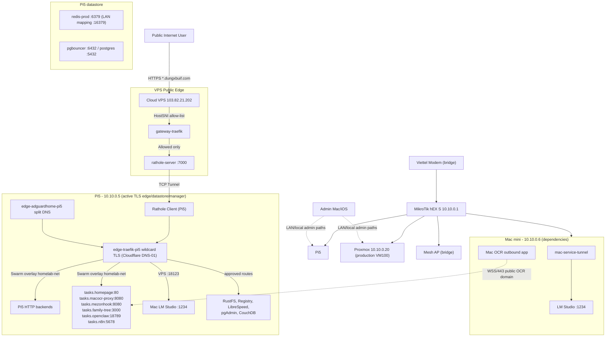

# 🏠 HOMELAB SYSTEM CONTEXT & AI AGENT PLAYBOOK

> This playbook contains current procedures plus explicitly dated history.
> Start with [STACK.md](./STACK.md) for the audited inventory and evidence
> boundaries; consult manifests and runtime before changing infrastructure.
>
> **Architecture version:** v3.5 (2026-10-21). User-facing workloads run on
> **VM100** (`10.10.0.31`); the **Pi5** (`10.10.0.5`) is the active home edge
> (Traefik+Rathole+AdGuard), datastore backend, and Swarm manager while the
> **Orange Pi Zero 3** (`10.10.0.2`) is unavailable; the **Mac mini**
> (`10.10.0.6` documented LAN) provides native OCR, LM Studio, and local
> MyPocket development support through the Mac service tunnel; the **Cloud VPS**
> (`103.82.21.202`) is the public boundary; the **Proxmox** host
> (`10.10.0.20`) hosts production VM100. No Kubernetes cluster, node, or Kubernetes VM is part of the current lab; old design docs are historical only in [`archived/k8s-v2/`](./archived/k8s-v2/).

> For exact current image tags, image IDs, replica state, backup markers, and
> recent deployment reconciliation, use the [runtime inventory](./deployments/runtime-inventory-2026-10-13.md)
> together with the [2026-10-15 catalog reconciliation](./deployments/runtime-catalog-reconciliation-2026-10-15.md).

---

## 🗺️ System Topology & Network Architecture

The homelab is a hybrid of a cloud boundary (VPS), a home TLS edge (currently Pi5),
a production compute VM (VM100), Mac-hosted native dependencies, and a production
hypervisor (Proxmox). Headscale, the old VPS-hosted NetBird stack, Coturn,
RustDesk, node-exporter, and Tailscale were removed from the VPS on
2026-09-13. A new NetBird control-plane bootstrap now runs on VM100; keep the
old VPS service removal and the new VM100 deployment separate in docs and
operations.

### 0. Current Routing Summary

```text
Shared public HTTP:
  VPS -> Rathole :7000 -> Pi5 Traefik -> Docker DNS on homelab-net
GitLab web / Registry trial:
  VPS Traefik -> separate Rathole :7002 / :7003 -> VM100 -> GitLab :80 / :5005
Git SSH:
  VPS :2222 -> Rathole :7001 -> VM100 -> GitLab :22
BDS:
  Cloudflare -> VM100 bds-cloudflared -> bds-app on bds-tunnel-net
Datastores:
  VM100 -> Pi5 PostgreSQL/PgBouncer/Redis over homelab-net
Native dependencies:
  Mac OCR apps -> outbound WSS/443 -> OCR proxy (no local OCR tunnel or listener)
  LLM route -> Mac Rathole tunnel :18123 -> LM Studio :1234
```

No VM100 application host ports `18080/18081/18084/18085` remain as current
upstreams. The diagram below describes the shared-edge path; GitLab and BDS
exceptions are in [the complete catalog](./STACK.md). Mac OCR/LLM public
roaming uses the Mac Rathole client. NetBird's VM100 control plane and VPS
relay are active; private LAN routing still depends on peer enrollment and
policy assignment.

### 1. High-Level Traffic & Data Flow



---

## 📐 Network Configuration & IP Allocation

### 1. Subnet Classifications
* **Physical LAN (primary):** `10.10.0.x` — leased by MikroTik hEX S DHCP.
* **Tailnet mesh:** retired on 2026-09-13 when Headscale was removed from the
  VPS. Do not treat `100.64.0.0/10` paths as current until a new access plan is
  implemented.
* **Failover tunnel:** Cloudflared provides a high-availability backup channel
  (HTTPS/WebSockets) in case the ISP throttles/blocks UDP.

### 2. Physical & Virtual Address Allocation

| Device / Node | IP Address(es) | Role & Primary Function |
| :--- | :--- | :--- |
| Viettel Modem (Huawei) | internal | Bridge Mode (VLAN 35); forwards PPPoE to MikroTik. WiFi disabled. |
| MikroTik hEX S | `10.10.0.1` | Primary router & gateway: PPPoE, NAT, DHCP, LAN routing, FastTrack. |
| Orange Pi Zero 3 | `10.10.0.2` (LAN) | Former home edge; currently unavailable/retired from active edge duty until deliberately restored. |
| Raspberry Pi 5 | `10.10.0.5` (LAN) | **Active edge + manager/datastore**: `edge-traefik-pi5`, `edge-rathole-pi5`, `edge-adguardhome-pi5`, Postgres+PgBouncer, Redis-prod, RustFS, production Docker Registry, LibreSpeed, pgAdmin, CouchDB. |
| VM100 | `10.10.0.31` | **Production compute / Swarm worker**: homepage, macocr-proxy, Family Tree, MezonHook, OpenClaw, n8n, MyPocket, Batdongsan, RelayHub bootstrap, and GitLab CE (public SSH, temporary VPS-terminated HTTPS, and a separate bundled Registry trial). |
| Mac mini | `10.10.0.6` documented LAN; OCR connects outbound via public domain | Universal OCR app connects WSS/443 to production; only LM Studio (`:1234`) uses `/Users/dungxbuif/dev-env/mac-service-tunnel`. |
| Cloud VPS | `103.82.21.202` (public) | **Public boundary**. `gateway-traefik`, production Rathole `7000`, isolated GitLab SSH `7001`/`:2222`, temporary GitLab HTTP `7002`, and Registry trial `7003` Rathole servers; no GitLab app/database/registry storage container. Batdongsan app/database containers and source were removed from the VPS on 2026-09-13; SQL snapshots remain under `/root/backup-bds`. Headscale, the old VPS-hosted NetBird stack, Coturn, RustDesk, node-exporter, and Tailscale were removed the same day. |
| Proxmox VE | `10.10.0.20` (LAN) | **Production hypervisor for VM100**; no Kubernetes VM/cluster is active. Old VM100-102 IaC is historical and must not destroy or recreate VM100. |
| Mesh WiFi | dynamic `10.10.0.x` | AP / bridge mode; DHCP centralized on MikroTik. |

### 3. Production Stack Context

* 📖 **[VM100.md](./VM100.md)** — VM100 production stack: homepage,
  macocr-proxy, Family Tree, MezonHook, OpenClaw, n8n, MyPocket, Batdongsan,
  NetBird, RelayHub bootstrap and GitLab with Registry trial.
* 📖 **[MAC.md](./MAC.md)** — Mac mini native OCR and LM Studio dependencies.
* PostgreSQL + Redis live on the Pi5 (not on the Mac). See [PI.md](./PI.md).
* S3 object storage for macocr is the Pi5 RustFS bucket `mac-ocr`.

### 4. Proxmox Production Context

* 📖 **[PROXMOX.md](./PROXMOX.md)** — Proxmox production hypervisor; isolated optional AWS lab
  (LocalStack / eksctl / k3s). The K8s cluster history is archived under
  [`archived/k8s-v2/`](./archived/k8s-v2/).
* 📖 [PRE_REQUIRE.md](./PRE_REQUIRE.md) — Proxmox API token & SSH key setup
  (still applicable for Terraform/Ansible against the Proxmox API).

---

## ☁️ Cloud VPS (103.82.21.202) Configuration

### 1. Resource Configuration & OS
* **OS:** Ubuntu 24.04 LTS x86_64.
* **CPU:** Intel Xeon E5-2690 v4 @ 2.60GHz (4 vCPUs).
* **RAM:** 8 GB.
* **Storage:** 38 GB SSD (root `/`).

### 2. Inherited WireGuard Record (runtime unverified)

The configuration below is retained context, not a freshly verified listener
or instruction to open `51820`. Verify current host/service state before
reusing it; the proposed Mac private access layer is NetBird.
* **Config:** `/etc/wireguard/wg0.conf`, subnet `<VPS_WG_IP>/24` + `fd42:42:42::1/64`, port `51820/udp`.
* **Masquerade (PostUp/PostDown):**
  ```ini
  PostUp = iptables -I INPUT -p udp --dport 51820 -j ACCEPT
  PostUp = iptables -I FORWARD -i ens3 -o wg0 -j ACCEPT
  PostUp = iptables -I FORWARD -i wg0 -j ACCEPT
  PostUp = iptables -t nat -A POSTROUTING -o ens3 -j MASQUERADE
  ```
* **Peers:** `pi-gateway`, `Mac`, `IPAD` (admin clients).

### 3. Container Services Stack (Docker)

#### A. Traefik Public Gateway (`gateway-traefik`)
* **Dir:** `/root/gateway`. **Ports:** `80`, `443`.
* **Dynamic config:** `/root/gateway/dynamic.yml`.
* Public home-edge names are admitted by the `rathole-passthrough` TCP router's
  exact HostSNI rule and forwarded to Rathole. Unknown names are not forwarded.
* Add public names with `edge-registrar/scripts/edge-publish.sh`; update it for
  the active Pi5 edge path before using it again.

#### B. Rathole Server (`rathole-server`)
* **Dir:** `/root/gateway` (`rathole.toml`). **Port:** `7000/tcp`. Anchor of the NAT traversal tunnel (receives the outbound Pi5 edge client connection).

#### C. Batdongsan legacy snapshots
* **Dir:** `/root/backup-bds`. Batdongsan app/database containers, the old
  Docker network, local image, `/root/batdongsan`, and stale VPS gateway routes
  were removed on 2026-09-13 after migration to VM100/Pi5.
* **Backup:** `/root/backup-bds/bds_prod_snapshot_20260913_121113.sql`.
* **Current runtime:** VM100 container `bds-app` on `homelab-net`; current
  database is Pi5 PostgreSQL `bds_prod`.

#### VPS access and relay services
Headscale, Headscale UI, NetBird server/dashboard, node-exporter, and Tailscale
were removed on 2026-09-13. NetBird's external relay/STUN was later restored on
the gateway. RustDesk `hbbs`/`hbbr` were reintroduced on 2026-10-23 at
`/root/rustdesk` for remote desktop signaling and fallback relay. Public
RustDesk listeners are TCP `21115-21117` and UDP `21116`; unused browser
WebSockets `21118-21119` are blocked by a persistent gateway firewall unit.

NetBird was reintroduced as a new VM100 bootstrap on 2026-09-13, not as a VPS
service. NetBird runs as Swarm services on `homelab-net` with no VM100 host
ports published. Its management, activity, and embedded IdP stores use Pi5
PostgreSQL databases `netbird`, `netbird_activity`, and `netbird_idp` through
`pgbouncer:6432`. Pi5 Traefik routes `netbird.dungxbuif.com` to
`tasks.netbird_netbird-server` and `tasks.netbird_netbird-dashboard`; the VPS
`gateway-traefik` HostSNI allow-list includes `netbird.dungxbuif.com`.
On 2026-09-17, a VPS-only NetBird relay/STUN container was added at
`netbird-relay.dungxbuif.com`: Traefik routes TCP `443` by exact HostSNI to
`netbird-relay:443` on `gateway-network`, while UDP `3478` is published
directly for STUN. This is relay infrastructure only; NetBird management and
dashboard remain on VM100.

RelayHub bootstrap was deployed on VM100 on 2026-09-14 as Swarm service
`relayhub` with image `homelab/relayhub:bootstrap-20260914`. It publishes no
host port. Pi5 `dynamic.yml` routes the public domain to
`tasks.relayhub:8080`, matching the established pattern for portless Swarm
applications.

### 4. VPS Directory Map

```text
/root/
├── gateway/                  # gateway-traefik + rathole-server
│   ├── docker-compose.yml
│   ├── dynamic.yml           # Traefik TCP HostSNI allow-list
│   └── rathole.toml          # server-side tunnel config (:7000)
├── gitlab-ssh-tunnel/        # isolated Git SSH :7001 / public :2222
├── gitlab-https-tunnel/      # temporary GitLab web :7002 / Docker-private :8085
├── gitlab-registry-trial/    # Registry trial :7003 / Docker-private :8086
├── netbird-relay/            # NetBird relay via Traefik TCP SNI + UDP 3478 STUN
├── backup-bds/               # retained Batdongsan SQL snapshots only
├── wg0-client-pi-gateway.conf
├── wg0-client-Mac.conf
└── wg0-client-IPAD.conf
```

---

## 🛡️ Pi5 Datastore Role & Core Network Flows

The Pi5 (`10.10.0.5`) is the **database, persistent-services, and active edge node** for the
homelab (v3.2). Deep technical detail (volumes, compose structure, host
security): 📖 [PI.md](./PI.md). Orange Pi edge duties are retired until the
operator deliberately restores them — see [System Topology & Network Architecture](#-system-topology--network-architecture).

### 1. Rathole Ingress Flow (NAT Traversal)
The Rathole client on the **Pi5** opens an **outbound** TCP tunnel to the
VPS (`103.82.21.202:7000`). Any inbound `*.dungxbuif.com` request reaching the
VPS `gateway-traefik` is tunneled through Rathole to `edge-traefik-pi5`.
Pi5 Traefik terminates TLS (Cloudflare DNS-01 wildcard) and
routes to Pi5 HTTP services over the declared Swarm edge overlay and to
portless VM100 services including
Homepage (`tasks.homepage:80`), macocr-proxy (`tasks.macocr-proxy:8080`),
OpenClaw, and n8n. No VM100 HTTP host port remains in this cutover.
The Mac mini remains a dependency host for LM Studio and native OCR through
the Mac service tunnel, not direct public/LAN upstreams.

### 2. Admin Remote Access
Headscale is no longer active. The old VPS-hosted NetBird stack was removed,
and the current NetBird control plane now runs on VM100 at
`netbird.dungxbuif.com`. As verified 2026-10-23, Mac `100.69.16.144` and
`vm100-router` `100.69.183.252` are enrolled and connect P2P on demand.
VM100 reports route `10.10.0.0/24`; route access from an external client remains
untested. The VPS relay now uses native Let's Encrypt automatic renewal, and
both clients report relay Available via ws. See the
[TLS repair and verification record](./deployments/netbird-relay-tls-2026-10-23.md).

### 3. Failover Backup Tunnel (Cloudflared)
Cloudflared connects to the Cloudflare edge over HTTPS/WebSockets (TCP 443),
immune to ISP UDP QoS. Use it only for explicitly approved service tunnels; it
is not a replacement for the retired Headscale/NetBird control plane.

### 4. Shared datastores
* **PostgreSQL** `pgbouncer:6432` on `homelab-net` for Swarm clients; the
  retained LAN `10.10.0.5:5432` mapping is PgBouncer, not raw PostgreSQL.
  Databases include NetBird
  `netbird`, `netbird_activity`, and `netbird_idp`.
* **Redis-prod** `redis-prod:6379` on `homelab-net` for OCR/MyPocket/GitLab Swarm
  clients; retained LAN `10.10.0.5:16379` for approved non-Docker clients.
  Auth, AOF, 1 GiB `noeviction`; data under `/ssd-data/infra/redis-prod/`.

GitLab uses a dedicated `gitlabhq_production` database/role on the same Pi5
PostgreSQL instance via direct `postgres:5432` and Redis DB `/2`. Its
[runbook](./services/gitlab.md) distinguishes public VPS Git SSH `:2222`
and **temporary VPS-terminated GitLab HTTPS** from the Pi5 GitLab
file route that still returns 404. The SSH Rathole server uses VPS
`7001/tcp`; a separate HTTP Rathole server uses `7002/tcp` for its VM100
client and private VPS Docker port `8085`. Both are separate from the
production Pi5 HTTPS tunnel on `7000`. Self-registration is disabled.
GitLab's bundled Container Registry is trial-active at
`registry-gitlab.dungxbuif.com` through its own VPS `7003` control tunnel;
the Pi5 Docker Registry at `registry.dungxbuif.com` remains production.
The trial's ARM64 push/pull, AMD64 push, and backup-archive inclusion passed.
The Pi5 Registry route is live and returns the expected HTTPS authentication
challenge, but native Docker/Swarm pull from lab nodes is not yet verified. See
[Registry trial evidence](./deployments/gitlab-registry-trial-2026-09-16.md).

---

## 🚀 Service Export Playbook (End-to-End, v3)

To expose an approved HTTP application, add a file-provider router and
`tasks.<swarm-service>:<container-port>` upstream to the active Pi5 Traefik
dynamic YAML, then add the hostname to the VPS HostSNI allow-list. Validate
both configs and verify through LAN and the public Rathole path. Do not use
`edge-registrar/scripts/edge-publish.sh`: it still edits retired Pi5 Caddy
and is not the current publisher.

GitLab is a documented temporary exception: VPS Traefik Docker labels on
its **VPS-local HTTP Rathole container** route only
`gitlab.dungxbuif.com`, with VPS TLS termination. This does not enable
Traefik Swarm labels on the Pi5 edge. Cut it back to the file-provider edge
path once the intended permanent edge path is selected and verified.

### Step 1: Run the workload
* **On VM100** — deploy a portless Swarm service on `homelab-net`, placed on
  VM100. Record its internal HTTP port and verify task health.
* **On the Mac** — OCR apps connect outbound to the public OCR domain over
  WSS/443; only the LLM backend still uses the Mac service tunnel. MyPocket
  production is on VM100.
* **On the Pi5** — deploy only approved datastore/infrastructure services;
  attach a routed HTTP backend to `homelab-net` without a new host port.

### Step 2: Route through Traefik

Use the existing router/service pattern in
[`migration/traefik/dynamic.yml`](../migration/traefik/dynamic.yml). The live
Pi5 copy is `/home/dungxbuif/edge/traefik/dynamic.yml`. Its service URL must use
`http://tasks.<service>:<port>` on `homelab-net`; do not point at VM100's LAN
IP. For public exposure, add the hostname to the VPS
`/root/gateway/dynamic.yml` Rathole HostSNI allow-list. Internal-only
hostnames do not need a VPS entry. Review diffs, validate YAML/reload, then
smoke-test LAN and public paths. This step is manual until a maintained
Traefik/Ansible publisher is implemented.

### Step 3: Cloudflare DNS
Create an A/CNAME record for `app.dungxbuif.com` pointing at the VPS public IP
(`103.82.21.202`) in Cloudflare. (Wildcard `*.dungxbuif.com` already covers it
if proxying.)

> [!NOTE]
> The old 4-step playbook had a "Step 1: Kubernetes Traefik + kube-vip" stage.
> That stage is gone — see `archived/k8s-v2/` for the retired K8s flow.

---

## 🪐 Architectural Evolution (Decision Registry)

### Phase 1 — Network modernization
The Viettel ONT was unstable under multi-device NAT/DHCP. Turned it into a
passive bridge (VLAN 35) and let a MikroTik hEX S handle PPPoE/NAT/DHCP under a
unified `10.10.0.x` subnet. Mesh WiFi set to AP/bridge mode to centralize DHCP.

### Phase 2 — TCP NAT traversal (FRP → Rathole)
Vietnamese ISPs aggressively QoS-throttle high-volume UDP (WireGuard),
paralyzing remote admin. Rerouted public ingress over TCP (Rathole, Rust) to
mimic HTTPS and evade UDP filters. Rathole's tiny footprint suits the
Orange Pi Zero 3 (1 GB RAM) edge node.

### Phase 3 — Worker VM offload (Proxmox, historical)
Moved resource-heavy workloads (Jellyfin transcode, qBittorrent, RustDesk relay)
off the Pi5 onto a Proxmox VM with passthrough-mounted media SSD, preserving Pi5
as a lightweight edge/gateway.

### Phase 4 — Mac mini consolidation (v3, 2026-08, historical)
Migrated all user-facing production workloads off the 3-node Proxmox K8s
cluster onto the Mac mini (`10.10.0.10`) running plain Docker Compose. The Pi5
remained the TLS edge at that time and also hosted Redis-prod for the Mac stack. The K8s
cluster was retired; Proxmox was repurposed as a self-hosted AWS practice lab.
See [`archived/k8s-v2/k8s/migration_k8s_to_mac.md`](./archived/k8s-v2/k8s/migration_k8s_to_mac.md)
for the migration record. The current compute spec is [VM100.md](./VM100.md);
[MAC.md](./MAC.md) now documents dependency services only.

---

## 🪵 Troubleshooting, Optimization & Bug Registry

Unless a subsection states a recent verification date, bandwidth/MTU/kernel
and WireGuard observations here are historical measurements, not live host
configuration assertions. Current verification scope is in [STACK.md](./STACK.md).

### 1. Tunnel Bandwidth Bottleneck & ISP UDP Throttling
* **Symptom:** WireGuard tunnel throughput collapsed to ~5 Mbps despite gigabit
  LAN and a 250 Mbps fiber package.
* **Root cause:** Vietnamese ISPs throttle high-volume UDP on non-standard
  ports, flagging it as VPN/torrent traffic.
* **Fix / state:**
  1. Public ingress moved to TCP via Rathole (mimics HTTPS).
  2. Current TCP congestion state on the Pi5 (stable): `cubic` + `fq_codel`:
     ```bash
     sysctl net.ipv4.tcp_congestion_control   # cubic
     sysctl net.core.default_qdisc           # fq_codel
     ```
  3. Current MTU state: MikroTik `pppoe-out1` 1492; Pi `eth0` 1500; Pi `wg0`
     1420; Mac `en0` 1500.
  4. Optional future tuning (only after a benchmark proves the need): BBR +
     `fq`, lower tunnel MTU.

### 2. MikroTik Remote Access Isolation via VPN
* **Symptom:** Admins on the VPN subnet could not ping/open WebFig on the
  MikroTik through the Pi5.
* **Fix:** Documented and resolved via Pi5 iptables + routing — see
  📖 [MIKROTIK.md](./MIKROTIK.md).

### 3. Client-Side WireGuard Pitfalls (macOS / iOS)
* Apple's WireGuard client is strict about IPv6 and non-resolving DNS; Raspbian
  was missing `resolvconf`. Fix: strip IPv6 + absolute DNS from client configs;
  drop the DNS param from Pi5 `/etc/wireguard/wg0.conf`.

### 4. Docker Hub Registry Outages (502)
* **Root cause:** upstream ISP DNS flakiness.
* **Fix:** pin a stable resolver: `echo "nameserver 8.8.8.8" | sudo tee /etc/resolv.conf`.

### 5. RustDesk Black Screen (historical)
* **Root cause:** host UFW blocked relay ports.
* **Fix:** `sudo ufw allow 21115:21119/tcp && sudo ufw allow 21116/udp`.
* **Current state:** RustDesk `hbbs`/`hbbr` were reintroduced on the gateway on
  2026-10-23. Clients should use the generated public key and leave
  `ALWAYS_USE_RELAY` disabled so P2P is preferred.

### 6. WireGuard NAT Session Timeout (SSH unreachable outside LAN)
* **Root cause:** the Pi5 sits behind a double-NAT/ISP firewall; without a
  keepalive the home router closes the UDP NAT mapping after idle.
* **Fix:** `PersistentKeepalive = 25` in the `[Peer]` of `/etc/wireguard/wg0.conf`
  on the Pi5, then `wg-quick down wg0 && wg-quick up wg0`.

### 7. macOS Docker `network_mode: host` does not reach native services (v3)
* **Symptom:** a container launched with `network_mode: host` could not reach
  the Mac-host native OCR (`:8787`) or LM Studio (`:1234`) — connection refused.
* **Root cause:** on Docker Desktop for macOS, `--network host` operates inside
  the Linux VM; the VM namespace is not the macOS host namespace, so host
  services are invisible.
* **Fix:** use a **bridge** network plus `extra_hosts:
  host.docker.internal:host-gateway` (resolves to the Mac host gateway). Verified
  working — native OCR capacity returns `ready`. See [MAC.md](./MAC.md).

### 8. DB password `/` breaks Go `net/url` (v3)
* **Symptom:** freshly built macocr-proxy images failed config
  validation on `DATABASE_URL` (`uri` tag), while the legacy K8s image `v1.0.2`
  accepted the same value.
* **Root cause:** the database password contained a literal `/`;
  the newer `net/url` parser is stricter and rejects the unencoded slash as an
  "invalid port after host".
* **Fix:** URL-encode the slash (`/` → `%2F`) in `DATABASE_URL` in `.env`. The
  decoded password is still the raw value the DB expects. See [MAC.md](./MAC.md).

---

## 🤖 Strict Compliance Guidelines for AI Agents

> [!IMPORTANT]
> When executing autonomous commands, modifying config, or extending services,
> strictly adhere to these guardrails:

1. **Platform compatibility:** images for the **Pi5** must support `linux/arm64`.
   Images for **VM100** should match the VM architecture. Mac-only helper
   images may be `arm64` (native) or `amd64` (Rosetta emulation), preferring
   arm64-native where available.
2. **Pi5 portless principle:** never declare host `ports:` for new Pi5
   `proxy_net` microservices; route approved HTTP services via the active Pi5
   Traefik edge over the Swarm overlay. VM100 app host ports from the earlier
   Compose phase are retired; use `tasks.<service>:<port>`. Approved native
   Mac dependencies use the Mac service tunnel when they need to work outside
   the LAN; do not infer those exceptions apply to Docker apps.
3. **Image pinning target:** pin versions/digests for reproducible changes.
   Current NetBird uses `latest`, Family Tree `oven/bun:1-slim`, and n8n
   `stable` per runtime inventory. These are existing reproducibility risks,
   not evidence that all workloads already meet the pinning target.
4. **Zero interactive sudo:** prefer volume mounts over commands that prompt.
5. **Runbook continuity:** keep verification scripts in `/ssd-data/scratch/`
   updated when credentials or routing paths change, so health tests stay green.
6. **mac-ocr source is read-only:** never edit
   `~/workspace/mac-ocr/` to change behaviour; apply all
   behaviour changes at build time via patches in deployment-specific build
   context.
7. **Proxmox lab is ephemeral:** lab VMs on Proxmox are disposable — never treat
   them as production; back up state before any `terraform destroy`.
