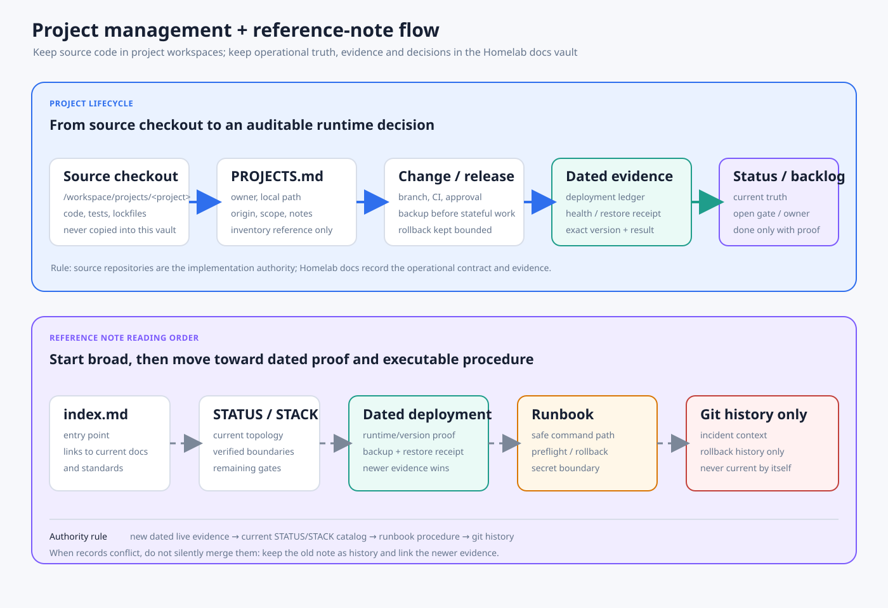

# Local Project Workspace Inventory

Homelab keeps only the project inventory, notes, local folder paths, and remote
origin links. Project source checkouts live directly under:

```text
/home/dungxbuif/workspace/projects/
```

Do not commit independent application source trees into the Homelab
infrastructure repository. Use this file as the map from Homelab documentation
to the source checkouts.

## Layout Policy

- Keep Homelab operations, diagnostics, and infrastructure docs in this repo.
- Keep independent project source repositories under `/home/dungxbuif/workspace/projects/<project>/`.
- Keep remote origin links here when available.
- Leave projects with no recorded `origin` as local-only until a remote is added.
- `MyPocket` is included in this inventory at
  `/home/dungxbuif/workspace/projects/MyPocket/`.

## Project and reference flow



The project checkout remains the implementation source. This inventory records
where it lives and which remote it uses; dated deployment records capture what
actually reached runtime; `STATUS.md`, `STACK.md` and `BACKLOG.md` summarize the
current operational decision. Do not mark a project or rollout complete from a
source change alone without runtime or restore evidence where applicable.

## GitLab mirrors

As of 2026-10-31 the workspace has 35 Git repositories and 11 non-Git
directories. Every Git repository is published to a private GitLab project
under `dungxbuif`; the 11 non-Git directories are intentionally not
initialized. Four repositories use GitLab as `origin` (`NoteVault`,
`db-management`, `homelab-ops`, `homepage`); the other 31 keep their original
`origin` and have a second remote named `gitlab`.

- The `gitlab` remote uses the GitLab SSH endpoint; no PAT is stored in
  `.git/config` or embedded in any remote URL. The API token lives only in a
  mode-`0600` local secret file.
- Pushes did not change local upstream tracking. Local uncommitted work (e.g.
  in `RelayHub`, `homelab-ops`) is not mirrored until committed and pushed.
- `MyPocket` is a shallow local clone with a missing parent object, so its
  GitLab branch is a one-commit snapshot whose tree matches local `HEAD`;
  branch protection is in place.
- The PAT used in the mirror preflight was exposed in a shell error and must
  be rotated (BACKLOG `S3`).

| Local project | GitLab project | Remote | Published branch |
|---|---|---|---|
| `99tech_code-challenge` | `dungxbuif/99tech-code-challenge` | `gitlab` | `main` |
| `BrowserBridge` | `dungxbuif/browserbridge` | `gitlab` | `codex/workspace-unreleased-20261028` |
| `Flotsam` | `dungxbuif/flotsam` | `gitlab` | `master` |
| `GraphQL_Real-time-Digital-Auction-Hub` | `dungxbuif/graphql-real-time-digital-auction-hub` | `gitlab` | `fea/us-004` |
| `Knowledgebase` | `dungxbuif/knowledgebase` | `gitlab` | `main` |
| `MyPocket` | `dungxbuif/mypocket` | `gitlab` | `codex/workspace-unreleased-20261028` (tree-matching snapshot) |
| `NoteVault` | `dungxbuif/note-vault` | `origin` | `main` |
| `PocketNode` | `dungxbuif/pocketnode` | `gitlab` | `codex/workspace-unreleased-20261028` |
| `QnOffice` | `dungxbuif/qnoffice` | `gitlab` | `production` |
| `RelayHub` | `dungxbuif/relayhub` | `gitlab` | `codex/centrifugo-upstream-baseline` |
| `RuntimeRoasters` | `dungxbuif/runtimeroasters` | `gitlab` | `codex/workspace-unreleased-20261028` |
| `bds-ngoctinh` | `dungxbuif/bds-ngoctinh` | `gitlab` | `codex/workspace-unreleased-20261028` |
| `code-challenge` | `dungxbuif/code-challenge` | `gitlab` | `main` |
| `cortex` | `dungxbuif/cortex` | `gitlab` | `feat/ctx-708` |
| `couchloom` | `dungxbuif/couchloom` | `gitlab` | `codex/workspace-unreleased-20261028` |
| `datcom-clone` | `dungxbuif/datcom-clone` | `gitlab` | `codex/workspace-unreleased-20261028` |
| `db-management` | `dungxbuif/db-management` | `origin` | `main` |
| `devtool` | `dungxbuif/devtool` | `gitlab` | `codex/workspace-unreleased-20261028` |
| `doino` | `dungxbuif/doino` | `gitlab` | `codex/workspace-unreleased-20261028` |
| `donation` | `dungxbuif/donation` | `gitlab` | `codex/workspace-unreleased-20261028` |
| `go-study` | `dungxbuif/go-study` | `gitlab` | `codex/workspace-unreleased-20261028` |
| `harness` | `dungxbuif/harness` | `gitlab` | `main` |
| `homelab-ops` | `dungxbuif/homelab-ops` | `origin` | `codex/workspace-unreleased-20261028` |
| `homepage` | `dungxbuif/homepage` | `origin` | `main` |
| `k8s-syntax` | `dungxbuif/k8s-syntax` | `gitlab` | `main` |
| `learn` | `dungxbuif/learn` | `gitlab` | `master` |
| `llm-flashcard` | `dungxbuif/llm-flashcard` | `gitlab` | `codex/phase-0-foundation` |
| `mac-ocr` | `dungxbuif/mac-ocr` | `gitlab` | `codex/workspace-sync-20261023` |
| `mezon-desktop` | `dungxbuif/mezon-desktop` | `gitlab` | `codex/workspace-unreleased-20261028` |
| `mezon-sdk-go` | `dungxbuif/mezon-sdk-go` | `gitlab` | `codex/discordgo-organization` |
| `mezonhook` | `dungxbuif/mezonhook` | `gitlab` | `codex/mvp-webhook-builder` |
| `my-cv` | `dungxbuif/my-cv` | `gitlab` | `codex/workspace-unreleased-20261028` |
| `my_family_tree` | `dungxbuif/my-family-tree` | `gitlab` | `main` |
| `random-template-code` | `dungxbuif/random-template-code` | `gitlab` | `codex/workspace-unreleased-20261028` |
| `selfhost` | `dungxbuif/selfhost` | `gitlab` | `codex/workspace-unreleased-20261028` |

## Project Inventory

| Project | Local folder | Remote origin | Notes |
| --- | --- | --- | --- |
| `99tech_code-challenge` | `/home/dungxbuif/workspace/projects/99tech_code-challenge/` | `git@github.com:harrybui-dev/99tech_code-challenge.git` | Git checkout |
| `apps` | `/home/dungxbuif/workspace/projects/apps/` | none | Local grouping directory; not a standalone Git project |
| `BrowserBridge` | `/home/dungxbuif/workspace/projects/BrowserBridge/` | `git@github.com:dungxbuif/browserbridge.git` | Git checkout |
| `Flotsam` | `/home/dungxbuif/workspace/projects/Flotsam/` | none recorded | Git checkout without origin; mirrored via `gitlab` remote |
| `GraphQL_Real-time-Digital-Auction-Hub` | `/home/dungxbuif/workspace/projects/GraphQL_Real-time-Digital-Auction-Hub/` | `git@github.com:dungxbuif/GraphQL_Real-time-Digital-Auction-Hub.git` | Git checkout |
| `Knowledgebase` | `/home/dungxbuif/workspace/projects/Knowledgebase/` | `git@github.com:dungxbuif/Knowledgebase.git` | Git checkout |
| `MezonDong` | `/home/dungxbuif/workspace/projects/MezonDong/` | none recorded | Local directory |
| `MyPocket` | `/home/dungxbuif/workspace/projects/MyPocket/` | `git@github.com:dungxbuif/MyPocket.git` | Git checkout; production app source |
| `NoteVault` | `/home/dungxbuif/workspace/projects/NoteVault/` | `ssh://gitlab.dungxbuif.com:2222/dungxbuif/note-vault.git` | Git checkout; existing GitLab origin verified |
| `PocketNode` | `/home/dungxbuif/workspace/projects/PocketNode/` | `git@github.com:dungxbuif/PocketNode.git` | Git checkout |
| `QnOffice` | `/home/dungxbuif/workspace/projects/QnOffice/` | `git@github.com:tiennguyenvan-ncc/QnOffice.git` | Git checkout |
| `RelayHub` | `/home/dungxbuif/workspace/projects/RelayHub/` | `git@github.com:dungxbuif/RelayHub.git` | Git checkout; production app source |
| `RuntimeRoasters` | `/home/dungxbuif/workspace/projects/RuntimeRoasters/` | `git@github.com:dungxbuif/RuntimeRoasters.git` | Git checkout |
| `bds-ngoctinh` | `/home/dungxbuif/workspace/projects/bds-ngoctinh/` | `git@github.com:dungxbuif/bds-ngoctinh.git` | Git checkout |
| `code-challenge` | `/home/dungxbuif/workspace/projects/code-challenge/` | `git@github.com:dungxbuif/code-challenge.git` | Git checkout |
| `cortex` | `/home/dungxbuif/workspace/projects/cortex/` | `git@github.com:dungxbuif/cortex.git` | Git checkout |
| `couchloom` | `/home/dungxbuif/workspace/projects/couchloom/` | `git@github.com:dungxbuif/couchloom.git` | Git checkout |
| `db-management` | `/home/dungxbuif/workspace/projects/db-management/` | `ssh://git@gitlab.dungxbuif.com:2222/dungxbuif/db-management.git` | NestJS/Bun database operations UI (runs as `db-management` Swarm stack on VM110), adapter-based backups and Drive upload |
| `datcom-clone` | `/home/dungxbuif/workspace/projects/datcom-clone/` | `git@github.com:dungxbuif/komu-foward.git` | Git checkout |
| `devtool` | `/home/dungxbuif/workspace/projects/devtool/` | none recorded | Git checkout without origin; mirrored via `gitlab` remote |
| `doino` | `/home/dungxbuif/workspace/projects/doino/` | `git@github-dungxbuif:dungxbuif/mezon-doino.git` | Git checkout |
| `donation` | `/home/dungxbuif/workspace/projects/donation/` | `git@github.com:dungxbuif/donate.git` | Git checkout |
| `fox-spirit` | `/home/dungxbuif/workspace/projects/fox-spirit/` | none recorded | Local directory |
| `go-study` | `/home/dungxbuif/workspace/projects/go-study/` | `git@github.com:dungxbuif/go-study.git` | Git checkout |
| `harness` | `/home/dungxbuif/workspace/projects/harness/` | `git@github.com:dungxbuif/harness.git` | Git checkout |
| `homelab-ops` | `/home/dungxbuif/workspace/projects/homelab-ops/` | `ssh://gitlab.dungxbuif.com:2222/dungxbuif/homelab-ops.git` | Canonical infrastructure-as-code checkout; target of the IaC rebuild plan |
| `homelab-legacy` | `/home/dungxbuif/workspace/projects/homelab-legacy/` | none | Retained source snapshot; rollback/migration history only, never the deployment source |
| `homelab-tunnel` | `/home/dungxbuif/workspace/projects/homelab-tunnel/` | none recorded | Local directory |
| `homepage` | `/home/dungxbuif/workspace/projects/homepage/` | `ssh://gitlab.dungxbuif.com:2222/dungxbuif/homepage.git` | Git checkout |
| `k8s-syntax` | `/home/dungxbuif/workspace/projects/k8s-syntax/` | `git@github.com:dungxbuif/k8s-syntax.git` | Git checkout |
| `learn` | `/home/dungxbuif/workspace/projects/learn/` | none recorded | Git checkout without origin; mirrored via `gitlab` remote |
| `llm-flashcard` | `/home/dungxbuif/workspace/projects/llm-flashcard/` | `git@github.com:dungxbuif/llm-flashcard.git` | Git checkout |
| `mac-ocr` | `/home/dungxbuif/workspace/projects/mac-ocr/` | `git@github.com:dungxbuif/mac-ocr.git` | Git checkout |
| `mezon-desktop` | `/home/dungxbuif/workspace/projects/mezon-desktop/` | `git@github.com:dungxbuif/mezon-desktop.git` | Git checkout |
| `mezon-sdk-go` | `/home/dungxbuif/workspace/projects/mezon-sdk-go/` | `git@github.com:dungxbuif/mezon-sdk-go.git` | Git checkout |
| `mezonhook` | `/home/dungxbuif/workspace/projects/mezonhook/` | `git@github.com:dungxbuif/mezonhook.git` | Git checkout |
| `my-cv` | `/home/dungxbuif/workspace/projects/my-cv/` | `git@github.com:dungxbuif/my-cv.git` | Git checkout |
| `my_family_tree` | `/home/dungxbuif/workspace/projects/my_family_tree/` | `git@github.com:dungxbuif/my_family_tree.git` | Git checkout |
| `n8n-nodes-mezon` | `/home/dungxbuif/workspace/projects/n8n-nodes-mezon/` | none | Local package directory; no Git metadata |
| `project-learn` | `/home/dungxbuif/workspace/projects/project-learn/` | none recorded | Local directory |
| `random-template-code` | `/home/dungxbuif/workspace/projects/random-template-code/` | `git@github.com:dungxbuif/random-template-code.git` | Git checkout |
| `selfhost` | `/home/dungxbuif/workspace/projects/selfhost/` | `git@github-dungxbuif:dungxbuif/selfhost.git` | Git checkout |
| `speedydd` | `/home/dungxbuif/workspace/projects/speedydd/` | none recorded | Local directory |
| `study` | `/home/dungxbuif/workspace/projects/study/` | none recorded | Local directory |
| `test-clone` | `/home/dungxbuif/workspace/projects/test-clone/` | none recorded | Local directory |
| `toeic` | `/home/dungxbuif/workspace/projects/toeic/` | none recorded | Local directory |

## Notes

- The dangling compatibility symlink
  `/home/dungxbuif/workspace/projects/mezon-go-sdk` points to a missing Mac
  path and is intentionally excluded from the inventory.
- Inventory reconciled against the filesystem on 2026-10-31: 46 real project
  directories.
