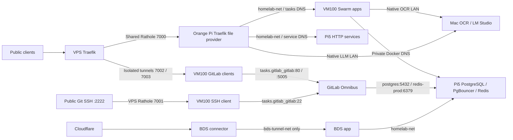

# Current Homelab Stack

Audit date: 2026-09-16. This is the current navigation/catalog surface, not a
claim that every application workflow passed. See the
[audit evidence and limits](./research/docs-stack-audit-2026-09-16.md).

## Host Roles

| Host | Address | Role |
|---|---|---|
| VPS | `103.82.21.202` | Public Traefik, shared edge Rathole and isolated GitLab tunnels; no application DB/image storage |
| Orange Pi Zero 3 | `10.10.0.2` | Traefik file-provider edge, Rathole client, AdGuard split DNS; Swarm worker |
| Pi5 | `10.10.0.5` | Swarm manager; PostgreSQL/PgBouncer, Redis, RustFS and persistent backend services |
| VM100 | `10.10.0.31` | Production compute, Swarm worker, BDS Compose runtime, persistent GitLab filesystem |
| Mac | `10.10.0.6` documented LAN | Native OCR and LM Studio; separate local development checkouts |
| Proxmox | `10.10.0.20` | Production hypervisor for VM100; optional experiments must use a separate lifecycle |

## Runtime Catalog

VM100 inventory below was observed through direct SSH on the audit date:
16 running Swarm task containers plus 2 BDS standalone containers. Edge
and Pi5 rows reflect deployment records/source and were not host-revalidated
in this audit. A running container without a healthcheck is not proof of
application readiness.

| Workload | Placement / runtime | Domain or endpoint | State / scope |
|---|---|---|---|
| Homepage | VM100 `homepage` | `dungxbuif.com`, `www.dungxbuif.com` -> `tasks.homepage:80` | Production; healthy task, selected public probe 200 |
| OCR proxy | VM100 `macocr-proxy` | `ocr.dungxbuif.com` -> `tasks.macocr-proxy:8080` | Healthy task; native Mac dependency `10.10.0.6:8787` |
| Family Tree | VM100 `family-tree` | `family.dungxbuif.com` -> `tasks.family-tree:3000` | Healthy task; Bun runtime |
| MezonHook | VM100 `mezonhook` | `mezonhook.dungxbuif.com` -> `tasks.mezonhook:8080` | Healthy task |
| OpenClaw | VM100 `openclaw` | `openclaw.dungxbuif.com` -> `tasks.openclaw:18789` | Healthy task; do not confuse with retired GoClaw |
| n8n | VM100 `n8n` | `n8n.dungxbuif.com` -> `tasks.n8n:5678` | Healthy task; public health probe 200 |
| MyPocket | VM100 `mypocket-web`, `mypocket-api`, `mypocket-worker` | `money.dungxbuif.com` -> `tasks.mypocket-web:80` | Production runtime migrated; local dev checkout intentionally unmoved |
| NetBird | VM100 `netbird_netbird-server`, `netbird_netbird-dashboard` | `netbird.dungxbuif.com`; edge aliases `tasks.netbird-server` / `tasks.netbird-dashboard` | Containers running, dashboard public 200; remote peer/STUN/relay coverage not established |
| RelayHub | VM100 `relayhub` | `relayhub.dungxbuif.com` -> `tasks.relayhub:8080` | Bootstrap only: health 200, ready 503; full provider implementation not deployed |
| GitLab CE | VM100 `gitlab_gitlab` | `gitlab.dungxbuif.com`, Git SSH VPS `:2222` | Healthy Omnibus task; public web 200; Pi5 PostgreSQL/Redis |
| GitLab tunnel clients | VM100 `gitlab-ssh-tunnel_client`, `gitlab-https-tunnel_client`, `gitlab-registry-trial_client` | Docker DNS GitLab `:22`, `:80`, `:5005` | All running; independent outbound Noise pairs to VPS |
| GitLab Registry trial | Inside VM100 Omnibus task | `registry-gitlab.dungxbuif.com` | Trial, public 401 challenge; image push/pull evidence in runbook; native lab Swarm pull pending |
| BDS app / connector | VM100 Compose `bds-app`, `bds-cloudflared` | Dedicated Cloudflare tunnel -> `http://bds-app:3000` | Both running; connector only on `bds-tunnel-net`, never `homelab-net` |
| Pi5 production Registry | Pi5 `docker-registry` | `registry.dungxbuif.com` -> `registry:5000` | Production retained; selected public challenge 401 |
| Pi5 HTTP backends | RustFS, pgAdmin, CouchDB, LibreSpeed | `storage`, `cdn`, `pgadmin`, `couchdb`, `sync-db`, `speed` under `dungxbuif.com` | Deployment inventory; see Pi5 runbook for exact upstreams |
| Native LLM | Mac LM Studio | edge `llm.dungxbuif.com` -> `10.10.0.6:1234` | Development/native LAN exception; roaming migration proposed only |

## Network and Ingress

Normal HTTP routing uses Orange Pi **file configuration**, not automatic
Swarm labels. VPS GitLab labels belong to its local Docker provider only.
GitLab Web/Registry TLS currently terminates on VPS; normal shared-edge TLS
terminates on Orange Pi. VPS GitLab private backend ports `8085/8086` are
not published. Public SSH `2222` and control ports `7000-7003` are intentional
transport listeners, not VM100 app publications.

GitLab trial DNS publicly targets VPS, but lab split DNS targets Orange Pi,
whose direct GitLab/trial Registry routes are not deployed (previous 404
observations). No domain cutover or service migration was performed here.
Broad `homelab-net` remains shared; narrower ingress/data/app networks are
proposed, not deployed. BDS connector isolation is already deployed.

## Datastores and Storage

| Consumer | Backend | Endpoint / logical namespace |
|---|---|---|
| n8n | Pi5 PostgreSQL via PgBouncer | `pgbouncer:6432`, database `n8n` |
| MyPocket API/worker | Pi5 PostgreSQL + Redis | `pgbouncer:6432`, database `mypocket`; `redis-prod:6379/1` |
| OCR | Pi5 PostgreSQL + Redis | `pgbouncer:6432`; `redis-prod:6379/0`; DB name must be obtained from private runtime config |
| Family Tree | Pi5 PostgreSQL | `pgbouncer:6432`; exact DB/role from private runtime config |
| BDS | Pi5 PostgreSQL | DB `bds_prod`, role `bds_user`; build `postgres:5432`, runtime `pgbouncer:6432` |
| NetBird | Pi5 PostgreSQL | `pgbouncer:6432`; `netbird`, `netbird_activity`, `netbird_idp` |
| GitLab | Pi5 PostgreSQL + Redis | direct `postgres:5432`, DB `gitlabhq_production`, role `gitlab`; `redis-prod:6379/2` |
| GitLab repositories / Registry trial | VM100 filesystem | `/opt/apps/gitlab/{config,logs,data}`; Registry metadata DB disabled, S3 not enabled |
| Object storage | Pi5 RustFS | `rustfs:9000` API, `rustfs:9001` console; not enabled for GitLab |
| CouchDB sync | Pi5 CouchDB | `couchdb:5984`; separate document database, not PostgreSQL |

Redis shared instance uses 1 GiB `noeviction` and AOF per deployment record.
Logical Redis DB indexes are namespaces, not separate security boundaries.
LAN Pi5 `:5432` maps PgBouncer, not raw PostgreSQL. Retained LAN Redis
`:16379` serves approved non-Docker users. Do not remove these mappings
without auditing those consumers.

## Retired and Proposed

- Retired: old K8s/kube-vip/Longhorn stack, VMs 101/102 per record, Caddy,
  GoClaw production route/runtime, OmniScan bot, PairDrop/Coturn/transfer
  route, old VPS Headscale/NetBird/RustDesk/Tailscale/exporter services.
  Source/research folders can remain without implying a running service.
- Proposed: Mac NetBird agent and stable private backend DNS for roaming,
  network segmentation, Semaphore/Ansible service provisioning, complete
  multi-engine DB backup to Google Drive. Do not label these operational.
- Pending GitLab: native lab Docker/Swarm Registry pull, deployed edge routes,
  CI runner, scheduled/off-host backup and restore drill; SMTP and S3 optional.
- NetBird remote connectivity requires verified peer enrollment, ACLs,
  relay/STUN and DNS from host/container contexts, not just dashboard 200.

## Resource and Backup Boundary

VM100 documented allocation: 6 CPU / 16 GB / 200 GiB. The audit's guest
sample reported 15 GiB RAM total, 10 GiB available, root 194 GiB with
65 GiB used / 130 GiB free, and **no VM100 swap**. Pi5 4 GiB swap is a
separate recorded configuration, not proof of swap on VM100.

GitLab has a 10 GiB/4 CPU limit; each GitLab tunnel client has a 128 MiB/
0.5 CPU limit. Do not infer other apps have limits simply because the host
allocation is bounded; see the dated resource audit. One-time GitLab backup
and separate config snapshots exist per the trial report. Scheduled/off-host
backup and restore have not been established; a DB dump does not replace
Registry layers/repository/config backup.

## Detailed Runbooks

- [VM100](./VM100.md), [Pi5](./PI.md), [Mac](./MAC.md), [Proxmox](./PROXMOX.md)
- [GitLab](./services/gitlab.md), [GitLab Registry trial](./deployments/gitlab-registry-trial-2026-09-16.md)
- [NetBird deployment](./deployments/netbird-2026-09-13.md)
- [Network segmentation proposal](./research/network-segmentation-2026-09-15.md)
- [Resource audit](./research/resource-limit-audit-2026-09-15.md)
