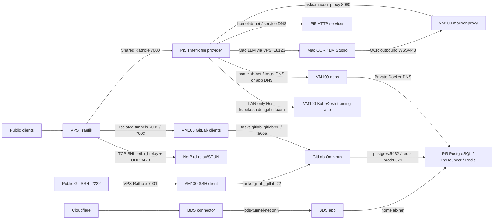

# Current Homelab Stack

Audit baseline: 2026-10-13, reconciled by dated records through 2026-10-15.
This is the current navigation/catalog surface, not a claim that every
application workflow passed. See the
[audit evidence and limits](./research/docs-stack-audit-2026-09-16.md).
The point-in-time runtime and image-version source of truth is the
[2026-10-13 runtime inventory](./deployments/runtime-inventory-2026-10-13.md)
plus [runtime/catalog reconciliation](./deployments/runtime-catalog-reconciliation-2026-10-15.md).

## Current corrections, 2026-10-17

- Automation source is now reconciled on private GitLab `main` at commit
  `9ab809d`; main pipeline 267 passed Semaphore validation, execution-environment
  validation, automation-ee publication, and provisioner publication. This
  proves the source/CI boundary, not live OpenTofu import or broad app/route
  apply.
- The rootless GitLab runner intentionally permits only the pinned
  `docker:27.5.1-dind-rootless` service. Jobs using ordinary `docker:dind` are
  rejected as an unsafe, unrelated-branch configuration; do not weaken this
  allow-list to make those jobs pass.

- VM100 backup timers and the multi-instance PostgreSQL class are active; the
  combined health template passed task 57 with both locks free. Remote Drive
  restore acceptance is still intentionally open.
- Homepage release template 6 is the only enrolled application release path.
  Its dedicated Mezon notification boundary passed live task 56. The generic
  `app-deploy` contract remains design-only.
- The restricted VM100/Pi5 observers and GitLab CI runner are active. Semaphore
  project 2 (`Homelab Audit`) now provides a separate owner-only read-only
  boundary for host and backup audits. OpenTofu VM100 import, broad route/app
  apply and fine-grained non-admin RBAC remain unverified or unenrolled.
- On 2026-10-16, the shared Pi5 Redis container was recreated after a stale
  overlay-network ID caused GitLab HTTP 500 and MyPocket Redis DNS failures.
  Redis data/AOF were retained; GitLab recovered to sign-in 200 and runner
  job-request 204. MyPocket API and worker now use the live `redis-prod` alias
  and are 1/1; its intentionally stopped web service remains 0/0.
- Older sections below remain useful topology history; when a dated deployment
  record conflicts with them, the newer record is authoritative.

## Host Roles

| Host | Address | Role |
|---|---|---|
| VPS | `103.82.21.202` | Public Traefik, shared edge Rathole, isolated GitLab tunnels, and NetBird relay/STUN; no application DB/image storage |
| Orange Pi Zero 3 | `10.10.0.2` | Former Traefik/Rathole/AdGuard edge; currently unavailable and scaled out of active edge duty |
| Pi5 | `10.10.0.5` | Swarm manager, active Traefik/Rathole/AdGuard edge, PostgreSQL/PgBouncer, Redis, RustFS, CouchDB and persistent backend services |
| VM100 | `10.10.0.31` | Production compute, Swarm worker, BDS Compose runtime, persistent GitLab filesystem |
| Mac | `10.10.0.6` documented LAN; roaming via VPS Rathole | Native OCR and LM Studio; separate local development checkouts |
| Proxmox | `10.10.0.20` | Production hypervisor for VM100; optional experiments must use a separate lifecycle |

## Runtime Catalog

VM100, Pi5, and VPS inventories were observed through direct SSH on the audit
date. Use the linked runtime inventory for complete image IDs and current
replica states. A running container without a healthcheck is not proof of
application readiness.

| Workload | Placement / runtime | Domain or endpoint | State / scope |
|---|---|---|---|
| Homepage | VM100 `homepage` | `dungxbuif.com`, `www.dungxbuif.com` -> `tasks.homepage:80` | Production; healthy task, selected public probe 200 |
| Stirling PDF | VM100 `stirling-pdf` | `stirling.dungxbuif.com` -> `tasks.stirling-pdf:8080` | Image `docker.stirlingpdf.com/stirlingtools/stirling-pdf:3.1.0`; portless Swarm service with persistent config/OCR/pipeline mounts, login enabled, edge HTTPS route verified; VPS HostSNI allow-list still pending |
| OCR proxy | VM100 `macocr-proxy` | `ocr.dungxbuif.com` -> `tasks.macocr-proxy:8080`; Mac apps connect outbound WSS/443 | `homelab/macocr-proxy:scan-api-20261008`; multi-node shared-key routing; admin-only routed Users/Workers UI; runtime OpenAPI advertises scan submit/status paths and schemas; native worker unchanged |
| Family Tree | VM100 `family-tree` | `family.dungxbuif.com` -> `tasks.family-tree:3000` | Healthy task; Bun runtime |
| MezonHook | VM100 `mezonhook` | `mezonhook.dungxbuif.com` -> `tasks.mezonhook:8080` | Healthy task |
| OpenClaw | VM100 `openclaw` | `openclaw.dungxbuif.com` -> `tasks.openclaw:18789` | Healthy task; do not confuse with retired GoClaw |
| n8n | VM100 `n8n` | `n8n.dungxbuif.com` -> `tasks.n8n:5678` | Healthy task; public health probe 200 |
| MyPocket | VM100 `mypocket-api`, `mypocket-worker` 1/1; `mypocket-web` 0/0 | `money.dungxbuif.com` -> `tasks.mypocket-api:8080` | API/worker `registry.dungxbuif.com/mypocket-api:release-20261016-7846945`; web image retained but service stopped. API health and Swagger UI return 200; root no longer serves web UI. See [API-only deployment](./deployments/mypocket-api-only-2026-10-13.md), [AI config sync](./deployments/mypocket-ai-config-2026-09-24.md), and [feedback/API-key rollout](./deployments/mypocket-feedback-api-key-2026-09-29.md) |
| NetBird | VM100 `netbird_netbird-server`, `netbird_netbird-dashboard`; VPS `netbird-relay`; VM100 client prepared | `netbird.dungxbuif.com`; relay `netbird-relay.dungxbuif.com` / `3478/udp` | Control plane running, dashboard public 200; external relay/STUN active; Mac CLI currently needs reconnect/refresh; VM100 routing peer client installed but `NeedsLogin` until setup key enrollment |
| RelayHub | VM100 Compose `relayhub-api`, `relayhub-worker`, `relayhub-nats`, `relayhub-redis`; old Swarm `relayhub` scaled to `0/0`; Pi5 local Compose now keeps only PostgreSQL running | `relayhub.dungxbuif.com` -> `relayhub-api:8080` | Production image live on VM100; public docs, OpenAPI, Admin UI and email/password login verified |
| GitLab CE | VM100 `gitlab_gitlab` | `gitlab.dungxbuif.com`, Git SSH VPS `:2222` | Healthy Omnibus task; public web 200; Pi5 PostgreSQL/Redis |
| GitLab tunnel clients | VM100 `gitlab-ssh-tunnel_client`, `gitlab-https-tunnel_client`, `gitlab-registry-trial_client` | Docker DNS GitLab `:22`, `:80`, `:5005` | All running; independent outbound Noise pairs to VPS |
| GitLab Registry trial | Inside VM100 Omnibus task | `registry-gitlab.dungxbuif.com` | Trial, public 401 challenge; image push/pull evidence in runbook; native lab Swarm pull pending |
| BDS app / connector | VM100 Compose `bds-app`, `bds-cloudflared` | Dedicated Cloudflare tunnel -> `http://bds-app:3000` | Both running; connector only on `bds-tunnel-net`, never `homelab-net` |
| Pi5 production Registry | Pi5 `docker-registry` | `registry.dungxbuif.com` -> `registry:5000` | Production retained; selected public challenge 401 |
| Pi5 HTTP backends | RustFS, pgAdmin, CouchDB, LibreSpeed | `storage`, `cdn`, `pgadmin`, `couchdb`, `sync-db`, `speed` under `dungxbuif.com` | Deployment inventory; see Pi5 runbook for exact upstreams |
| Native LLM | Mac LM Studio through Mac Rathole client | `llm.dungxbuif.com` -> VPS `:18123` -> Mac `host.docker.internal:1234` | Tunnel established; backend must be started on Mac port `1234` |
| KubeKosh LAN training app | VM100 standalone Docker Compose | LAN-only `kubekosh.dungxbuif.com` -> Pi5 Traefik -> `kubekosh:80` | Isolated training application only; not a managed Kubernetes cluster; no VM100 host port and no VPS HostSNI route |
| Semaphore control plane | Pi5 Swarm `semaphore_semaphore` + `homelab-provisioner_provisioner` | LAN-only `semaphore.dungxbuif.com` -> Pi5 Traefik -> `tasks.semaphore_semaphore:3000`; provisioner stays internal on `homelab-net:8787` | Private DB/user provisioning and backup-catalog enrollment; no host ports; backup scheduling remains owned by VM100 systemd |

### Automation control plane

The active operator boundary is the private Semaphore UI. Its versioned
resource and template contract is in
[`automation/semaphore/`](../automation/semaphore/). Host audits, Ansible
check mode, and OpenTofu plans are non-mutating. Host/app changes, route
publication, rollback, and OpenTofu apply require a reviewed artifact and
`Manager` approval. Semaphore has no Docker socket mount and no public route.

The job executor is the pinned image described in
[`automation/execution-environment/`](../automation/execution-environment/).
Jobs resolve it by registry digest via `AUTOMATION_EE_IMAGE_DIGEST`; no
production template may use `latest` or a free-form image tag. The existing
systemd backup runner remains the owner of backup schedules, so Semaphore does
not duplicate or reschedule backup jobs.

## Network and Ingress

Current note: Orange Pi `orangepizero3` is currently down
from the Swarm manager's perspective. The shared edge has been restored on
Pi5 with standalone containers: `edge-traefik-pi5` for HTTP/HTTPS,
`edge-rathole-pi5` for the shared Rathole tunnel, and
`edge-adguardhome-pi5` for LAN DNS. The old Swarm edge services
`edge_traefik`, `edge_rathole`, and `edge_adguardhome` are scaled to zero so
Orange Pi cannot retake the tunnel unexpectedly when it comes back online.
VM100 fallback containers were removed after Pi5 public smoke tests passed.
Runtime state lives under `/home/dungxbuif/edge`; no active container mounts
the former temporary `/home/dungxbuif/edge-temp` path.

Normal HTTP routing uses Pi5 Traefik **file configuration**, not automatic
Swarm labels. VPS GitLab labels belong to its local Docker provider only.
GitLab Web/Registry TLS currently terminates on VPS; normal shared-edge TLS
terminates on Pi5. VPS GitLab private backend ports `8085/8086` are
not published. Public SSH `2222`, GitLab/Rathole control ports `7000-7003`,
and NetBird STUN `3478/udp` are intentional transport listeners, not VM100 app
publications.

NetBird management stays on VM100 behind the Pi5 edge. NetBird relay/STUN is
the one deliberate VPS-side NetBird runtime: TCP `443` is routed by a dedicated
Traefik HostSNI rule for `netbird-relay.dungxbuif.com`, and UDP `3478` is
published directly for STUN. Pi5 AdGuard has a specific rewrite for
`netbird-relay.dungxbuif.com -> 103.82.21.202` before the wildcard LAN rewrite.

GitLab trial DNS publicly targets VPS, but lab split DNS targets the Pi5 edge,
whose direct GitLab/trial Registry routes are not deployed (previous 404
observations). No domain cutover or service migration was performed here.
Mac LLM no longer depends on the Mac LAN address for its public route. Mac OCR
keeps the VM100 `macocr-proxy` layer for auth/docs/API behavior; only the
native transport moved to app-owned outbound WSS on 2026-10-06. No Mac OCR port or tunnel mapping remains. A local container in `/Users/dungxbuif/dev-env/mac-service-tunnel`
dials the VPS Rathole server and forwards only LLM traffic to Mac port `1234`. The tunnel config uses local
secrets and is intentionally not committed.

RelayHub went live on VM100 on 2026-09-20 and currently runs image
`homelab/relayhub:prod-eee9e7c`. Its API is attached to `homelab-net`
as `relayhub-api`; worker, NATS and Redis stay on private `relayhub-net`, and
PostgreSQL uses the Pi5 `relayhub` database. Pi5 Traefik routes
`relayhub.dungxbuif.com` to `http://relayhub-api:8080`; the former Swarm
bootstrap service `relayhub` is scaled to `0/0`, and the old Pi5 local
API/worker/NATS containers are stopped. Admin access uses email/password and a
session cookie; the retired Admin bearer token is no longer required in the
VM100 env.

Broad `homelab-net` remains shared; narrower ingress/data/app networks are
partly deployed as canary attachments while `homelab-net` is retained for
rollback: `edge-http-net`, `data-net`, `mypocket-net`, `netbird-net`, and
`gitlab-net`. BDS connector isolation is already deployed. Do not remove
`homelab-net` from production services broadly; continue only with
service-by-service canaries from the active Pi5 edge and keep verified rollback
paths.

## Datastores and Storage

| Consumer | Backend | Endpoint / logical namespace |
|---|---|---|
| n8n | Pi5 PostgreSQL via PgBouncer | `pgbouncer:6432`, database `n8n` |
| MyPocket API/worker | Pi5 PostgreSQL + Redis | `pgbouncer:6432`, database `mypocket`; `redis-prod:6379/1` |
| OCR | Pi5 PostgreSQL + Redis | `pgbouncer:6432`; `redis-prod:6379/0`; DB name must be obtained from private runtime config |
| Family Tree | Pi5 PostgreSQL | `pgbouncer:6432`; exact DB/role from private runtime config |
| BDS | Pi5 PostgreSQL | DB `bds_prod`, role `bds_user`; build `postgres:5432`, runtime `pgbouncer:6432` |
| NetBird | Pi5 PostgreSQL | `pgbouncer:6432`; `netbird`, `netbird_activity`, `netbird_idp` |
| GitLab | Pi5 PostgreSQL + Redis | direct `postgres:5432`, DB `gitlabhq_production`, role `gitlab`; `redis-prod:6379/2` |
| RelayHub | Pi5 PostgreSQL, VM100 private NATS and Redis | Pi5 DB `relayhub`; VM100 `relayhub-nats:4222` and `relayhub-redis:6379` on `relayhub-net` |
| GitLab repositories / Registry trial | VM100 filesystem | `/opt/apps/gitlab/{config,logs,data}`; Registry metadata DB disabled, S3 not enabled |
| Object storage | Pi5 RustFS | `rustfs:9000` API, `rustfs:9001` console; not enabled for GitLab |
| CouchDB sync | Pi5 CouchDB | `couchdb:5984`; separate document database, not PostgreSQL |

Redis shared instance uses 1 GiB `noeviction` and AOF per deployment record.
Logical Redis DB indexes are namespaces, not separate security boundaries.
LAN Pi5 `:5432` maps PgBouncer, not raw PostgreSQL. Retained LAN Redis
`:16379` serves approved non-Docker users. Do not remove these mappings
without auditing those consumers.

## Retired and Proposed

- Retired: old K8s/kube-vip/Longhorn stack, VMs 101/102 per record, Caddy,
  GoClaw production route/runtime, OmniScan bot, PairDrop/Coturn/transfer
  route, old VPS Headscale/NetBird/RustDesk/Tailscale/exporter services.
  Source/research folders can remain without implying a running service.
- Proposed: NetBird private backend DNS/ACLs for non-public roaming
  administration and network segmentation. The backup design and post-check
  contract are documented in [the backup runbook](./runbooks/backup-restore.md),
  and the scheduler is now active on VM100 with class-specific success markers
  and remote snapshots. The combined health gate passed through Semaphore task
  57; remote restore remains a separate acceptance. Semaphore's private control
  plane is documented in [the deployment record](./deployments/semaphore-backup-ui-2026-10-04.md)
  and the [runtime inventory](./deployments/runtime-inventory-2026-10-13.md);
  it provisions databases/users and enrolls them in the catalog, but remains
  separate from the backup scheduler.
- Lab-only: KubeKosh, if retained, is a single isolated training application
  reachable only through LAN/NetBird split DNS and the Pi5 Traefik `lan-only`
  middleware. It is not part of the managed Kubernetes inventory. Do not add
  it to the VPS HostSNI allow-list. Educates was removed on 2026-09-17.
- Pending GitLab: native lab Docker/Swarm Registry pull and final deployed edge
  route reconciliation; the project CI runner and scheduled/off-host backup
  classes are active. Remote Drive restore drills remain a separate acceptance
  gate; SMTP and S3 are optional.
- NetBird LAN routing requires VM100 peer enrollment with a setup key, a
  `10.10.0.0/24` network route/resource, and policy assignment. Dashboard 200
  and an active external relay alone do not grant LAN access.

## Resource and Backup Boundary

VM100 documented allocation: 6 CPU / 16 GB / 200 GiB. VM100 has an 8 GiB
`/swapfile` enabled as of 2026-09-17 for lab workloads. The 2026-10-13 sample
reported 15 GiB RAM total, 8.6 GiB available, root 194 GiB with 55 GiB free,
and 1.0 GiB swap in use. This is a point-in-time capacity check, not a new
resource limit recommendation.

GitLab has a 10 GiB/4 CPU limit; each GitLab tunnel client has a 128 MiB/
0.5 CPU limit. Do not infer other apps have limits simply because the host
allocation is bounded; see the dated resource audit. One-time GitLab backup
and separate config snapshots exist per the trial report. The scheduled/off-host
backup path is active: VM100 timers orchestrate native database, GitLab, and
RustFS jobs, while Pi5 remains the datastore/object executor. The planned boundary is
PostgreSQL/CouchDB database backup, a separate native GitLab backup, and a
separate RustFS object backup. Redis and NATS are excluded. See [the backup
runbook](./runbooks/backup-restore.md); a database dump does not replace
GitLab repository/configuration or RustFS object recovery. Online adapters and
local restore rehearsal were verified on 2026-10-05; the latest class markers
and Drive snapshot IDs are recorded in the [runtime inventory](./deployments/runtime-inventory-2026-10-13.md).

## Detailed Runbooks

- [VM100](./VM100.md), [Pi5](./PI.md), [Mac](./MAC.md), [Proxmox](./PROXMOX.md)
- [GitLab](./services/gitlab.md), [GitLab Registry trial](./deployments/gitlab-registry-trial-2026-09-16.md)
- [NetBird deployment](./deployments/netbird-2026-09-13.md)
- [Network segmentation proposal](./research/network-segmentation-2026-09-15.md)
- [Resource audit](./research/resource-limit-audit-2026-09-15.md)
