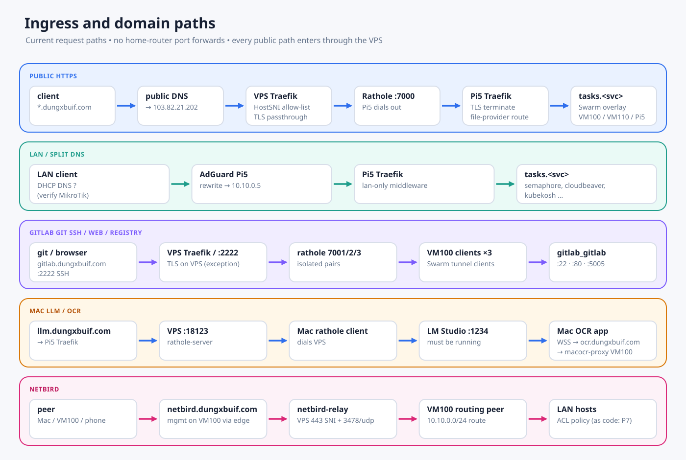

# Current Homelab Stack

Current as of 2026-10-31 (read-only live audit of Pi5, VM100 and VM110; VPS
from the [2026-10-31 gateway audit](./deployments/vps-gateway-audit-2026-10-31.md)).
Proxmox and MikroTik were not audited live. Code and manifests live in
`/home/dungxbuif/workspace/projects/homelab-ops`; this page is the catalog.

A running task without a healthcheck proves process stability, not
application readiness.

## Hosts

| Host | Address | Role |
|---|---|---|
| VPS `instance-11904600` | `103.82.21.202` | Public edge: `gateway-traefik`, Rathole servers, NetBird relay/STUN, Coturn, RustDesk. 4 vCPU / 7.8 GiB / 38 GiB, Docker 29.3.0 |
| Pi5 `rpivn` | `10.10.0.5` | Swarm manager (leader), home TLS edge, LAN DNS, all authoritative datastores, production registry. Docker 28.4.0; disk 469 G, 42% used |
| VM100 `vm100-prod` | `10.10.0.31` | Production compute, Swarm worker, plus standalone Compose projects. Docker 29.8.2; disk 194 G, 66% used; allocation 6 vCPU / 16 GB |
| VM110 `db-ops` | `10.10.0.32` | Swarm worker for `db-management` only; no Compose, no homelab timers. Docker 29.1.3; disk 78 G, 65%; RAM 7.8 G |
| Proxmox | `10.10.0.20` | Hypervisor for VM100 and VM110 (one failure domain); no Kubernetes |
| Mac mini | `10.10.0.6` (documented) | Native OCR worker (outbound WSS) and LM Studio via Mac Rathole client |
| MikroTik hEX S | `10.10.0.1` | PPPoE, NAT, DHCP. DHCP DNS reportedly still advertises `10.10.0.2` (dead Orange Pi) — **verify urgently** |
| Orange Pi Zero 3 `orangepizero3` | `10.10.0.2` | **Down**, still a Swarm member; no active role |


## Swarm services (manager Pi5)

Running 1/1 (placement on VM100 unless stated):

| Service | Version / image | Endpoint |
|---|---|---|
| `homepage` | pinned digest | `dungxbuif.com`, `www.dungxbuif.com` -> `tasks.homepage:80` |
| `stirling-pdf` | 3.1.0 | `stirling.dungxbuif.com` -> `:8080` |
| `macocr-proxy` | `scan-api-20261008` | `ocr.dungxbuif.com` -> `:8080`; Mac workers connect outbound WSS/443 |
| `family-tree` | `oven/bun:1-slim` | `family.dungxbuif.com` -> `:3000` |
| `mezonhook` | `vm100-20260911` | `mezonhook.dungxbuif.com` -> `:8080` |
| `openclaw` | `vm100-20260912` | `openclaw.dungxbuif.com` -> `:18789` |
| `n8n` + `n8n-runners` | 2.46.3 | `n8n.dungxbuif.com` -> `:5678` |
| `mypocket-api`, `mypocket-worker` | `release-1.2.1-837bd505` | `money.dungxbuif.com` -> `tasks.mypocket-api:8080` |
| `netbird_netbird-server` / `-dashboard` | 0.82.0 / v2.96.0 | `netbird.dungxbuif.com` |
| `relayhub-v1_relayhub`, `_admin`, `_nats`, `_redis` | `c61e998`, `v1-public-20261031`, nats 2.14.5, redis 7.4 | `relayhub.dungxbuif.com` (API + UI task DNS) |
| `gitlab_gitlab` | 18.11.11-ce.0 | `gitlab.dungxbuif.com`; Git SSH VPS `:2222`; trial registry `registry-gitlab.dungxbuif.com` |
| GitLab tunnel clients (ssh, https, registry-trial) | rathole | outbound to VPS `7001-7003` |
| `k8s-syntax` | (unverified) | (unverified) |
| `semaphore` + `semaphore-executor_runner` | v2.19.17 | LAN-only `semaphore.dungxbuif.com` (Pi5) |
| `homelab-provisioner` | — | internal `homelab-net:8787`, no route (Pi5) |
| `db-management_{api,web,worker,cloudbeaver,databasus}` | CloudBeaver 26.2.3, Databasus v3.64.0 | `db-management`, `cloudbeaver`, `databasus` `.dungxbuif.com`, LAN via Pi5 edge (VM110) |
| `couchloom-network_anchor`, `pg-net-anchor` | anchor containers | keep overlays attachable for Compose workloads |

Leftovers at 0/0 (cleanup candidates, do not scale up): `edge_traefik`,
`edge_rathole`, `edge_adguardhome` (old Orange Pi edge), `relayhub`
(bootstrap legacy), `mypocket-web` (web intentionally stopped).

## Non-Swarm workloads


**Pi5**

| Project | Contents |
|---|---|
| Compose `infra` (`/ssd-data/infra`) | PostgreSQL pgvector pg16 (16.15), PgBouncer `latest` (1.26.1), CouchDB 3.5.3, RustFS 1.0.4, VictoriaMetrics v1.155.0, Alertmanager v0.34.2, postgres/blackbox/snmp exporters, cAdvisor, `couchdb-backup-proxy` |
| Compose `redis-prod` (`/ssd-data/infra/redis-prod`) | Redis 7.2 (AOF, 1 GiB `noeviction`); override attaches `gitlab-net` with alias `redis-prod` |
| Standalone | `edge-traefik-pi5` (traefik v3.6), `edge-rathole-pi5` (rathole:local), `edge-adguardhome-pi5` (`latest`), `docker-registry` (registry:2) |
| Native systemd | `cloudflared` 2026.10.7 — degraded, `Unauthorized: Tunnel not found`; not an active route. Databasus verification agent `pi-verifier-1` |

No homelab systemd timers on Pi5.

**VM100** (manual Compose)

| Project | Contents |
|---|---|
| `couchloom` | couchloom, postgres (pgvector pg17), ollama 0.40.13; no public route |
| `whiteboard` | 5 containers; `whiteboard.dungxbuif.com` |
| `kubekosh` | LAN-only training app `kubekosh.dungxbuif.com`; not a managed cluster |
| `prod` | Legacy RelayHub Go (api, worker, nats, redis) — **rollback only**, not public |
| `diun` | image update notifier |
| `knowledge-hub-search` | search backend (SearXNG, unverified) |
| `homelab-backup-db-ops-relay` | 3 Nginx relay containers for db-ops backup access (exact targets unverified) |

VM100 timers: only `homelab-monitoring-drift` and `homelab-docker-maintenance`.
**No backup timers exist.**

**VPS** (`/root/...` Compose dirs): `gateway-traefik` (traefik v3.6, 80/443),
`rathole-server` (7000, 18087, 18123), `gitlab-{ssh,https,registry-trial}-rathole-server`
(2222+7001, 7002, 7003), `netbird-relay` (TCP 443 via HostSNI, UDP 3478),
`coturn` 4.6.3 (TCP/UDP 5349), RustDesk `hbbs`/`hbbr` (TCP 21115-21117, UDP 21116).
UFW inactive; provider firewall policy unconfirmed.

## Network and ingress




```text
Public HTTPS -> VPS gateway-traefik (HostSNI allow-list) -> Rathole :7000
             -> Pi5 edge-traefik-pi5 (file provider, wildcard TLS)
             -> tasks.<service>:<port> on Swarm overlays
GitLab web / registry trial -> VPS Traefik (TLS on VPS) -> Rathole 7002/7003 -> VM100 clients
Git SSH -> VPS :2222 -> Rathole 7001 -> VM100 -> GitLab :22
LLM -> VPS :18123 -> Mac Rathole client -> LM Studio :1234
LAN DNS -> edge-adguardhome-pi5 (wildcard rewrite to 10.10.0.5;
           netbird-relay.dungxbuif.com -> 103.82.21.202)
```

- Pi5 Traefik routes are **file-provider** (`/home/dungxbuif/edge/traefik/dynamic.yml`),
  not Swarm labels. VPS HostSNI list: `/root/gateway/dynamic.yml`.
- Overlays: `homelab-net` (broad, retained for rollback), `edge-http-net`,
  `data-net`, `pg-net`, `s3-net`, `gitlab-net`, `mypocket-net`, `netbird-net`,
  `macocr-redis-net`. Narrowing is service-by-service.
- Approved Pi5 LAN host ports: `5432` (PgBouncer, not raw Postgres) and
  `16379` (Redis) for non-Docker clients. No home-router port forwards.
- Pi5 Traefik pending for GitLab: lab split DNS points GitLab names at Pi5,
  which has no GitLab route (unverified whether still 404).

## Datastores

| Consumer | Backend / endpoint |
|---|---|
| n8n | `pgbouncer:6432` DB `n8n` |
| MyPocket API/worker | `pgbouncer:6432` DB `mypocket`; `redis-prod:6379/1` |
| OCR proxy | `pgbouncer:6432`; `redis-prod:6379/0`; RustFS bucket `mac-ocr` |
| Family Tree | `pgbouncer:6432` (DB name in runtime config) |
| NetBird | `pgbouncer:6432` DBs `netbird`, `netbird_activity`, `netbird_idp` |
| GitLab | direct `postgres:5432` DB `gitlabhq_production`; `redis-prod:6379/2` via `gitlab-net`; repos/registry on VM100 `/opt/apps/gitlab/{config,logs,data}` |
| RelayHub v1 | `pgbouncer:6432` DB `relayhub_v1_staging_20261030`; NATS/Redis private on VM100. Legacy DB `relayhub` kept for rollback |
| Object storage | Pi5 RustFS `rustfs:9000` (API), `:9001` console; `storage`/`cdn` domains |
| Obsidian sync | Pi5 CouchDB `couchdb:5984`; `homelab` DB stays private/admin-only (no public `sync-db` route by decision); routed names `couchdb`/`sync-db` exposure (unverified) |
| CouchLoom | own Postgres on VM100; reads Pi5 CouchDB |

PostgreSQL holds 17 databases (2026-10-31 dump set). Redis DB indexes are
namespaces, not security boundaries.

## Backups (current reality)


- Active: `db-management` / Databasus on VM110 -> Google Drive. Six service
  DBs (`n8n`, `homelab`, `relayhub`, `netbird`, `netbird_activity`,
  `netbird_idp`) pass backup plus automatic restore verification via the Pi5
  agent. Other Databasus jobs are out of that scope.
- Restic repository `homelab-backups/databases/` on Google Drive was
  re-initialised 2026-10-31; rclone config at
  `/ssd-data/infra/backup/secrets/rclone.conf` (Pi5) and
  `/etc/homelab-backup/secrets/rclone.conf` (VM100).
- **No scheduled backup** for GitLab, RustFS, CouchDB, Redis or host configs:
  VM100 has no backup timers. GitLab native backup is multi-GB and unsolved.
- No VM image backup (Proxmox has no separate failure-domain target).

See [backup runbook](./runbooks/backup-restore.md),
[Databasus operations](./runbooks/databasus-backup-operations.md) and
[2026-10-31 repair record](./deployments/backup-repair-2026-10-31.md).

## Retired

Orange Pi edge, Kubernetes/kube-vip/Longhorn, VMs 101/102, Caddy, GoClaw
route, OmniScan, BDS app and Cloudflare connector (do not recreate), Headscale,
Tailscale, WireGuard admin access. Source folders may remain without implying
a running service.

## Forward plan

[Lab-wide IaC automation rebuild (proposed)](./superpowers/plans/2026-10-31-lab-iac-automation-rebuild.md).
Host detail: [Pi5](./PI.md), [VM100](./VM100.md), [Mac](./MAC.md),
[Proxmox](./PROXMOX.md), [MikroTik](./MIKROTIK.md).
