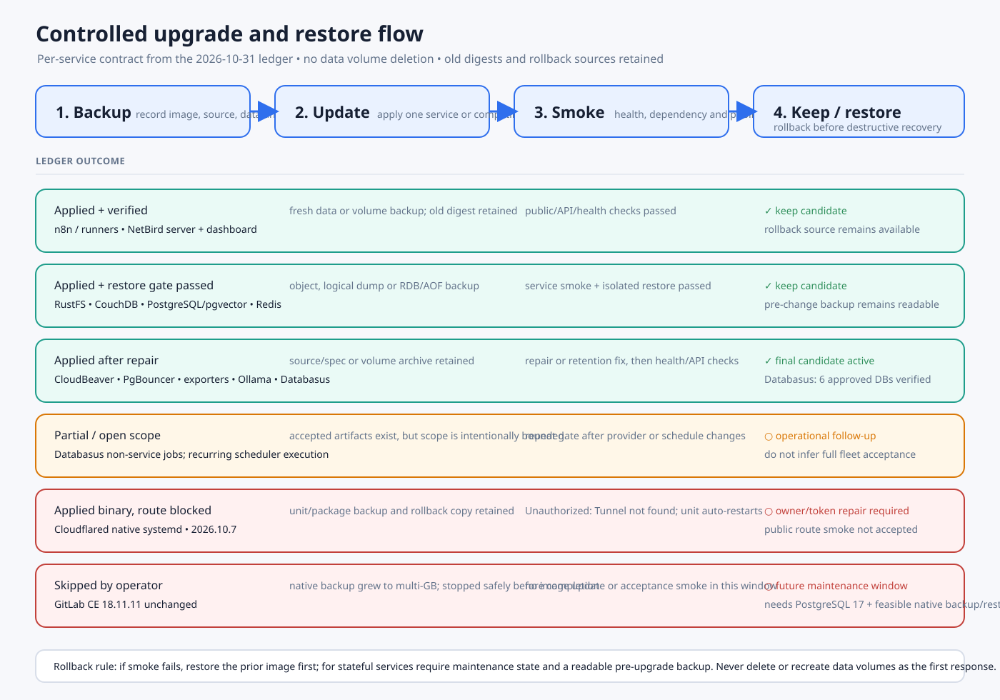

# Controlled Docker image upgrades — 2026-10-31

## Scope

This note is the live ledger for the approved upgrade sequence:

1. `n8n` + `n8n-runners`, SearXNG, and the NetBird server/dashboard pair.
2. Exporters, PgBouncer, Semaphore, Cloudflared, and CloudBeaver.
3. RustFS, CouchDB, PostgreSQL/pgvector, and Redis only after a fresh
   backup/restore gate.
4. Ollama, VictoriaMetrics, and Alertmanager.
5. GitLab and Databasus in their own maintenance window.

The procedure is one service or compatible pair at a time: record the old
image and digest, validate the deployment source, create the required backup,
apply the image change, run health and dependency smoke checks, then record
the rollback command and result. No data volume is removed during this work.

## Operator deferrals

Cloudflared is explicitly deferred from this maintenance window at the
operator's request. Its native binary update remains recorded for rollback
purposes, but the Cloudflare tunnel route is not part of this window's
acceptance gate. Do not restart, reconfigure, or recreate the retired BDS
connector until a future window explicitly reopens this item.

## Preflight — 2026-10-31

- Pi5 Swarm manager is reachable; VM100 and VM110 are Swarm workers, so Swarm
  services are updated from Pi5 while standalone Compose workloads are updated
  on their owning host.
- Existing backup runner is on VM100 under `/opt/apps/homelab-backup`; its
  retained restore-drill marker is `/opt/apps/homelab-backup/runs/.state/restore-drill.success`.
- Pi5 Compose source is `/ssd-data/infra/docker-compose.yml`; its source is
  backed up before each change.
- The first stateless wave has been applied to n8n, n8n-runners, SearXNG,
  blackbox-exporter, snmp-exporter, Alertmanager, VictoriaMetrics, and the
  PostgreSQL exporter. n8n and its external runners now match at `2.46.3`.
- Sensitive values are intentionally omitted from this document.

## Version candidates

| Service | Current | Candidate | Gate |
|---|---|---|---|
| n8n | `2.46.3` / `sha256:1a6e1865…` | Applied | Pair with runners and public/API smoke passed |
| n8n-runners | `2.46.3` / `sha256:e10899bf…` | Applied | Pair with n8n passed |
| NetBird server | `0.82.0` / `sha256:7b5b53b2…` | Applied | Dashboard, peers and relay smoke passed |
| NetBird dashboard | `v2.96.0` / `sha256:340b13c0…` | Applied | Updated with server |
| SearXNG | pinned GHCR digest | Applied | Search request and n8n private-network check passed |
| Exporters | blackbox/SNMP/PostgreSQL exporter pinned to tested images | Applied | Scrape health and config parse passed |
| cAdvisor | `v0.55.1` / `sha256:3de2bd52…` | Applied | Container health and `/metrics` smoke passed |
| PgBouncer | `latest` / `sha256:ca2814bc…` / PgBouncer `1.26.1` | Applied | PostgreSQL connection and pool smoke passed |
| Semaphore | `v2.19.17` / `sha256:008dacd9…` | Applied | UI, executor and PostgreSQL smoke passed |
| Cloudflared | native systemd `2026.10.7` | Deferred by operator | Binary update retained; route/control-plane verification intentionally excluded from this window |
| CloudBeaver | `26.2.3` / `sha256:0c875296…` | Applied | Login, private DB explorer and public status smoke passed |
| RustFS | `1.0.4` / `sha256:ed9210d6…` | Applied | Backup/restore and health smoke passed |
| CouchDB | `3.5.3` / `sha256:bed314d1…` | Applied | Export/restore, document-count and auth smoke passed |
| PostgreSQL/pgvector | `pg16.15` / `sha256:f40e48ec…` | Applied | Logical backup, isolated restore and pgvector smoke passed |
| Redis | Pi5 `7.2.17` / `sha256:2c933526…`; RelayHub `7.4.12` | Applied | RDB/AOF restore and app smoke passed |
| Ollama | `0.40.13` / `sha256:b2f0122c…` | Applied | Model/embedding request and CouchLoom smoke passed |
| VictoriaMetrics | `v1.155.0` / `sha256:f60dc268…` | Applied | Query, retention and scrape smoke passed |
| Alertmanager | `v0.34.2` / `sha256:39d8bb39…` | Applied | Ready/API smoke passed |
| GitLab | `18.11.11` / `sha256:10528ba5…` | Skipped by operator | Keep unchanged; future separate window requires PostgreSQL 17 and feasible native backup/restore |
| Databasus | `v3.64.0` / `sha256:dca80ac1…` | Applied | Pi5 agent online; six approved service DBs passed provider backup + isolated restore |

## Execution ledger

| Time | Service | Result | Backup/verification evidence |
|---|---|---|---|
| 2026-10-31 00:26 ICT | n8n | **Applied**: `stable` / `sha256:a8c95f75…` → `2.45.7` / `sha256:9a8d8dce…` | Initial n8n data snapshot retained; Swarm `1/1`, health `healthy`, restart `0`, public `/healthz` and `/` returned `200`; rollback spec saved |
| 2026-10-31 00:32 ICT | n8n-runners | **Applied**: `2.38.7` / `sha256:82167390…` → `2.46.3` / `sha256:e10899bf…` | Swarm `1/1`; JavaScript/Python launchers started. Pair compatibility was then closed by the follow-up n8n upgrade below |
| 2026-10-31 01:01 ICT | n8n + n8n-runners compatibility | **Completed**: n8n `2.45.7` / `sha256:9a8d8dce…` → `2.46.3` / `sha256:1a6e1865…` from GHCR, runners already `2.46.3` | Fresh custom-format PostgreSQL dump `/ssd-data/infra/backups/version-upgrade-20261031/n8n/n8n-postgres.dump` is `13039731` bytes and `pg_restore --list` reported `1799` entries. Final Swarm update completed `1/1`; `https://n8n.dungxbuif.com/healthz` returned `{"status":"ok"}`, public root `200`; runners showed both launchers waiting for task offers without recent fatal errors. Rollback service specs saved under the same backup directory; authenticated Code-node execution remains a follow-up smoke item |
| 2026-10-31 00:34 ICT | SearXNG | **Applied**: `sha256:ad273460…` → `sha256:f1bbc31c…` | Backups: `/opt/apps/homelab-backup/runs/version-upgrade-20261031/searxng/{compose.yml,settings.yml,old-image.txt}`; Compose validated with root env file; container running, restart `0`, JSON search returned `200`; rollback is previous digest |
| 2026-10-31 00:36 ICT | blackbox-exporter | **Applied and source pinned**: prior `latest` digest → `sha256:608fb26f…` | Compose recreated only this service; source now pins repository digest `sha256:ea1c7aa3…`; running, restart `0`, metrics endpoint returned data, binary reports `0.29.1`, no recent error/fatal/panic logs; rollback image is in pre-upgrade Compose/image cache |
| 2026-10-31 00:36 ICT | snmp-exporter | **Applied and source pinned**: prior `latest` digest → `sha256:6b05e1f2…` | Compose recreated only this service; source now pins repository digest `sha256:e5f1aba9…`; running, restart `0`, metrics endpoint returned data, binary reports `0.31.0`, no recent error/fatal/panic logs; rollback image is in pre-upgrade Compose/image cache |
| 2026-10-31 00:49 ICT | Alertmanager | **Applied**: `prom/alertmanager:v0.27.0` / `sha256:e13b6ed5…` → `quay.io/prometheus/alertmanager:v0.34.2` / `sha256:39d8bb39…` | Config check passed with the candidate image; Compose source and container inspect saved under `/ssd-data/infra/backups/version-upgrade-20261031/alertmanager/`; running, restart `0`, `/-/ready` returned `OK`, `/api/v2/status` returned valid JSON with version `0.34.2`; rollback is the saved Compose/image |
| 2026-10-31 00:51 ICT | VictoriaMetrics | **Applied**: `v1.102.0` / `sha256:b51f6910…` → `quay.io/victoriametrics/victoria-metrics:v1.155.0` / `sha256:f60dc268…` | Service was stopped for a tar backup of `vm-data` (`448963273` bytes) and recreated only after the archive listed successfully; running, restart `0`, `/-/ready` returned `VictoriaMetrics is Ready`, PromQL `up` returned `14` series; rollback source/image and backup saved under `/ssd-data/infra/backups/version-upgrade-20261031/victoriametrics/` |
| 2026-10-31 00:52 ICT | PostgreSQL exporter | **Applied with config repair**: `latest` / `sha256:d991414f…` → `quay.io/prometheuscommunity/postgres-exporter:v0.18.1` / `sha256:fb96c441…` | Candidate initially exposed a pre-existing unescaped `/` in `DATA_SOURCE_NAME` (`pg_up=0`); Compose was backed up, the password component was URL-encoded without logging its value, and the service was recreated. Final `pg_up=1`, running, restart `0`, no recent fatal/panic logs; rollback is the saved Compose/image |
| 2026-10-31 01:05 ICT | NetBird server/dashboard | **Applied**: server `sha256:541ecef7…` → `ghcr.io/netbirdio/netbird-server:0.82.0` / `sha256:7b5b53b2…`; dashboard `sha256:3d6adfee…` → `netbirdio/dashboard:v2.96.0` / `sha256:340b13c0…` | Config/specs and a stopped-server volume archive (`28,306,223` bytes) saved under `/opt/apps/homelab-backup/runs/version-upgrade-20261031/netbird/`. Server migration completed with no fatal errors; both services Swarm `1/1`, public root returned `200`, unauthenticated `/api/peers` returned expected `401`; first dashboard attempt used the wrong GHCR prefix and rolled back automatically before the correct Docker Hub reference succeeded |
| 2026-10-31 01:17 ICT | Semaphore | **Applied**: `v2.19.12` / `sha256:39968046…` → `v2.19.17` / `sha256:008dacd9…` | SQLite/data archive (`761573` bytes), stack source, and service spec saved under `/ssd-data/infra/backups/version-upgrade-20261031/semaphore/`; archive listed successfully before update. Swarm `1/1`, UI returned `200`, private executor remained on its existing digest; after a forced runner refresh, runner log reported `Runner connected` with no new 502s |
| 2026-10-31 01:27 ICT | CloudBeaver | **Applied after automatic rollback and healthcheck repair**: `25.3.5` / `sha256:f3cca49f…` → `26.2.3` / `sha256:0c875296…` | Workspace archive `/opt/apps/homelab-backup/runs/version-upgrade-20261031/cloudbeaver/workspace-v3.tgz` (`28422` bytes) listed successfully; first candidate task rolled back because 26.2.3 no longer ships `curl` while the old HTTP healthcheck still required it. Source `/home/dungxbuif/workspace/projects/homelab-ops/automation/stacks/db-management/stack.yml` and live service now use the Bash TCP healthcheck; retry completed with Swarm `1/1`, container `healthy`, restart `0`, and `https://cloudbeaver.dungxbuif.com/status` returned `200`. Startup schema migration `28 → 29` completed; the existing optional Yandex ClickHouse driver warning remains non-fatal |
| 2026-10-31 01:37 ICT | PgBouncer | **Applied after Compose/network repair**: rollback image `sha256:2a9d6e7c…` → `edoburu/pgbouncer:latest` / `sha256:ca2814bc…`, repository digest `sha256:8638aa56…` | Source is pinned and validated; source/spec backup is under `/ssd-data/infra/backups/version-upgrade-20261031/pgbouncer/`. Compose could not reuse the fixed container name and then hit a transient external-network-mode error, so the old container was retained as `pgbouncer-rollback-version-upgrade` and the candidate was recreated with the original env, userlist bind, port, aliases, and five networks. Candidate reports PgBouncer `1.26.1`, restart `0`, local `pg_isready` accepts, `n8n.dungxbuif.com/healthz` returned `200`; no new fatal/DNS errors after convergence |
| 2026-10-31 01:40 ICT | Ollama | **Applied**: `0.34.0` / `sha256:684d8674…` → `0.40.13` / `sha256:b2f0122c…` | Candidate pulled for VM100 amd64; source updated for both `ollama` and `ollama-model` and Compose config validated. `ollama_data` archive `/opt/apps/homelab-backup/runs/version-upgrade-20261031/ollama/ollama-data.tgz` is `252237297` bytes and listed successfully. Container healthy, restart `0`, `nomic-embed-text` retained; CouchLoom remained healthy, restart `0`, with no new embedding/Ollama errors |
| 2026-10-31 01:42 ICT | cAdvisor | **Applied**: `v0.49.1` / `sha256:6cd5d633…` → `v0.55.1` / repository digest `sha256:3de2bd52…`, config digest `sha256:fc364f31…` | Compose source/spec backup is under `/ssd-data/infra/backups/version-upgrade-20261031/cadvisor/`; the old image remains cached for rollback after the fixed-name recreate. Candidate is healthy, restart `0`, and `/metrics` reports `cadvisorVersion="v0.55.1"`; no new fatal/panic errors observed |
| 2026-10-31 02:06 ICT | RustFS | **Applied**: `1.0.1` / `sha256:6024cc1b…` → `1.0.4` / `sha256:22826c14…` (`rustfs/rustfs@sha256:ed9210d6…`) | Data archive `/ssd-data/infra/backups/version-upgrade-20261031/rustfs/rustfs-data.tgz` is `1220619392` bytes and listed successfully before update; source now pins the candidate digest. ARM64 binary reports `1.0.4`, container restart `0`, internal `/health/ready` on ports `9000/9001` returned `200`, and public S3/console health routes returned `200`; old image remains cached for rollback |
| 2026-10-31 02:10 ICT | CouchDB | **Applied**: `3.3.3` / `sha256:6efff69c…` → `3.5.3` / `sha256:7e18c096…` (`couchdb@sha256:bed314d1…`) | Pre-change data archive `/ssd-data/infra/backups/version-upgrade-20261031/couchdb/couchdb-data.tgz` is `702475296` bytes and listed successfully; `obsidian_vault` metadata archive recorded `49341` docs before update. Candidate source is digest-pinned, CouchDB logs report `3.5.3` started, restart `0`, authenticated root/database checks returned `200`, `_changes?limit=1` returned one result, and the post-update document count remained `49341`; public routes returned expected unauthenticated `401`; old image remains cached |
| 2026-10-31 02:12 ICT | PostgreSQL/pgvector | **Applied**: image `sha256:af89eca7…` / PostgreSQL `16.14` → pinned `pgvector/pgvector:pg16@sha256:7b822b0a…` / PostgreSQL `16.15` | Fresh custom-format dumps plus globals for `17` databases are under `/ssd-data/infra/backups/version-upgrade-20261031/postgres/`; `59M` total and `checksums.sha256` verified. Candidate image restored `n8n.dump` into scratch and `SELECT 1` passed. Live candidate is healthy, vector `0.8.3` remains present in `goclaw` and `homelab`, `pg_isready` via PgBouncer accepts, and n8n `/healthz` returned `200`; old image remains cached |
| 2026-10-31 02:14 ICT | Redis (Pi5 + RelayHub) | **Applied/pinned**: Pi5 `7.2.15` / `sha256:9a79915a…` → `7.2.17` / `redis@sha256:2c933526…`; RelayHub legacy Compose `7.4.12` now pins `sha256:8da19c73…` and the active Swarm task was already on that digest | Pi5 RDB snapshot (`3455327` bytes), AOF/data archive (`3517120` bytes), and checksums are under `/ssd-data/infra/backups/version-upgrade-20261031/redis-prod/`; scratch candidate loaded the RDB with `PING=PONG`, `DBSIZE=10`. Pi5 candidate reports `PONG`, `DBSIZE=10`, AOF enabled, restart `0`; legacy RelayHub Redis is healthy, non-persistent by design (`--save "" --appendonly no`), API/worker remained healthy and public RelayHub returned `200` |
| 2026-10-31 follow-up | GitLab Redis path | **Repaired without data recreate**: Redis had been recreated from base Compose and lost its overlay attachments; the current GitLab task was on `gitlab-net`, so Rails could not resolve `redis-prod` and valid-token API calls returned 500. Redis was attached to `gitlab-net` with the `redis-prod` alias and the persistent override was updated. | GitLab resolves Redis as `10.0.5.31`; TCP and secret-authenticated DB2 `PONG` pass; GitLab health/readiness are `200`; public unauthenticated API returns expected `401`. Full evidence and rollback: [GitLab Redis network repair](./gitlab-redis-network-repair-2026-10-31.md). |
| 2026-10-31 02:32 ICT | Cloudflared | **Applied with route blocker**: native `2026.2.0` → `2026.10.7` | Unit backup and package artifacts are under `/ssd-data/infra/backups/version-upgrade-20261031/cloudflared/`; package SHA-256 is `d9407eb6e70ac31f54978a6b408a0320b51b664a6d0b498248692d7ac56bf836`, old binary rollback SHA-256 is `03c5d58e283f521d752dc4436014eb341092edf076eb1095953ab82debe54a8e`, and installed binary SHA-256 is `3df43aedc9ff291d1735b5cb576cb97e0b157488796db2e32b28aecabb445775`. The current token was not changed; direct candidate launch returned `Unauthorized: Tunnel not found`, so systemd remains `activating/auto-restart` and public tunnel smoke is not accepted |
| 2026-10-31 02:20 ICT | GitLab CE | **Skipped by operator; no update** | Native backup was started for `18.11.11` but became a multi-GB operation (`registry.tar.gz` reached about `2.1G` while the backup set grew to about `14G`); it was stopped safely before `COMPLETE`/manifest/upload. Live `gitlab_gitlab` remains `18.11.11` / `sha256:10528ba5…`, healthy, and untouched. Patch `18.11.14` and the major `18.11.14 → 19.2.10 → 19.5.3` path remain a future maintenance window; PostgreSQL 17 and source drift still need reconciliation |
| 2026-10-31 02:27 ICT | Databasus | **Attempted then rolled back**: `v3.60.0` / `sha256:2e9aec56…` → `v3.64.0` / image ID `sha256:a4bbf8b2…` → restored `v3.60.0` | Named volume archive `/ssd-data/infra/backups/version-upgrade-20261031/databasus/databasus-volume.tgz` is `29523155` bytes with SHA-256 recorded; candidate converged `1/1` and public health/root returned `200`, but startup backup-cleaner logged `unknown period: THREE_MONTH`. The same retention panic appeared after rollback restart, so it was an existing data/config blocker rather than proof of a candidate-only regression. Volume was not removed or reset |
| 2026-10-31 02:42 ICT | Databasus | **Applied after retention repair**: `v3.60.0` → `v3.64.0@sha256:dca80ac1bf555b706d33cd9506a6422387a34fb22eea5ca1cacfc52babd58d2e` | Fresh volume archive `/ssd-data/infra/backups/version-upgrade-20261031/databasus/databasus-volume-before-retention-fix.tgz` is `29280340` bytes, SHA-256 `471f340e7b4a82877d7192e4d5c8cfad1e7cf668d8dcc0123948503f7c322748`. Embedded PostgreSQL transaction changed all `15` logical configs from invalid `THREE_MONTH` to the source-supported `3_MONTH`; candidate task is running `1/1`, `/api/v1/system/version` reports `3.64.0`, health/root return `200`, migrations complete, and no fresh cleaner panic appeared after startup. Provider-authenticated backup and isolated restore acceptance remain open |
| 2026-10-31 02:50 ICT | Databasus verification | **Agent added and first restore proof passed**: `pi-verifier-1` online on Pi5, official ARM64 binary supervised by `databasus-verification-agent.service` | Agent capacity is `2` CPU / `2048` MB RAM / `20` GB disk / `1` job. Manual verification of the latest n8n backup completed `Successful`: `pg_restore` exit `0`, `1` schema, `153` tables, `52.58 MB` restored, `2s` restore. `After backup` was enabled for n8n, homelab, relayhub, netbird, netbird_activity and netbird_idp. GitLab remains excluded by the requested size-based skip |
| 2026-10-31 02:53 ICT | Databasus n8n backup + verification | **Provider and restore gate passed after `v3.64.0`** | New n8n backup completed `Successful` with a `1.91 MB` payload / `147.82 MB` DB size; the enabled `After backup` check completed `Successful` with `pg_restore` exit `0`, `1` schema, `190` tables, `54.76 MB` restored and `2s` restore duration |
| 2026-10-31 02:55–02:58 ICT | Databasus approved service DB wave | **Completed: 6/6 service databases passed backup + restore verification** | `homelab` (`0.18 MB` / `1.6 MB`, `63` tables, `10.16 MB` restore), `relayhub` (`0.1 MB` / `1.41 MB`, `30` tables, `9.15 MB`), `netbird` (`0.1 MB` / `1.79 MB`, `39` tables, `9.74 MB`), `netbird_activity` (`0.01 MB` / `0.08 MB`, `2` tables, `7.49 MB`), and `netbird_idp` (`0.02 MB` / `0.37 MB`, `13` tables, `7.77 MB`) all showed `Successful` + `Verified`; every restore reported `pg_restore` exit `0` |
| 2026-10-31 00:38 ICT | PgBouncer | **Not applied; automatic rollback** | Compose recreation first hit a Docker `data-net` endpoint-table/network race. Old image `sha256:2a9d6e7c…` was retained under `edoburu/pgbouncer:rollback-version-upgrade`; restored container is running, `pg_isready` accepts connections, n8n health `200`. New image remains `sha256:ca2814bc…` and is not active |
| 2026-10-31 00:25 ICT | databases backup gate | **Passed after remote repair and restore validation** | Retained OAuth config was checked against its legacy root, a new `homelab-backups/databases` Restic repository was initialized, and local run `databases-20261030-174710` uploaded as snapshot `b1391e30a90fb2048970c3b01bbff07738a25ba0c85cb9a1d4802a5cf5bcd6c0`. VM100 restore drill `restore-drill-version-upgrade-20261031` passed manifest/`COMPLETE`/SHA-256 checks; engine restore also passed for PostgreSQL `n8n` (`SELECT 1`) and CouchDB `obsidian_vault` (`49341` docs). Detailed evidence: [backup repair and restore acceptance](./backup-repair-2026-10-31.md) |

## Rollback contract

Rollback uses the recorded old digest/tag and the service's existing Compose or
Swarm deployment source. For stateful services, rollback is allowed only after
the service is stopped or placed in the documented maintenance state and the
pre-upgrade backup remains readable. If a smoke test fails, restore the prior
image first; do not delete or recreate data volumes as a first response.

## Open blockers

- Private/local images are not fully covered by Diun because several registry
  credentials are unavailable; custom apps require source build/CI evidence.
- Docker Hub returned HTTP 429 during the initial CloudBeaver candidate pull;
  the exact candidate was later pulled and smoke-tested successfully. Any
  remaining Docker Hub candidate still needs the same exact-image gate.
- The `databases` remote and restore gate is repaired and passed. The retained
  portable Pi executor path remains documented because the root transient scope
  still requires the executor UID to own the private runtime directory. See
  [backup repair and restore acceptance](./backup-repair-2026-10-31.md).
- RustFS, CouchDB, PostgreSQL/pgvector, and Redis each passed their
  service-specific pre-change backup and post-update smoke checks in the
  execution ledger above.
- Cloudflared is not a Docker service in the live topology: Pi5 now runs native
  systemd `cloudflared` `2026.10.7`, but the unit remains
  `activating/auto-restart` with a high restart count. The binary update and
  rollback copy are verified; the unchanged token returns `Unauthorized:
  Tunnel not found`, so public tunnel smoke is not accepted until the
  Cloudflare owner repairs or reissues the tunnel token. VM100 has no live
  `bds-cloudflared` container or source; do not recreate the retired BDS
  connector until its owner/source and tunnel route are explicitly reconciled.
  Recovery acceptance is: (1) Cloudflare owner confirms or recreates the
  intended tunnel and approved hostname/origin mapping in the dashboard, (2)
  the replacement token is stored through the existing secret boundary and
  updated on Pi5 without putting it in Git or this vault, (3) the systemd unit
  reaches `active` with no restart growth, and (4) one bounded public route
  smoke plus the journal/health evidence is recorded. Login/token entry is an
  operator handoff; it is not performed by this maintenance run.
- GitLab has a source drift between the deployed `/ssd-data/infra/gitlab` copy
  and the local migration source. Its staged path is blocked until PostgreSQL
  17, a feasible durable native backup, and isolated restore evidence are
  available. The operator-specified backup attempt was stopped after the
  archive grew to multi-GB size; no GitLab image change was made.
- Databasus now runs `v3.64.0` on the verified amd64 manifest digest. Before
  rollout, a fresh named-volume archive was taken and all `15` logical configs
  with invalid `THREE_MONTH` retention were changed transactionally to the
  source-supported `3_MONTH`; the candidate starts without a fresh cleaner
  panic and reports healthy. The Pi5 verification agent is online and the n8n
  restore proof passed, and the remaining five approved service DBs then passed
  the same provider + restore gate. Other configured Databasus jobs remain
  outside this service-maintenance scope and need a separate decision before
  adding load to the single-job Pi5 agent.
- Gateway/DNS access is separate from the Docker upgrade path.
- The active Pi5 Compose source contains credentials; this ledger never copies
  them. Credential rotation is tracked separately from image upgrades.
