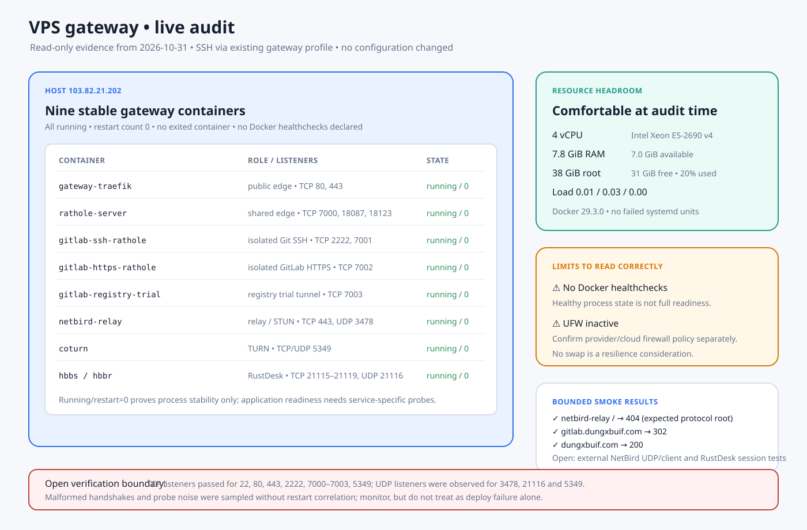

# VPS Gateway Live Audit — 2026-10-31

This is a read-only audit of VPS `103.82.21.202`, reached through the local
`gateway` SSH profile. No VPS configuration, container, image, firewall rule,
or service was changed.

## Access evidence

- SSH reached `instance-11904600` as `root` at `2026-10-31T10:20:41+07:00`.
- The Gateway private key was read from the existing 1Password item only into a
  mode-`0600` temporary file. Its derived ED25519 fingerprint matched the
  server-accepted key: `SHA256:URb/OiEj368s8xT5z+l37itEeOLyqxXJFW6fpEFs540`.
- The temporary key file was removed after each SSH command. No private key
  material is recorded here.

## Host and Docker resources

| Check | Live result | Assessment |
|---|---|---|
| Uptime/load | 21 days 13:25; load `0.01, 0.03, 0.00` | Pass; no current CPU pressure |
| CPU | 4 vCPU, Intel Xeon E5-2690 v4 | Pass |
| RAM | 7.8 GiB total; 801 MiB used; 7.0 GiB available; no swap | Pass for current load; no swap is a resilience consideration |
| Root disk | 38 GiB total; 7.5 GiB used; 31 GiB free; 20% | Pass; ample headroom |
| systemd failed units | None | Pass |
| Docker Engine | Server/client `29.3.0` | Pass |
| Docker Compose | `v5.1.1` | Informational |
| Docker storage | 4.082 GB images, 600.4 MB reclaimable; 3 active volumes | Healthy footprint; no cleanup performed |
| Host firewall | UFW `inactive` | Warning; confirm provider/cloud firewall policy separately |

## Container inventory and stability

All 9 containers were `running=true`, with `restart=0` and no exited
container. The live images and published ports were:

| Container | Image | Published/listened service | Runtime result |
|---|---|---|---|
| `gateway-traefik` | `traefik:v3.6` | TCP `80`, `443` | Running, restart 0 |
| `rathole-server` | `rapiz1/rathole:latest` | TCP `7000`, plus `18087`, `18123` | Running, restart 0 |
| `gitlab-ssh-rathole-server` | digest `a31b9178e985…` | TCP `2222`, `7001` | Running, restart 0 |
| `gitlab-https-rathole-server` | digest `a31b9178e985…` | TCP `7002` | Running, restart 0 |
| `gitlab-registry-trial-rathole-server` | digest `a31b9178e985…` | TCP `7003` | Running, restart 0 |
| `netbird-relay` | `netbirdio/relay:latest` | TCP `443`, UDP `3478` | Running, restart 0 |
| `coturn` | `coturn/coturn:4.6.3` | TCP/UDP `5349` | Running, restart 0 |
| `hbbs` | `rustdesk/rustdesk-server:latest` | TCP `21115`, `21116`, `21118`; UDP `21116` | Running, restart 0 |
| `hbbr` | `rustdesk/rustdesk-server:latest` | TCP `21117`, `21119`; UDP relay-related socket observed | Running, restart 0 |

None of these containers declares a Docker healthcheck. Therefore `running`
and `restart=0` prove process/container stability only, not full application
readiness. RustDesk client-session and authenticated NetBird peer-session
smokes remain separate checks.

## Route and protocol smoke

The following local-to-VPS TLS checks passed through `gateway-traefik` with
the intended SNI:

| Route | Result | Interpretation |
|---|---:|---|
| `netbird-relay.dungxbuif.com/` | `404` | Expected relay protocol root, not an HTTP application page |
| `gitlab.dungxbuif.com/` | `302` | GitLab public route is reachable |
| `dungxbuif.com/` | `200` | Homepage public route is reachable |

From the audit client, TCP connection checks also succeeded for `22`, `80`,
`443`, `2222`, `7000`, `7001`, `7002`, `7003` and `5349`. The host listener
table confirmed UDP `3478` for NetBird/STUN, UDP `21116` for RustDesk, and
TCP/UDP `5349` for Coturn. An external UDP end-to-end STUN/client-session test
was not run in this read-only audit.

## Log interpretation

Recent error-like log lines were sampled without recording full logs or
secrets:

- NetBird relay: malformed/aborted TLS handshakes from an internal gateway
  address; the valid TLS route returned the expected relay `404`.
- Coturn: unauthenticated probes using user `test`; no process restart.
- Rathole servers: malformed hello, handshake timeouts and connection resets
  from public clients; the live GitLab/homepage route smoke passed and all
  tunnel containers remained at restart `0`.
- Traefik: a connection reset from a peer; no corresponding container restart.

These are noise/aborted-client signals rather than proof of an outage. They
should still be monitored because the VPS exposes protocol ports directly.

## Verdict and follow-ups

**Operational verdict: core VPS gateway is up and routing correctly at the
time of audit.** Resources have large headroom, all 9 containers are stable,
systemd has no failed unit, and the three bounded HTTPS route checks pass.

Open verification limits:

1. Add or document service-specific health probes for the containers that have
   no Docker healthcheck.
2. Run an authenticated NetBird peer/relay and UDP STUN test from an external
   client; run a real RustDesk client-session test.
3. Confirm the provider/cloud firewall policy because host UFW is inactive.
4. Keep malformed handshake noise under review; do not treat it as a deploy
   failure unless it correlates with route failure, resource pressure, or
   restarts.
