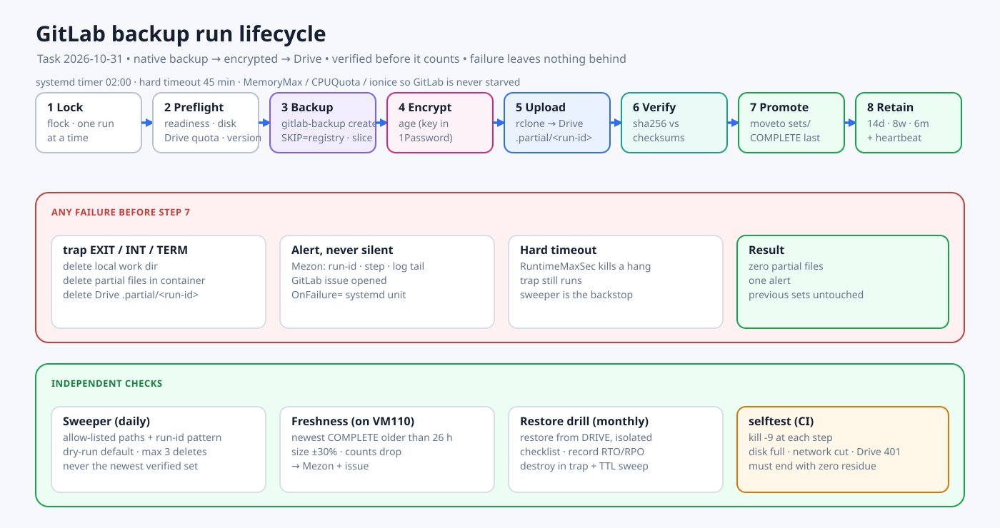

# GitLab Backup and Restore

Code for everything below lives in `homelab-ops/automation/gitlab-backup/` and is deployed with Ansible. **Rule: a script is written, reviewed and committed in `homelab-ops` first, then deployed to a server and run there.** Nothing that changes state is typed on a server or run from a scratch directory (see [overview](/docs/overview.md)).



## 1. What is backed up

| Part | How | Where |
|---|---|---|
| Database, repositories, uploads, artifacts, CI data | `gitlab-backup create SKIP=registry` (native) | Encrypted with `age`, uploaded to `homelab1:homelab-gitlab-backup/sets/<run-id>/` |
| `gitlab-secrets.json`, SSH host keys, `gitlab.rb` | `gitlab-ctl backup-etc` | Same set, encrypted |
| Manifest and checksums | Generated per run | Same set, not encrypted, contains no secrets |
| Container registry | **Not in the set.** A separate class (restic, to be built) | See section 7 |

The decryption key is the 1Password item `backup - gitlab - age private key` in the human-only vault `Homelab-Recovery` ([secrets standard](/docs/standards/secrets-1password.md)). Without it no set can be read.

## 2. Schedule and failure handling

| Item | Behaviour |
|---|---|
| Schedule | `homelab-gitlab-backup.timer`, daily 02:00 (**installed, currently disabled**; enabling it is a decision for the owner) |
| Retries | rclone retries 5 times with a 20 s pause on transient Drive errors |
| Cleanup | Any failure before promotion removes the local work directory, the files left inside the container (including `db/`, `repositories/` and `*.tar.gz` staging) and the remote partial directory, then sends one alert |
| Foreign backup | A run refuses to start while another GitLab backup process is running and never touches its files |
| Sweeper | After each successful run: removes stale `.partial` data and applies retention (14 daily, 8 weekly, 6 monthly, never below 7 verified sets). Dry run unless `--apply`; at most 3 deletions per run; only names that match the run-id pattern |
| Freshness | `gitlab_backup_tools.py freshness` alerts when the newest set is older than 26 hours, jumps in size by more than 30%, or loses repositories |
| Timeout | `TimeoutStartSec=3000` plus an inner `timeout 2700` on `gitlab-backup` |

## 3. Restore: decision table

| Situation | Procedure |
|---|---|
| GitLab data damaged, host is fine | A. Restore on the same host |
| Host lost or being replaced (migration) | B. Restore on a new host |
| Drive or 1Password unreachable | Do not improvise. Recover access first: the set is useless without the key and the Drive remote |
| Only the registry lost | Section 7 |

## 4. Restore on a host (A and B)

Prerequisites on the target:

- Docker and the project from `automation/ansible/playbooks/gitlab-host-deploy.yml`, running the **same GitLab version as the set** (`manifest.json` has `gitlab_version`). A restore into a different version fails or corrupts data.
- 1Password CLI signed in on the machine that runs the script.
- A host that can read Drive (has rclone and `/etc/homelab-gitlab-backup/env`), named with `--drive-host`.

Run from the repository checkout (this is the script, not hand-typed commands):

```sh
automation/gitlab-backup/gitlab-restore.py \
  --target ubuntu@<target-ip> --identity ~/.ssh/id_homelab_k8s \
  --drive-host <host-with-drive-access> --i-understand-this-overwrites
```

What it does, in order: picks the newest complete set (or `--set`), checks both SHA256 sums, decrypts in memory, places `gitlab-secrets.json` and the SSH host keys, stages the native archive, stops Puma and Sidekiq, runs `gitlab-backup restore`, reconfigures, starts Puma and runs `gitlab:doctor:secrets`. **Sidekiq stays stopped** unless `--start-sidekiq` is given.

## 5. Verification checklist (after every restore)

1. `gitlab:doctor:secrets` reports 0 failures.
2. `gitlab:check` passes Shell, Gitaly, database, migrations and uploads.
3. `gitlab:git:fsck` shows no repository errors.
4. `/-/readiness?all=1` is ok and the sign-in page returns 200.
5. Project and user counts match the old instance.
6. Log in, run a pipeline on a runner and clone a repository over HTTP and SSH.
7. Registry `/v2/` answers 401, and one image pulls (needs the registry restored, section 7).

The rehearsal on 2026-10-31 passed checks 1 to 4; checks 5 to 7 are still open.

## 6. Cautions

- **Restoring drops the target database.** Never run it on a live instance without a fresh backup of that instance and a maintenance window.
- **`gitlab-secrets.json` is mandatory.** The backup archive does not contain it; the script takes it from the encrypted config archive. Without it, CI variables, runner tokens and 2FA secrets are lost.
- **Same version only.** Upgrade after the restore, never during it.
- **A rehearsal copy must not run Sidekiq.** It would push mirrors and call webhooks from a copy. The script keeps it stopped.
- **The age key is the single point of recovery.** Keep the 1Password item; add a second offline recipient; never store the key on the GitLab host or on Drive.
- **Only one tunnel client per service can connect** to the VPS Rathole servers. Before starting clients on a new host, stop the old ones, or the new ones are refused.
- **Do not delete sets by hand.** Retention and the sweeper decide. A set without `COMPLETE` is not valid.
- **Git SSH host keys** come from the config archive, so users do not see a changed-host warning.
- **Registry data is separate and large (about 14 GiB).** It is not covered by the daily set.
- **The Drive remote and the key are credentials.** Do not copy them to a new host without a reason; when you do, record it.

## 7. Registry

The native set skips the registry. Until the restic class exists, moving GitLab means copying the registry directory (`gitlab-rails/shared/registry`) with the registry service stopped on the source, or re-pushing the images from CI. Services that pull images from the registry (homepage, db-management, the provisioner) cannot be redeployed until it is restored.

## 8. Migration to VM120 (status 2026-10-31)

**Status 2026-10-31 17:56: the cutover is complete. GitLab serves from VM120 through the VPS tunnels.** It took nine runs of `gitlab-cutover.py`; each earlier run stopped safely and rolled back:

| Attempt | Stopped at | Cause and fix |
|---|---|---|
| 1 | Final backup | The env file was sourced but not exported, so rclone did not see its config. Fixed |
| 2 | Restore | 1Password could not be read ten minutes into a background run. The key is now supplied by the caller |
| 3 | Preflight | 1Password cannot prompt inside a background process |
| 4 | Smoke test | Restore, readiness and counts passed (39 projects, 3 users, 0 groups, identical). The smoke test took the LAN path (the name resolves to Pi5, which reaches the old service), and the freeze had been undone: **the image healthcheck makes Swarm replace the GitLab container about four minutes after Puma is stopped.** Fixed with `--prepare-old` (removes the healthcheck, already applied to the old service), a guard that aborts if the old Puma is up again, and a smoke test that forces the VPS address |
| 5 | Preflight | The 1Password approval prompt was dismissed, so the backup key could not be read. Nothing was frozen |
| 6 | Switch guard | `--direct` mode (no Drive, no key, no 1Password): backup on the frozen old instance, stream to VM120, restore, counts equal. A guard bug stopped it (`gitlab-ctl status` exits non-zero for a stopped service). Fixed |
| 7 | Smoke test through the VPS | Everything passed up to and including the switch of the three tunnel clients. The request to the VPS address then failed (`curl` code 000, no connection) and the run rolled back. **Unknown why**: the new Rathole clients on VM120 either did not register with the VPS in the 50 seconds allowed, or the VPS path was unreachable at that moment. The client logs were lost when the rollback removed the containers. Next step: keep the new clients' logs (`docker logs` before `down`), wait longer than 50 seconds, and check the Rathole server logs on the VPS (needs the 1Password SSH agent) |

| 8 | Smoke test | The new tunnel clients logged `Permission denied` reading their 0600 config (the container user could not read a root-only file). Fixed: root inside a read-only container with all capabilities dropped |
| 9 | none | **Complete.** Freeze, direct transfer, restore, counts (39 projects, 3 users, 0 groups), tunnel switch, smoke test through the VPS (web served by the new host, SSH host key unchanged), and the first backup from the new host (set `20261031T105352Z` on Drive) |

After the cutover: the old Swarm tunnel clients are at 0 and the old instance has Puma and Sidekiq stopped (kept for rollback, not to be started). The backup, sweep and Docker cleanup timers are enabled on VM120.

**GP7 closed 2026-10-31 19:46.** GitLab now runs on VM120 as Swarm service `gitlab_gitlab` (stack `gitlab`, node `gitlab`; code `homelab-ops` commits `4dc46f5` and `83d0e42`, script `automation/gitlab-backup/gitlab-swarm-adopt.py`, stack `automation/stacks/gitlab/stack.yml`). Smoke test: LAN through Pi5 = 200, public through the VPS = 200. The three tunnel clients are services of the same stack (`gitlab_tunnel-https|ssh|registry`).

Consequences to remember:

- The compose project on VM120 was stopped and removed. Never start it while the stack runs (both use the same bind mounts under `/opt/apps/gitlab`). `--rollback` of `gitlab-swarm-adopt.py` goes back to compose.
- The backup role finds the container with the pattern `gitlab_gitlab[.]` (inventory group `gitlab_host`). Redeploy `gitlab-backup-deploy.yml` once so the env file on VM120 carries it.
- `gitlab-restore.py --container auto` finds either the compose container `gitlab` or the Swarm task.
- The old service spec is saved on VM120 in `/opt/apps/gitlab/old-swarm-service.json` (mode 0600). VM100 stays frozen.

**Registry (owner decision 2026-10-31):** the old registry is restored and in use again. Data copied from VM100 with `gitlab-registry-restore.py` (stream, no temporary files; the VM100 data is kept until the owner approves its deletion). **Every project must push its images to this registry** (`registry-gitlab.dungxbuif.com`). The registry is not part of the daily backup set (section 7); until the restic class exists its loss is recovered by re-pushing from CI.

**Verified 2026-10-31 after GP7:** registry restored (13.5 GiB, 2 repositories, 11 container repositories in the database, `/v2/` answers 401 through Pi5 and through the VPS); counts still 39 projects, 3 users, 0 groups; a backup run from the Swarm container succeeded (set `20261031T131411Z`, 38 repositories) after the container pattern was changed with `automation/gitlab-backup/deploy-backup-gitlab-host.sh`.

**Still open (owner action or approval needed):**

1. ~~Delete two staged archives on VM120~~ Done 2026-10-31 on the owner's instruction; `data/backups` is empty (the sets are on Drive).
2. ~~Restore from a set made on the new host~~ **Done 2026-10-31 21:04** (`gitlab-restore-rehearsal.py`, `homelab-ops` commits `3c0aff5` to `b617fc6`). Set `20261031T133629Z` (made by the Swarm container after the key rotation, encrypted to the new key only) was restored into an isolated instance on VM100 (no ports, Sidekiq stopped, 6 GiB limit): counts 39 projects, 3 users, 0 groups, identical to production; `gitlab:doctor:secrets` 0 failures; sign-in page 200. The instance, its data and its network were removed afterwards (VM100 verified clean). The first run printed FAILED only because the script's doctor-output check was too narrow; after the fix (`b617fc6`) a second full run at 21:26 printed **REHEARSAL PASSED** with the same figures and a clean VM100. Not covered by the rehearsal: registry data (not in the set), real login and pipelines.
3. Partly done 2026-10-31 with `gitlab-smoke-readonly.py` (short-lived read-only root token, revoked at the end, 0 active left; `homelab-ops` `d095452`, `e5cdb01`): **git over HTTPS** (`git ls-remote` of `dungxbuif/99tech-code-challenge`) and the **registry token flow** (`/jwt/auth` then `/v2/<repo>/tags/list`, what `docker pull` does; lists the tag of `root/registry-trial/smoke`) both work on the LAN path through Pi5 and on the public path through the VPS. **Not verified, owner by hand:** the sign-in form, a push, a pipeline on a runner, git over SSH.
4. Instance-level (global) CI/CD variables for the registry need an admin token; per-job `CI_REGISTRY_*` and `CI_JOB_TOKEN` already work for pushes to this registry.
5. The old registry data on VM100 was deleted on 2026-10-31 on the owner's instruction ("không cần giữ data cũ của registry"); the registry on VM120 was restarted and answers 401 on LAN and VPS. The rest of the old GitLab data on VM100 stays frozen until the owner approves its deletion after a soak period.

Older notes from the attempts follow.

To finish: run `GITLAB_AGE_KEY="$(op read ...)" automation/gitlab-backup/gitlab-cutover.py --yes-cut-over` from a terminal where you can approve the 1Password prompt, and approve it when it appears. The run takes about 25 minutes and rolls back by itself on any failure.

Open after the cutover: LAN clients reach GitLab through the Pi5 route (`gitlab.dungxbuif.com` resolves to Pi5 on the LAN), which still points at the old Swarm service. That route must be pointed at VM120 before the old service is scaled to 0.

Rollback is only safe before writes happen on VM120. After the first hour on the new host, going back means exporting new data first.

## 9. Incident: age private key printed in a session transcript (2026-10-31 20:30) - closed

While reading the key for the verification, a shell redirection mistake printed the **private** age key into the local Claude Code session transcript on the owner's workstation (not Git, not Drive, not a ticket). **Rotated 2026-10-31 21:2x** with `gitlab-age-rotate.py` (`homelab-ops` `5109fde`): the old item is now `backup - gitlab - age private key (retired 2026-10)` (kept, because the four older sets on Drive are encrypted to it), the new key lives under the original title, the recipient on VM120 was replaced, and a new set (`20261031T133629Z`) was verified with the new key only. Restore and verify scripts accept several keys (one per line in `GITLAB_AGE_KEY`) so old sets stay readable. The four older sets stay encrypted to the exposed key; they age out through retention. Lesson: read secrets only into a variable (`VAR="$(op read ...)"`), never as the last command of a pipeline whose output is shown.
