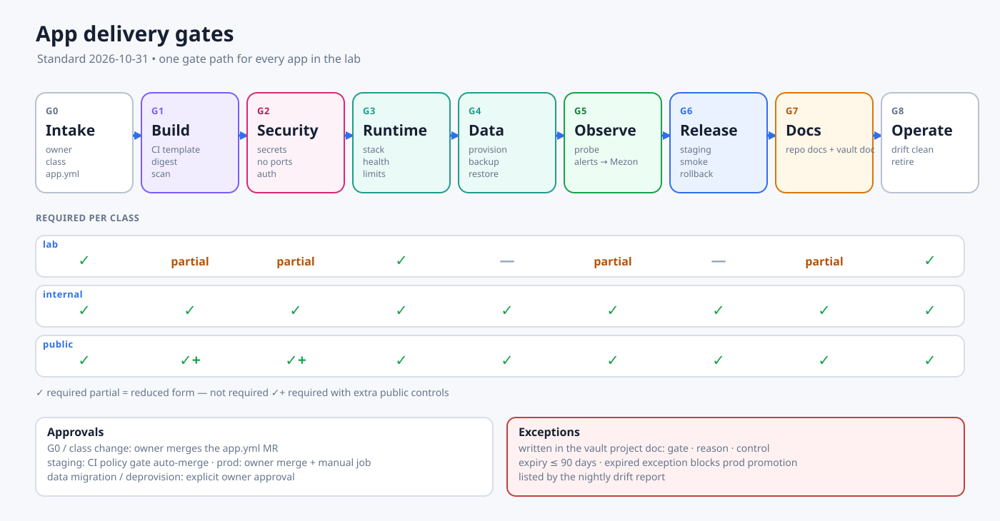

# App Delivery Gates

Every workload that runs in the lab passes the same gates. This covers our own projects and third-party apps such as n8n, Stirling PDF and GitLab. The gates are checked by CI wherever possible. When CI cannot check something, the evidence is recorded in the project's vault doc (see [Project documentation standard](./project-documentation.md)).

## 1. Classes

Choose one class at intake. It sets how strict the gates are.

| Class | Meaning | Exposure (`app.yml`) | Example |
|---|---|---|---|
| `lab` | Experiment or training. Data can be lost | `lan` or `private` only | kubekosh, k8s-syntax |
| `internal` | Real use by the owner/family; data matters | `lan` or `private` | db-management, CloudBeaver, Whiteboard |
| `public` | Reachable from the internet | `public` | homepage, MyPocket API, RelayHub |

Moving an app to a stricter class means passing the missing gates again before the route or exposure changes.

## 2. Gates

✅ = required, ◐ = required in reduced form, — = not required.

| Gate | What must be true | Evidence | lab | internal | public |
|---|---|---|---|---|---|
| **G0 Intake** | Owner, purpose and class are agreed. The repo exists on GitLab. A vault project doc stub exists. A draft `stacks/<app>/app.yml` exists | MR in `homelab-ops` + `docs/projects/<project>.md` | ✅ | ✅ | ✅ |
| **G1 Build** | CI includes `platform/ci-templates`, and tests and lint pass. The Dockerfile is multi-stage, runs as non-root and is built for the right arch (amd64 for VM100/VM110, arm64 for Pi5). The image is pushed to GitLab Registry and referenced **by digest**. Trivy finds no Critical. A High finding needs a backlog item | Green pipeline, digest, scan report | ◐ (no scan gate) | ✅ | ✅ + SBOM + cosign signature |
| **G2 Security** | Secrets live only in 1Password and Swarm secrets (`name_vN`). There are no secrets in the repo, image, env file or logs. No host ports. Every admin UI requires authentication. Renovate is enabled | CI secret scan + policy check | ◐ | ✅ | ✅ + VPS HostSNI entry reviewed, rate limit or auth on every write endpoint |
| **G3 Runtime contract** | A stack exists in `homelab-ops/stacks/<app>/` and is deployed only by CI. The service has a healthcheck, memory/CPU limits and reservations, and `update_config.failure_action: rollback`. Networks come only from `needs`. Placement follows the arch. The app logs to stdout and shuts down gracefully | Policy gate on the stack (see plan §3.5) | ✅ | ✅ | ✅ |
| **G4 Data & recovery** | Data needs are declared and provisioned by `db_provision`. Migrations are forward-only and tested on staging. A backup class is enrolled. **One successful restore** is recorded. RPO and RTO are stated | Backup receipt + restore record in the vault doc | — (declare "data may be lost") | ✅ | ✅ |
| **G5 Observability** | A health URL exists. A blackbox probe or metrics scrape is configured. Alerts go to Mezon. Logs are retained by the host default | Monitoring target generated from `app.yml` | ◐ (probe only) | ✅ | ✅ |
| **G6 Release** | The staging deploy passed the smoke script. Rollback (revert MR) has been rehearsed once. The release has a semver tag and notes | Pipeline receipts | — | ✅ | ✅ |
| **G7 Documentation** | The repo docs and the vault internal doc are both complete. Each links to the other, and the vault doc records the deployed repo revision | Doc checklist in [project-documentation.md](./project-documentation.md) | ◐ (stub) | ✅ | ✅ |
| **G8 Operate / retire** | The nightly drift report for the app is clean. To retire an app: final backup → `deprovision` job → remove route and DNS → mark the vault doc `retired` | Drift report, retirement MR | ✅ | ✅ | ✅ |

## 3. Who approves

| Change | Approver | How |
|---|---|---|
| G0 intake, class change | Lab owner | Merge of the `app.yml` MR |
| Staging deploy | CI (policy gate) | Auto-merge when every check is green |
| Prod deploy | Lab owner | Merge of the prod digest MR + manual `deploy:<app>:prod` job |
| Data migration, deprovision, restore into prod | Lab owner, explicitly | A manual job with a backup taken the same day |

## 4. Exceptions

Exceptions are allowed only when written down. Record each one in the project's vault doc under **Gate status** with:

- the gate it skips,
- the reason,
- the compensating control,
- an **expiry date** (at most 90 days).

The nightly drift report lists expired exceptions. An app with an expired exception cannot be promoted to prod until the exception is renewed or fixed.

## 5. Current apps (gate snapshot 2026-10-31)

Most running services were created by hand and predate these gates (see [STACK.md](../STACK.md)). Until each service is adopted into a stack (plan P0.5/P5), its vault doc shows the gates as `not assessed` or `fail`. Do not mark a gate as passed without evidence.
