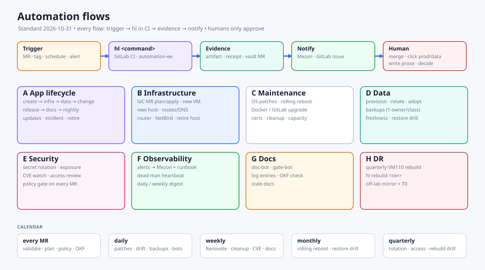

# Automation Flows

**Goal:** nothing in the lab is run by hand. Every flow has the same shape:

> **trigger** (MR, tag, schedule, alert) → **`hl <command>` in GitLab CI** → **evidence** (artifact, receipt, vault doc update) → **notification** (Mezon, GitLab issue)

People do only four things:

1. merge MRs;
2. click a manual job that touches prod or data;
3. write the human-authored parts of docs;
4. decide class and exceptions.

Everything else in this catalog is automatic. Execution model, runners and `hl` are described in the [IaC plan](../superpowers/plans/2026-10-31-lab-iac-automation-rebuild.md) §3.4.

## A. App lifecycle (one flow, ten stages)

| # | Stage | Trigger | Automated | Human |
|---|---|---|---|---|
| A1 | Create | `hl new app <name> --class <c>` | GitLab repo from a project template (CI include, Dockerfile, README/`docs/`), an MR with `app.yml` to `homelab-ops`, and a doc-stub MR to the vault | Merge |
| A2 | Infra for the app | `app.yml` merged | Generators: stack, Traefik route, HostSNI, DNS, networks, monitoring target. Data plan | — |
| A3 | Data | `provision:<app>` | DB/Redis/bucket, 1Password, Swarm secret `_vN`, Databasus job + first backup, vault *Data/Secrets* ([process](./database-provisioning.md)) | Click once |
| A4 | Change | Push to `main` | Build, scan, sign, push by digest; bot MR to `env/stg.yml` with auto-merge; staging deploy and smoke | — |
| A5 | Release | Tag `vX.Y.Z` | Bot MR to `env/prod.yml` (same digest). Migration job with a backup first | Approve + click |
| A6 | After deploy | Prod deploy done | Doc-bot updates deployed revision, digest and gates; `log.md` entry; Mezon | — |
| A7 | Nightly | Schedule | Drift, gate-bot, backup freshness, stale docs, expired exceptions → Mezon + GitLab issues | Handle issues |
| A8 | Updates | Renovate (weekly) | Dependency/base-image MRs. Patch updates for `lab`/`internal` go to staging automatically | Merge |
| A9 | Incident | Alert | Swarm auto-rollback on failed health. `rollback:<app>` button (revert MR). Runbook link in the alert | Decide |
| A10 | Retire | `lifecycle: retired` MR | Final backup → remove route and DNS → rename DB → vault doc marked retired | Confirm |

## B. Infrastructure

| Flow | Trigger | Automated | Human |
|---|---|---|---|
| B1 IaC change | MR in `tofu/` or `ansible/` | `hl plan` / `hl check --diff` commented on the MR, then the saved plan is applied | Merge + click apply |
| B2 New VM | MR adds a VM in `tofu/stacks/proxmox` | Clone the cloud-init template → `base`/`docker` roles → Swarm join with labels → node registered in monitoring and inventory | Merge + click |
| B3 New physical host | `hl bootstrap <host>` (first SSH with the break-glass key) | Create the `automation` user and key, base baseline, NetBird enrolment, then hand over to normal B1 runs | Run once at the console |
| B4 Route / domain | `routes/catalog.yml` or `app.yml` exposure | Render Pi5 Traefik file, VPS HostSNI allow-list, AdGuard rewrite and public DNS; publish in place; smoke both edges | Merge |
| B5 Router / firewall | MR in `tofu/stacks/network` | RouterOS plan → apply with an auto-revert safety window → connectivity probe | Merge + click |
| B6 Remote access | MR in `tofu/stacks/netbird` | Users, groups, policies, routes, setup keys | Merge |
| B7 Host retire | MR removes a host | Drain the Swarm node → remove from inventory/monitoring → tofu destroy behind `prevent_destroy` review | Merge + click |

## C. Maintenance

| Flow | Trigger | Automated | Human |
|---|---|---|---|
| C1 OS security patches | Daily (unattended-upgrades via `base`) | Security updates only. A "reboot required" flag is reported | — |
| C2 Rolling reboot / kernel | Monthly schedule | Ansible `serial: 1`: drain node → reboot → wait healthy → activate. Pi5 (manager + data) last, with a backup first | Click (prod) |
| C3 Docker engine upgrade | Version bump MR in `group_vars` | Rolling per node, same as C2. The version is pinned on every host | Merge + click |
| C4 Third-party images | Renovate / Diun | MR with the new digest → staging → prod like A5 | Merge + click |
| C5 GitLab upgrade | Version MR | Scripted stateful runbook: check the upgrade path → backup → scale to 0 → confirm exit → start new → health + runner smoke | Merge + click |
| C6 Certificates | Traefik ACME (DNS-01) renews on its own | Nightly expiry probe; alert when under 14 days | — |
| C7 Disk and cleanup | Weekly | Docker prune on hosts (images not in use, older than 7 days), registry GC, log rotation; alert at 80% disk | — |
| C8 Capacity | Nightly | CPU/RAM/disk trend per host plus Proxmox thin pool → weekly digest | — |

## D. Data

| Flow | Trigger | Automated | Human |
|---|---|---|---|
| D1 Provision / rotate / adopt / retire | See [database provisioning](./database-provisioning.md) | — | Click for data jobs |
| D2 Scheduled backups | One owner per class (db-management/Databasus for PG + CouchDB, role `backup` for GitLab, RustFS, Redis, configs, tofu state, GitLab registry directory) | Backup → verify → mark success | — |
| D3 Backup freshness | Nightly | Compare the last success per class with its RPO; a miss opens an issue and goes to Mezon | — |
| D4 Restore drill | Monthly | Restore each class into a scratch target, check the data, record the result | — |
| D5 Config snapshots | Nightly | MikroTik export, Proxmox config, tofu state (encrypted) → backup | — |

## E. Security

| Flow | Trigger | Automated | Human |
|---|---|---|---|
| E1 Secret rotation | Quarterly per class + on demand | `hl rotate` (new `_vN+1` → deploy → drop the old version) | Merge |
| E2 Exposure response | Secret scan hit / manual report | Revoke and rotate the affected credential, open an issue with the checklist | Confirm |
| E3 CVE watch | Weekly | Trivy over every running digest → issue per Critical/High with owner app | Fix MR |
| E4 Access review | Quarterly | Report of NetBird users/peers, GitLab members/tokens, 1Password SAs, SSH keys → issue | Review |
| E5 Policy gate | Every MR | Stack, route and secret rules ([gates](./app-delivery-gates.md)) | — |

## F. Observability and operations

| Flow | Trigger | Automated | Human |
|---|---|---|---|
| F1 Alerts | Alertmanager rules generated from `app.yml` and the host inventory | Route to Mezon with a runbook link | Respond |
| F2 Dead-man | VPS external heartbeat | Alert if the lab stops reporting | Respond |
| F3 Digest | Daily 08:00 and weekly | Mezon summary: deploys, drift, backups, CVEs, stale docs, open issues | Read |

## G. Docs and knowledge

| Flow | Trigger | Automated | Human |
|---|---|---|---|
| G1 Doc-bot | After deploy / provision / nightly | Rewrite only the `<!-- generated -->` blocks (Runtime, Data, Delivery, Gate status) of vault docs via MR. Human-written text is never touched | Merge (auto-merge when only generated blocks change) |
| G2 Gate-bot | Nightly | Evaluate G0–G8 from evidence and write the result to the vault docs | — |
| G3 Log | Deploy and provision receipts | Append an entry to `docs/log.md` | — |
| G4 OKF check | Every vault MR | Frontmatter `type`, reserved `index.md`/`log.md` format, broken links, indexes regenerated | — |
| G5 Stale docs | Weekly | List docs past `stale_after` → issue | Review + `verified` |

The vault syncs to Obsidian through LiveSync. Bots therefore never write to CouchDB directly. They open MRs on the vault's GitLab repo, and LiveSync picks up the merged result.

## H. Disaster recovery

| Flow | Trigger | Automated | Human |
|---|---|---|---|
| H1 Rebuild drill | Quarterly | Rebuild VM110 from scratch (tofu → ansible → stacks → restore) and record the duration | Click |
| H2 Full rebuild | Disaster | Tier order T0 → T3 with `hl rebuild <tier>`, from the off-lab mirror and the break-glass workstation | Run |

## Schedule calendar

| When | Flows |
|---|---|
| Every MR | Validate, plan/diff, policy gate, OKF check |
| Daily | C1 patches, A7/C8/D3 nightly checks, D2 backups, D5 snapshots, G1/G2 bots, F3 digest |
| Weekly | A8 Renovate, C7 cleanup, E3 CVE scan, G5 stale docs, F3 weekly digest |
| Monthly | C2 rolling reboot, D4 restore drill |
| Quarterly | E1 rotation, E4 access review, H1 rebuild drill |

## Build order

| Phase | Flows delivered |
|---|---|
| P0.5 | Drift (part of A7), backup freshness (D3) |
| P1 | B1, `hl`, D1 (`db_provision`), Semaphore retired |
| P2 | C1, C2, C3, C7, B2 |
| P3 | B4, C6 |
| P4 | A1–A6, A9, E5, registry cleanup + GC |
| **P4b** | G1–G5 doc-bot and gate-bot, F3 digest, issue automation |
| P5 | All apps on flow A, A8 Renovate, E3 |
| P6 | D2, D4, D5, H1 |
| P7 | B5, B6, E4 |
| P8 | Calendar running; 30 days with zero manual drift |
