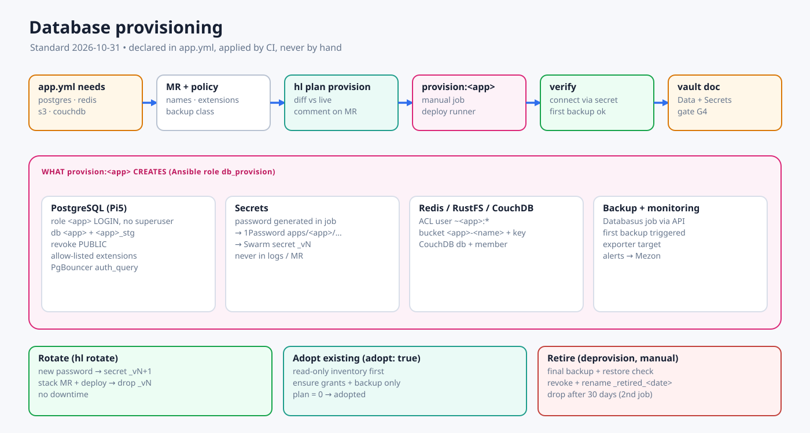

# Database Provisioning Process

**Today:** a database is created either by the Semaphore `db-provision` template, which calls the internal `homelab-provisioner` (Docker socket on Pi5), or by hand. Several steps stay manual in both paths: the Databasus job, the Swarm secret, the PgBouncer entry and monitoring. Semaphore is retired in plan P1. This document is the process that replaces both paths. Until P1 is done, the current steps are in [the DB provisioning runbook](../runbooks/db-provisioning.md).



## 1. Principles

1. **One declaration.** The app declares what it needs in `stacks/<app>/app.yml`. Nobody runs `CREATE DATABASE` by hand.
2. **One app, one identity.** Each app gets its own role and database (plus `_stg` when it has staging). Each app gets its own Redis ACL user and its own bucket. Apps never share credentials.
3. **The password is never seen.** It is generated inside the job, written straight to 1Password and to a versioned Swarm secret, and never printed to logs or MRs.
4. **Idempotent and plan-first.** The MR shows what will be created or changed. Apply converges to that state, and re-running it changes nothing.
5. **Never delete automatically.** Deletion goes through a separate manual job after a final backup has passed.
6. **Backup and monitoring belong to provisioning.** A database without a backup job is not provisioned.

## 2. Declaration

```yaml
# homelab-ops/stacks/<app>/app.yml
needs:
  postgres:
    databases: [main]          # → <app> and <app>_stg
    extensions: [pgvector]     # must be on the allow-list
    connection_limit: 20
    backup: postgres-daily     # backup class
  redis:
    acl: [read, write]         # → ACL user <app>, key prefix <app>:
  s3:
    buckets: [uploads]         # → RustFS bucket <app>-uploads + key pair
  couchdb:
    databases: []              # only for apps that need CouchDB
```

## 3. Flow

| Step | Where | What happens |
|---|---|---|
| 1. MR | `homelab-ops` | Add or change `needs`. The policy check validates names, the extension allow-list, the backup class and whether the target host has capacity |
| 2. Plan | CI `plan` runner (read-only) | `hl plan provision <app>` diffs the declaration against the live database: role, database, grants, extensions, Redis ACL, bucket, backup job. The result is commented on the MR |
| 3. Merge + apply | CI `deploy` runner, manual job `provision:<app>` | Runs Ansible role `db_provision` (see §4) |
| 4. Verify | Same job | Connects from a throwaway container on the app network using the new Swarm secret. Checks that the backup job exists and that its first backup succeeded |
| 5. Record | Vault | The project doc's *Data* and *Secrets* sections are updated (gate G4) |

## 4. What `db_provision` does

**PostgreSQL** (Pi5, through `community.postgresql`, connecting over the local socket on Pi5):

1. Generate a password and store it in 1Password at `homelab-prod/apps/<app>/postgres-<env>`.
2. `CREATE ROLE <app>[_stg] LOGIN NOSUPERUSER NOCREATEDB NOCREATEROLE CONNECTION LIMIT n`.
3. `CREATE DATABASE <app>[_stg] OWNER <role>`, `REVOKE ALL ON DATABASE … FROM PUBLIC`, and revoke `CREATE` on `public` from `PUBLIC`.
4. Create the extensions on the allow-list (`pgvector`, `pg_trgm`, `uuid-ossp`, `citext`). Anything else needs an exception.
5. PgBouncer uses `auth_query` through a dedicated `pgbouncer_auth` role, so no `userlist.txt` edit or reload is needed per app.
6. Create the Swarm secret `<app>_database_url_v<N>`, pointing at `pgbouncer:6432/<db>`.
7. Create the Databasus job through its API (Drive storage, the `Mezon Homelab` notifier, the class schedule), then trigger the first backup.
8. Add the database to the postgres-exporter target list.

**Redis:** create an ACL user `<app>` with a key pattern `~<app>:*`, store the password in 1Password and a Swarm secret, and persist it through `ACL SAVE`. Logical DB indexes are no longer used to separate apps.

**RustFS:** create the bucket `<app>-<name>` (versioning on for `internal`/`public` classes), a policy scoped to that bucket and an access key, then store them in 1Password and Swarm secrets. Enrol the bucket in the RustFS backup class.

**CouchDB:** create the database, add a member user with a password, then store it and enrol it in the db-management CouchDB adapter.

## 5. Rotation

`hl rotate <app> postgres` does the following:

1. Generate a new password and update the role.
2. Create the Swarm secret `_v<N+1>`.
3. Open a stack MR that switches the secret, then deploy.
4. Remove the `_v<N>` secret.

During the deploy the old password still works, so there is no downtime. Old sessions end when the old tasks stop.

## 6. Adopting existing databases

These databases were created by hand or through Semaphore:

`n8n`, `mypocket`, OCR, family-tree, `netbird`, `netbird_activity`, `netbird_idp`, `gitlabhq_production`, `relayhub*`, whiteboard, and CouchDB `homelab`/`obsidian_vault`.

1. Read-only inventory: list roles, databases, owners, grants and extensions (`hl inventory postgres`), plus Redis users and DB indexes, buckets and CouchDB databases.
2. Write them into each app's `app.yml` with `adopt: true`. Adopt mode only ensures grants and backup enrolment. It never recreates anything and never changes passwords.
3. A plan that shows 0 changes means the database is adopted. After that, passwords are rotated into 1Password one app at a time (§5).
4. Legacy databases with no app (for example `bds_prod`, `relayhub_v1_staging_20261030`) are listed for an explicit keep, rename or retire decision.

## 7. Retirement

`deprovision:<app>` is a manual job and needs the owner's approval:

1. Take a final backup and verify it with a restore check.
2. `REVOKE CONNECT`, then rename the database to `<db>_retired_<YYYYMMDD>`. The role becomes `NOLOGIN`.
3. Remove the Swarm secrets, mark the 1Password item archived and disable the backup job. The last backup is kept under the retention policy.
4. After 30 days, a second manual job drops the renamed database and the role.

## 8. Where this lands in the plan

| Phase | Deliverable |
|---|---|
| P0.5 | Read-only inventory of every existing database, user and bucket, recorded in the project docs |
| P1 | `db_provision` role + `hl plan/apply provision`. Replaces the Semaphore template and the provisioner (which mounts the Docker socket) |
| P4 | Databasus API enrolment, PgBouncer `auth_query`, generator wiring from `app.yml` |
| P5 | Adopt every existing database (`adopt: true`), then rotate credentials into 1Password |
