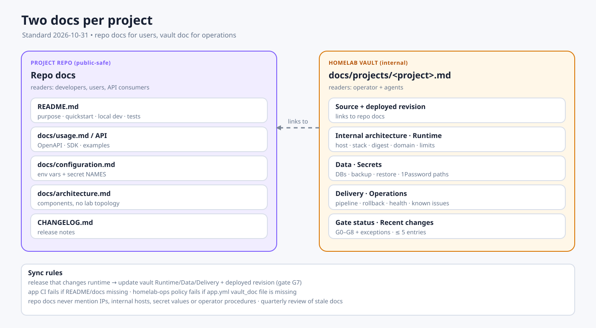

# Project Documentation Standard

Every project under `/home/dungxbuif/workspace/projects/` has **two** maintained documents. They have different readers and must not be copies of each other.

| | Repo docs | Vault internal doc |
|---|---|---|
| Location | `<repo>/README.md` + `<repo>/docs/` | `docs/projects/<project>.md` in this vault |
| Reader | Developers, users, API consumers | The operator and agents running the lab |
| Content | What it is, how to use it, how to develop it | How it runs here, what it depends on, how to recover it |
| Safe to publish | Yes, nothing about lab internals | No, internal only |
| Updated by | The project MR that changes behavior | The release that changes runtime, and the operator after any incident |

## 1. Repo docs (public-safe)

Required for every project:

- `README.md`: purpose, status, quickstart, local development, test command, link to `docs/`.
- `docs/` (required for `internal`/`public` classes):
  - `usage.md` or the API reference (OpenAPI/SDK)
  - `configuration.md`: every env var and secret **name**, with meaning and default
  - `architecture.md`: the component view without lab topology
  - `CHANGELOG.md` (or release notes)

**Never** put the following in repo docs: lab IPs and hostnames, internal domains that are not public, secret values or 1Password paths, backup locations, server paths, operator procedures, or internal component names that the product docs intentionally hide (the RelayHub pattern).

## 2. Vault internal doc

Create the doc from [the template](../projects/_TEMPLATE.md). Sections, in order:

1. **Summary**: one paragraph, plus the class, owner and `lifecycle` (`active`, `lab`, `paused`, `retired`, `not deployed`). Frontmatter follows the [OKF v0.2 profile](../OKF_SPEC.md); `status` is reserved for the document's own state.
2. **Source**: repo path, GitLab project, default branch, a link to the repo docs, and the **deployed revision**.
3. **Internal architecture**: what the repo docs leave out.
4. **Runtime**: host, stack and services, image digest, networks, domain and exposure, resource limits.
5. **Data**: databases, buckets and volumes, backup class, last restore evidence, RPO/RTO.
6. **Secrets**: names and 1Password item paths only.
7. **Delivery**: CI pipeline, staging and prod, how to roll back.
8. **Operations**: health URL, logs, known failure modes and their fixes.
9. **Gate status**: the table from [App Delivery Gates](./app-delivery-gates.md), with exceptions and expiry dates.
10. **Recent changes**: at most 5 entries. Older history lives in git, not here.

Levels:

| Project state | Required level |
|---|---|
| Deployed (`lab`/`internal`/`public`) | Full doc, every section |
| Not deployed (study, challenge, library, paused) | Stub: Summary, Source, status, and a one-line reason why it does not run |

## 3. Keeping the two in sync

- **G7 gate:** a release that changes runtime behavior updates the vault doc's *Runtime*, *Data* or *Delivery* sections and the deployed revision in the same change window.
- The app CI template fails when `README.md` or `docs/` is missing for `internal`/`public` classes.
- In `homelab-ops`, `app.yml` points to `vault_doc: docs/projects/<project>.md`. The policy check fails when the file is missing.
- The vault doc links to the repo docs. The repo docs never link to the vault, which is private.
- After an incident, the operator updates *Operations* within the same day.
- `stale_after` is set to 90 days after `generated.at`. Stale docs are reviewed and re-verified (`verified: {by: human:dungxbuif}`).

## 4. Third-party apps

Apps we run but do not develop (GitLab, n8n, Stirling PDF, NetBird, Databasus, CloudBeaver, kubekosh) have no repo docs of ours. They get a vault internal doc only, under `docs/services/<app>.md`, with the same sections. *Source* points to the upstream project and the pinned version.
