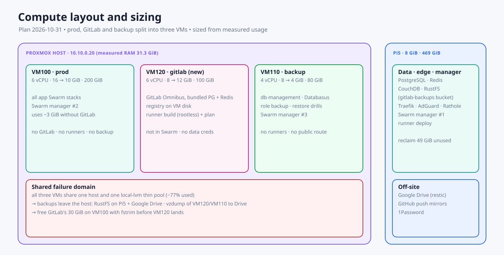

# Compute layout and resource sizing

The owner delegated this decision on 2026-10-31. The numbers below come from a read-only sample taken that day[^usage-2026-10-31]. **The Proxmox host's RAM, CPU and thin-pool capacity are still unknown**, so every number here must be checked against the host (step R0) before anything is resized.

## 0. Measured host (2026-10-31) — supersedes the sizing guesses below

Measured with the existing Proxmox API token, GET requests only.

| Item | Measured |
|---|---|
| Node `pve` (PVE 8.3.5) | 12 vCPU, **31.3 GiB RAM, 24.9 GiB in use** (VM100 16 + VM110 8, ballooning off) |
| `local-lvm` thin pool | 364.8 GiB total, 289.5 GiB used, **75.3 GiB free** |
| VMs | Only 100, 110 and template 9000 (present, stopped). VM id 120 is free. `10.10.0.33` does not answer ping |

**Consequence.** VM120 at 12 GiB cannot start: only about 6.4 GiB of RAM is free. The "host below 32 GiB" row of the fallback table applied, but actual use is low, so the split still works with resizing:

| Step | VM100 | VM120 | VM110 |
|---|---|---|---|
| Today | 16 GiB | n/a | 8 GiB |
| Before VM120 starts | 16 | n/a | **8 → 4 GiB** (db-management restarts, about 5 minutes) |
| VM120 created | 16 | **8 GiB**, 100 GiB disk | 4 |
| After the GitLab cutover | **16 → 10 GiB** (reboot window) | 8 → 12 GiB | 4 |

End state is 10 + 12 + 4 = 26 GiB for guests plus about 2 GiB for the host. VM110 uses under 2 GiB today, VM100 about 7 GiB with GitLab (5 GiB) and about 2 GiB without it.

**What fills the disks** (audit, read-only):

| Where | Finding |
|---|---|
| VM100 (115 GiB used of 194) | `/var/lib/containerd` **66 GiB**: 53 images (51.5 GB, 12.9 GB unused) and container layers, so it is images, not data. Two Ollama images (9.2 GB `0.34.0` unused, 8.5 GB `0.40.13` in use) and duplicate n8n images. `/opt/apps` 25 GiB (GitLab 17 GiB, of which the registry is 14 GiB). `/swapfile` 8 GiB. `/home` 6.3 GiB (`/home/homelab-ci/.local` 4.9 GiB of CI leftovers) |
| VM110 | The `db-management-backups` volume holds 18.2 GB of local export staging; the copies that count are on Drive |
| Thin pool | VM100's logical volume is fully allocated (200 GiB) although the guest uses 115 GiB. `discard=on` is set, so `fstrim` can return roughly 80 GiB. VM110 has no `discard`, so its space never returns |

Reclaiming (R1 below) is what makes room for VM120, and each item needs approval: `docker image prune` of unused images on VM100 (up to 12.9 GB), `fstrim` on VM100, reviewing `/home/homelab-ci/.local` and the VM110 staging volume.

**Import plans** (`tofu plan`, read only, ephemeral state): VM100 shows 1 import and 1 in-place change (the cloud-init SSH keys in the module differ from the VM), so the module must be aligned before any apply. VM110 shows a **destroy and create** (stopped only by `prevent_destroy`), most likely because of the `clone` block; the module must ignore it before import. VM120 shows a clean create. Do not apply either import until each plan is zero-diff.

## 1. Measured usage (2026-10-31)

| Machine | Allocated | RAM in use | CPU | Disk | Biggest consumers |
|---|---|---|---|---|---|
| VM100 | 6 vCPU · 16 GiB · 200 GiB | ~7 GiB (8 GiB available), swap 0 | load ~3.0 | 128 GiB used (66%) | GitLab **5.0 GiB** RAM, `/opt/apps/gitlab` **30 GiB** (14 GiB registry + ~14 GiB repos/DB-less data). Docker images 51 GiB (10.7 GiB reclaimable). kubekosh 1.2 GiB / 13% CPU, whiteboard-collab 12% CPU |
| VM110 | 4 vCPU · 8 GiB · 80 GiB | < 2 GiB (6 GiB available), no swap | load 0.1 | 51 GiB used (65%) | Docker volumes 23 GiB (Databasus/db-management staging), images 27 GiB (10.5 GiB reclaimable). db-management worker 1.3 GiB |
| Pi5 | 4 CPU · 8 GiB · 469 GiB NVMe | ~4 GiB (3 GiB available) | load 0.5 | 187 GiB used (42%) | CouchDB 2.0 GiB, PostgreSQL 0.5 GiB. **49 GiB reclaimable** (23.9 GiB unused images + 25.5 GiB build cache) |
| Proxmox host | unknown | unknown | unknown | `local-lvm` thin pool ~77% used at VM110 creation (~85 GiB free then, less now) | — |

Takeaways:

- GitLab is the largest consumer on VM100 by far: 5 GiB of RAM in use and 30 GiB of disk.
- VM110 is mostly idle. It only needs more resources while a restore drill runs.
- VM100's load of ~3 is CPU, not memory: kubekosh (an embedded K3s) and whiteboard-collab. This should be revisited when kubekosh is made LAN-only or retired.

## 2. Target layout

| Machine | Role | Runs | Never runs |
|---|---|---|---|
| **VM100 · prod** | Production apps | Every app Swarm stack. Swarm manager #2 | GitLab, CI runners, backup jobs |
| **VM120 · gitlab** (new) | Control plane | GitLab Omnibus with bundled PostgreSQL and Redis, registry on the VM disk. Runner `build` (rootless) and runner `plan`. Compose managed by Ansible, not in Swarm | Prod apps, data credentials |
| **VM110 · backup** | Backup and DB operations | db-management, Databasus, CloudBeaver, role `backup`, restore-drill sandbox. Swarm manager #3 | CI runners, public routes |
| **Pi5** | Data, edge, manager | PostgreSQL, Redis, CouchDB, RustFS, Traefik, AdGuard, Rathole. Swarm manager #1. Runner `deploy` | App compute |

Rules:

- **No CI runner on VM110.** It holds read credentials to every database and to Drive.
- **Backups never stay inside the Proxmox host.** All three VMs share one host and one `local-lvm`, so backups go to RustFS on Pi5 and to Google Drive.
- Making Pi5, VM100 and VM110 all Swarm managers keeps Swarm manageable if Pi5 is lost.

## 3. Sizing (recommended)

| VM | vCPU | RAM | Disk | Rationale |
|---|---|---|---|---|
| **VM120 gitlab** | 6 | **12 GiB** | **150 GiB** | GitLab uses 5 GiB today. Bundled PostgreSQL and Redis add ~1.5 GiB, so GitLab needs about 8 GiB. The build runner gets up to 4 GiB (concurrency 2). Disk: ~14 GiB of repos and data, plus the registry kept on this disk (14 GiB today, target < 25 GiB after GC), plus a staging area for 2× the native backup, plus OS and images, plus growth |
| **VM100 prod** | 6 | **16 → 12 GiB** | 200 GiB (unchanged) | Without GitLab, apps use ~3 GiB, but the sum of their limits is higher (CouchLoom Ollama 4 GiB, stirling, n8n, openclaw 2 GiB each). 12 GiB plus the existing 8 GiB swap leaves headroom. **The disk is not shrunk**, because shrinking a Proxmox disk is risky. The 30 GiB that GitLab frees is returned to the thin pool with `fstrim` |
| **VM110 backup** | 4 | **8 → 12 GiB** | 80 GiB + **scratch disk 100 GiB** | Daily work needs < 2 GiB. A GitLab restore drill needs ~8 GiB, and database restores need scratch space. The scratch disk is attached only during a drill, or kept thin and trimmed after each drill |
| Pi5 | — | 8 GiB (fixed) | 469 GiB | Reclaim 49 GiB of unused images and build cache. The 14 GiB registry bucket fits easily |

**Total VM RAM ≈ 36 GiB**, plus 4 GiB for the host itself, so the host needs **≥ 40 GiB**.

Fallbacks once the host is measured:

| Host RAM | Decision |
|---|---|
| ≥ 48 GiB | As in the table |
| 40–47 GiB | VM110 stays at 8 GiB. GitLab drills run in a throwaway VM created by tofu, or on the workstation |
| 32–39 GiB | VM120 10 GiB (build runner concurrency 1), VM100 12 GiB, VM110 8 GiB. GitLab drills on the workstation |
| < 32 GiB | **Do not split GitLab out.** Keep it on VM100, but move it to bundled PostgreSQL and Redis (registry on RustFS if VM100's disk is tight), and buy RAM or a second host later |

**Thin-pool check:** VM120's real footprint is about 40 GiB (data, registry, OS and images). It only fits if VM100's freed GitLab space is trimmed first, or if the pool has at least 55 GiB free. If not, use the RustFS fallback for the registry. The VM110 scratch disk must not permanently consume pool space.

## 4. Re-allocation steps

| Step | Action | Runtime impact | Prerequisite |
|---|---|---|---|
| R0 | Measure the Proxmox host (RAM, CPU, `pvesm status`, `lvs` thin pool) and pick the matching sizing row | None | Proxmox read-only API token or SSH |
| R1 | Reclaim space without touching services: Docker prune of unused images on VM100 (10.7 GiB) and Pi5 (49 GiB), `fstrim` on VM100 | None (unused images only) | Approval for the prune |
| R2 | GitLab G1 backup and G2 verified restore drill ([GitLab plan](./2026-10-31-gitlab-protection-and-registry-consolidation.md)) | I/O only | — |
| R3 | Create VM120 with tofu (6/12/150) and configure it with Ansible | None on prod | R0 |
| R4 | Migrate GitLab to VM120 with its registry (drill #2, cutover ~30 min) | GitLab read-only window | R2, R3 |
| R5 | After 14 stable days: delete the old GitLab data on VM100, run `fstrim` | None | R4 |
| R6 | Resize VM100 RAM 16 → 12 GiB | **VM100 reboot, so every prod app is down for ~5 min.** Needs a window | R5 |
| R7 | Resize VM110 RAM 8 → 12 GiB and add the scratch disk | VM110 reboot (db-management ~5 min) | R0 |
| R8 | Promote VM100 and VM110 to Swarm managers (3 managers) | No restart. Raft rejoin | Docker versions aligned (P2) |

All resizes go through `tofu/stacks/proxmox` MRs (plan → manual apply), never through the Proxmox UI.

## 5. Watch after re-allocation

- Per-VM RAM, CPU and disk trends are in the weekly digest. The alert threshold is 85% RAM or 80% disk.
- After 30 days: if VM100 stays under 6 GiB, keep 12 GiB. If GitLab plus the runner stay under 8 GiB, consider 10 GiB for VM120.

[^usage-2026-10-31]: Read-only `free`, `df`, `docker stats --no-stream`, `docker system df` and `du` on VM100, VM110 and Pi5, 2026-10-31.
