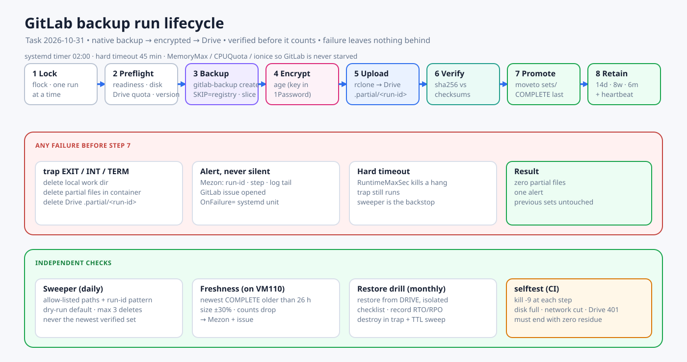

# GitLab Production Task

GitLab is the lab's control plane: source, CI/CD, the only registry and the place infrastructure changes are applied from. This task makes it production-grade. **Nothing in it may be started on the live GitLab without the approvals marked 🔴.**

Parent plans: [GitLab protection](./2026-10-31-gitlab-protection-and-registry-consolidation.md), [compute layout](./2026-10-31-compute-layout-and-sizing.md), [IaC rebuild](./2026-10-31-lab-iac-automation-rebuild.md).

## 1. What the audit found[^audit-2026-10-31]

| Finding | Consequence for this task |
|---|---|
| GitLab's real data is small: `git-data` 463 MiB, artifacts 59 MiB, uploads 60 KiB, LFS and packages empty. The registry is 14 GiB | A native backup **without the registry** is about 1 GiB plus the database, so it can run daily and fit on Drive. The registry is handled as a separate, incremental class |
| `/opt/apps/gitlab/data/backups/` held a **14.3 GB `registry.tar.gz`** left by the backup stopped on 2026-10-30, plus small partial files | This is the junk the new design must make impossible. **The 14.3 GB archive was deleted on 2026-10-31 with the owner's approval** (VM100 disk 66% → 59%). The small partial files (about 17 MiB) remain until the new sweeper removes them. The live registry was **not** touched: it holds images that running services use (`homepage`, `relayhub`, `db-management` api/web/worker, `homelab-ops/provisioner`, `homelab-automation/*`, `root/registry-trial`) |
| `homelab-ops/automation/gitlab-backup/run-gitlab-backup.sh` already takes a native archive, a config/secrets archive, a registry archive, a manifest and checksums | Reuse it as the base. It **lacks** a lock, preflight, an exit trap that cleans up, upload, verification of the upload, retention and a schedule. It includes the 14 GiB registry tar on every run |
| An rclone remote `homelab1` (type `drive`) exists on VM100 (`/etc/homelab-backup/secrets/rclone.conf`). **Verified 2026-10-31: the token works. The account has 2 TiB, of which 1.23 TiB is free.** BACKLOG R4 still records a Drive OAuth 401 for Databasus, which is a separate credential | Quota is not a constraint. The rclone remote can be reused; the scope should still be narrowed to `drive.file` for the backup folder |
| GitLab uses the Pi5 database and Redis. The Pi5 LAN `:5432` maps to PgBouncer, and GitLab needs direct PostgreSQL. VM120 will sit outside the Swarm overlay | VM120 cannot reach them, so it uses **bundled PostgreSQL and Redis**. The migration therefore restores into a new database engine, which is why it is rehearsed twice |
| The Proxmox module for VM100 sets `protection = false` and the state is local. Whether `tofu import` was ever applied is **unproven** | T1 makes `tofu plan` show zero changes before anything is modified |
| No access to Proxmox yet | T0 and everything on the hypervisor is **blocked** until access is given |

## 2. Hard requirements

1. **Every VM is controlled by OpenTofu.** VM100, VM110 and VM120 are managed in `tofu/stacks/proxmox`. Any change (CPU, RAM, disk, tags) goes through an MR and a saved plan. Nobody resizes in the Proxmox UI.
2. **GitLab moves to its own VM safely.** Same version on both sides, a restore rehearsal before the cutover, a written go/no-go and a tested rollback.
3. **Native backups run on a schedule and reach Google Drive.** The backup is made by GitLab's own `gitlab-backup`. GitLab's built-in uploader does not support Google Drive (it supports S3, Google Cloud Storage and Azure), so the archive is uploaded to Drive with rclone.
4. **A failed job must never leave waste.** A failure leaves no partial archive on disk, in the container, or on Drive. A failure is never silent.
5. **A backup only counts after it is verified**, and the whole set is restored from Drive at least monthly.
6. **GitLab stays up.** The backup runs under resource limits and cannot starve GitLab.

## 3. IaC for the VMs

| Item | Design |
|---|---|
| Stack | `tofu/stacks/proxmox` with a `proxmox-vm` module. VM100 and VM110 are adopted with `import` blocks, VM120 is new, plus a `drill` module for throwaway VMs |
| First rule | **Import before change.** `tofu plan` must show 0 changes for VM100 and VM110 before any resize is merged |
| Protection | `protection = true` (Proxmox delete protection) **and** `prevent_destroy` on VM100, VM110 and VM120. Tags: `prod`, `control-plane`, `backup`, `ephemeral` |
| Sizing as data | CPU, RAM and disk sit in `vms.auto.tfvars`. The CI policy reads the plan JSON and **fails the MR on any `delete` or `replace` of a VM, and on a disk that shrinks** |
| Restart awareness | A memory change needs a VM restart. The plan comment lists "restart required" and the apply job is manual, with a window |
| State | Encrypted state on RustFS S3 with locking (plan P1). Until then, an encrypted copy goes to Drive after every apply |
| Drift | Nightly `tofu plan -detailed-exitcode` on the stack, reported to Mezon |
| Tokens | Plan runner: Proxmox `PVEAuditor` (read-only). Apply runner: a token limited to `/vms`, the datastore and the bridge. Both live in 1Password |

## 4. The backup design

### 4.1 What is produced per run

`gitlab-backup create BACKUP=<run-id> STRATEGY=copy SKIP=registry CRON=1`, followed by `gitlab-ctl backup-etc`.

| Artifact | Content | Encrypted |
|---|---|---|
| `<run-id>_gitlab_backup.tar` | Database, repositories, uploads, artifacts, LFS, CI | yes (age) |
| `gitlab_config_<run-id>.tar` | `gitlab.rb` and `gitlab-secrets.json` (without it the backup cannot be decrypted) | yes (age) |
| `manifest.json` | GitLab and PostgreSQL versions, project and repository counts, sizes (no secrets) | no |
| `checksums.sha256`, `COMPLETE` | Integrity markers, `COMPLETE` is written last | no |
| Registry | **Separate class**: restic incremental of the registry directory, run weekly, plus before any upgrade | yes (restic) |

Encryption: archives hold source code and secrets and sit on a third-party service, so they are encrypted with `age` before upload. The private key is in 1Password and in the break-glass kit, never on the GitLab VM.

### 4.2 Run lifecycle (every step must be safe to abort)

| # | Step | Rule |
|---|---|---|
| 1 | Lock | `flock` on one lock file. A second run exits immediately without touching anything |
| 2 | Preflight | GitLab `/-/readiness` is OK. Free disk ≥ 2.5 × the last successful size. Drive reachable with enough quota (`rclone about`). Version equals the expected version. No upgrade or restore in progress. Any failure ends the run **before** anything is created |
| 3 | Backup | Runs inside a systemd slice (`MemoryMax`, `CPUQuota`, `IOWeight` low, `nice`/`ionice`) at 02:00, with a hard timeout of 45 minutes |
| 4 | Encrypt | `age` over each artifact |
| 5 | Upload to staging | `rclone copy` to `…/gitlab/.partial/<run-id>/` |
| 6 | Verify | `rclone check --download` or sha256 compare of every file against `checksums.sha256` |
| 7 | Promote | `rclone moveto` from `.partial/<run-id>` to `…/gitlab/sets/<run-id>/`, then write `COMPLETE` last |
| 8 | Local tidy | Delete local artifacts after step 7 succeeded, keep the newest 2 |
| 9 | Retention | See §4.4 |
| 10 | Heartbeat | Write the success marker and ping the external heartbeat |

### 4.3 Failure handling: no junk, no silence

| Mechanism | Behaviour |
|---|---|
| `trap … EXIT INT TERM` | On **any** exit path before step 7: remove the local working directory, remove partial files that `gitlab-backup` created inside the container (`/var/opt/gitlab/backups/<run-id>*`), delete the remote `.partial/<run-id>` directory |
| Hard timeout | `TimeoutStartSec` kills a hung run (`RuntimeMaxSec` is ignored for oneshot units), and the trap still runs. The in-container `timeout 2700` also bounds `gitlab-backup` itself |
| Sweeper (separate daily unit) | Deletes anything older than 24 h in `.partial/`, stale `.incomplete` directories and orphaned `*_gitlab_backup.tar` locally and in the container. It only touches **allow-listed paths that match the run-id pattern** and refuses to run if the path does not match |
| Delete guard | The sweeper and retention are dry-run by default, delete at most 3 sets per run, and never delete the newest verified set |
| `OnFailure=` | A failing unit sends Mezon the run-id, the failed step and a log tail (no secrets) and opens a GitLab issue |
| Freshness check | A second job on **another host (VM110)** alerts when the newest `COMPLETE` set is older than 26 h, when its size changes by more than ±30%, or when the manifest counts drop |
| Fault-injection test | `selftest` kills the run with `kill -9` at each step, fills the disk, cuts the network during upload and simulates a Drive 401. **The acceptance test is that every case ends with zero residue and one alert** |

The same rules apply to restore drills: a drill VM or container is always destroyed in a `trap`/`after_script`, and VMs tagged `ephemeral` older than 6 h are removed by the sweeper.

### 4.4 Retention on Drive

Keep 14 daily, 8 weekly and 6 monthly sets, plus the last set before any upgrade. Retention is computed from verified-complete sets only and never reduces the number of verified sets below 7. Drive's trash (30 days) is a last safety net. The rclone token uses the `drive.file` scope, restricted to files the backup created.

## 5. Task breakdown

Legend: 🟢 no runtime impact · 🟡 touches runtime, no restart · 🔴 restart, outage or data change, needs written approval.

| # | Task | Type | Depends on | Done when |
|---|---|---|---|---|
| **T0** | Get Proxmox access (read-only token + SSH). Verify the Drive remote and quota. Measure host RAM, CPU and thin pool | 🟢 | Owner | Numbers recorded, sizing row chosen |
| **T1** | Bring VM100 and VM110 under tofu: import, `plan` = 0, set `protection` and tags, move state to the encrypted backend, add the plan-JSON policy | 🟡 | T0 | `plan` shows 0 changes in CI. Nightly drift runs. **Partly written 2026-10-31**: the plan-JSON policy and the VM120 module exist (§10); importing VM100 and VM110 still needs Proxmox access |
| **T2** | Rewrite the backup tooling in `homelab-ops` (role `gitlab_backup`): lock, preflight, trap, age, upload to `.partial`, verify, promote, retention, sweeper, freshness job, systemd units, `selftest` | 🟢 | — | **Code written 2026-10-31** (see §10). Still to do: run against a real GitLab, with real `age` and rclone, in T4/T5 |
| **T3** | Remove the existing junk: the 14 GiB `registry.tar.gz` and partial files in `/opt/apps/gitlab/data/backups/` | 🔴 | Approval | **Partly done 2026-10-31**: archive deleted (approved), 14 GB reclaimed. Small partials are left for the sweeper |
| **T4** | Deploy T2 on VM100 and run the first full backup to Drive | 🟡 | T2, T3 | **Done 2026-10-31**: tooling deployed with Ansible (check mode first), set `20261031T062156Z` on Drive, checksums verified, decrypted with the 1Password key. The timer is installed but **disabled**; scheduling waits for the owner |
| **T5** | Restore drill #1 from **Drive** in an isolated instance (no outbound network, mirrors, webhooks, email or runners). Run the checklist | 🟢 | T4 | Drill passes. RTO and RPO recorded |
| **T6** | Create VM120 with tofu (6 vCPU, 12 GiB, 150 GiB) and configure it with Ansible: Docker, GitLab Omnibus (same version, bundled PostgreSQL and Redis, local registry), runner, tunnel clients (not started), monitoring | 🟢 | T1, T0 | VM120 healthy and empty, `plan` = 0 |
| **T7** | Rehearsal: restore the latest Drive set into VM120, verify everything, time it. Traffic is not switched | 🟢 | T5, T6 | Rehearsal passes. Cutover duration known |
| **T8** | **Cutover** (see §6) | 🔴 | T7, approval | GitLab serves from VM120 |
| **T9** | Soak for 14 days. Scheduled backups run from VM120. Drill #3 from Drive after cutover | 🟡 | T8 | 14 days with no incident, 14 verified sets, drill passes |
| **T10** | Decommission: delete GitLab data on VM100, `fstrim`, then resize VM100 and VM110 per the compute plan | 🔴 | T9, approval | VM100 freed, `plan` = 0 |
| **T11** | Registry hygiene: metadata DB, online GC, cleanup policy, weekly restic of the registry directory | 🟡 | T8 | Registry under 25 GiB, restic restore tested |
| **T12** | Docs and gates: update `services/gitlab.md`, `STACK.md`, `STATUS.md`, `BACKLOG.md`, `log.md` | 🟢 | each step | Gates G3 to G5 evidenced |

Order: T0 → T1 and T2 in parallel → T3 → T4 → T5 → T6 → T7 → T8 → T9 → T10. **T4 and T5 must pass before any other change to the live GitLab.** No GitLab upgrade (U0) happens during this task.

Rough duration: T0 1 day (waiting on access), T1 1–2 days, T2 3–4 days, T4 and T5 2 days, T6 and T7 3–4 days, T8 half a day, T9 14 days.

## 6. Cutover runbook (T8)

**Go criteria (all required):** T5 and T7 passed, the newest Drive set is under 24 h old, free space and VM120 health are fine, the three tunnel clients on VM120 are configured, rollback has been rehearsed on paper, and the owner approves in writing.

1. Pause the VM100 runner and cancel running pipelines. Announce the window.
2. Enable GitLab **maintenance mode** (read-only) on the old instance.
3. Take a final backup and verify it (same lifecycle, tagged `pre-cutover`). Keep a copy outside the host.
4. Restore it into VM120 and run the verification checklist (§7).
5. **Abort point A:** if any check fails, disable maintenance mode on the old instance and stop. Nothing else was changed.
6. Stop the three tunnel clients on VM100 and start the three on VM120. The domain, the VPS Rathole servers and the Git SSH port `2222` do not change.
7. Smoke test: web login, `git clone` and `git push` over HTTPS and SSH, CI pipeline on VM120's runner, `docker pull` from the registry, API with a PAT.
8. **Abort point B:** if a check fails, stop the VM120 clients, restart the VM100 clients and disable maintenance mode on the old instance. Writes made on VM120 are lost, so this is only allowed within the first hour.
9. Disable maintenance mode on VM120. Re-enable the runner. Post the receipt to Mezon.
10. Keep the old stack scaled to 0 with its data for 14 days. After the first hour on VM120, rollback means exporting new data first, and is a separate decision.

## 7. Verification checklist (used by T5, T7, T8 and the monthly drill)

- `gitlab-rake gitlab:check` and `gitlab:doctor:secrets` are clean.
- Project and repository counts match `manifest.json`.
- Three sample repositories clone and the HEAD sha matches.
- CI variables decrypt (a pipeline that reads a protected variable passes).
- A runner picks up a job.
- One registry digest pulls.
- Login works, including 2FA and a PAT API call.
- The GitLab version equals the manifest version.

## 8. Definition of done (production-grade)

| Area | Evidence |
|---|---|
| IaC | VM100, VM110 and VM120 in tofu with `plan` = 0 and a nightly drift report. No VM change outside an MR |
| Backup | 14 consecutive daily sets on Drive, each verified. Retention working. Registry class running weekly |
| Failure safety | The fault-injection `selftest` passes with zero residue. A real injected failure alerted Mezon and left nothing behind |
| Restore | A restore from Drive passed at least twice. RTO ≤ 2 h and RPO ≤ 24 h measured |
| Migration | GitLab runs on VM120. The old data is kept for 14 days and then removed with approval |
| Monitoring | Probes for readiness, SSH `:2222`, registry `/v2/`, runner heartbeat, disk and backup freshness, all alerting to Mezon |
| Docs | `services/gitlab.md` shows G3 to G5 as pass with evidence |

## 9. Result of T4 (2026-10-31) and what is still open

The first real backup ran on VM100 under the owner's approval.

| Check | Result |
|---|---|
| Duration and size | About 3 minutes; set of 455 MB, 38 repositories; GitLab stayed ready (readiness 200 throughout) |
| Upload verification | `rclone check --download`: 0 differences. SHA256 of the files re-downloaded from Drive matches `checksums.sha256` |
| Residue | `.partial` is empty, the container backup directory is empty (the old staging was cleaned), only one encrypted copy is kept locally |
| Decryption | The 1Password key decrypts both archives. The native archive holds 38 bundles and a 35.9 MB database dump with the `projects` table; the config archive holds `gitlab-secrets.json` and `gitlab.rb` |
| Sweeper and freshness | Run read-only against the real Drive: nothing to delete, freshness OK |
| Real-run bug found | `RuntimeMaxSec` is ignored for `Type=oneshot`; replaced by `TimeoutStartSec` and redeployed (`d92b74d`) |

This proves the backup is **recoverable in content**. It is not yet a restore: T5 must load it into an isolated GitLab and run the checklist.

Still open before this task can be called production-grade:

| Open item | Why |
|---|---|
| Enable the timer | Daily 02:00 runs; a decision for the owner because it changes the schedule on a production host |
| T5 full restore drill | Only a restore into an isolated instance proves RTO and RPO |
| Freshness job on a second host | Needs the Drive config on VM110; today the check runs on VM100 only |
| Registry backup class | Not covered by this set; restic weekly, to be built |
| T1, T6 to T8 | VM100 and VM110 import into tofu and VM120 need Proxmox access |
| Recovery secrets | Confirm `restic-password` and `rclone.conf` are also in 1Password (see [secrets standard](/docs/standards/secrets-1password.md)) |

## 9b. What blocked production earlier

The code, tests and read-only checks are done. A production-grade GitLab still needs actions that change the live system, which are not taken without the owner:

| Step | What it changes | Needs |
|---|---|---|
| T4 deploy and first backup | Install `age` on VM100, add files under `/opt/apps/homelab-gitlab-backup` and `/etc/homelab-gitlab-backup`, run one backup that puts I/O load on GitLab | **Done** (approved by the owner) |
| T5 restore drill | Needs the backup from T4 and an isolated target (workstation or VM110) | T4 |
| T1, T6 to T8 | Importing VM100 and VM110 into tofu, creating VM120, migrating | Proxmox access, then approval for each 🔴 step |

**Decision taken: the `age` private key.** The owner chose to have the key generated on the workstation and stored through the 1Password CLI in a dedicated vault (`Homelab-Recovery`, human access only). Only the public recipient is on VM100. The key never lives on VM100 or on Drive. Layout and rules: [secrets standard](/docs/standards/secrets-1password.md).

## 9a. Needed from the owner

1. Proxmox access (read-only API token and SSH key) for T0.
2. Approve the 1Password SSH agent so the VPS audit can finish.
3. Decide who holds the `age` private key (see §10). The Drive remote itself is already verified.
4. Approve T3, T8 and T10 individually when their turn comes.

## 10. Implementation status (2026-10-31)

Written in `homelab-ops` on branch `feat/gitlab-production` (commits `0c94b8b` and `e4d29a2`, worktree `/home/dungxbuif/workspace/.worktrees/homelab-ops-gitlab-prod`). **Nothing was applied or deployed.**

| Delivered | Where |
|---|---|
| Hardened backup runner (lock, preflight, native backup, archive checks, age encryption, upload to `.partial`, verify, promote, `COMPLETE` last, cleanup on every failed exit) | `automation/gitlab-backup/gitlab-backup-run.sh` |
| GFS retention, guarded sweeper, freshness check | `automation/gitlab-backup/gitlab_backup_tools.py` |
| Failure-injection test and unit tests, with docker, rclone and age stubs | `automation/tests/test_gitlab_backup_run.sh`, `test_gitlab_backup_tools.py`, `stubs/` |
| Plan policy: reject VM delete or replace and disk shrink | `automation/scripts/check-tofu-plan-policy.py` and its test |
| VM120 OpenTofu module (sizing as variables, protection, tags) | `automation/tofu/proxmox-gitlab/`, covered by `validate-proxmox-module.sh` |
| systemd units (backup, freshness, failure report) and the deploy playbook (approval gate, immutable release, timers off by default) | `automation/maintenance/systemd/`, `automation/ansible/playbooks/gitlab-backup-deploy.yml` |

Verified locally: 14 fault-injection scenarios (failure at each step, SIGTERM, lock, foreign backup process, leftover staging), 17 unit tests, and `shellcheck -S error`. The repo's test count went from 189 to 206 and the same 2 tests fail before and after (CloudBeaver healthcheck contract, unrelated, caused by the base commit).

**Verified afterwards, with the CI pins** (ansible-core 2.18.19, ansible-lint 25.5.0, in an isolated venv): `ansible-playbook --syntax-check` passes and `ansible-lint` passes the `production` profile for the new playbook (it found one real issue, a relative path, now fixed in `e4d29a2`). Across the whole lint scope one existing file, `ci-runner-install.yml`, still fails its syntax check because the venv lacks the collections that the CI image has; it is not part of this change.

**Verified against the real GitLab on VM100, read-only** (the assumptions the stubs could not check): the container name pattern matches; `curl`, `pgrep`, `timeout`, `tar`, `gitlab-backup` and `gitlab-ctl backup-etc` exist in the container; the readiness endpoint returns 200 from inside; the version is 18.11.11; the `df` output parses; no backup process is running. The Drive remote answers with 2 TiB total and 1.23 TiB free. The backup directory still holds the old staging (`db/`, `repositories/`, five small `*.tar.gz`), which the first run will clean.

**Not verified:** `tofu fmt` and `tofu validate`. The workstation has no OpenTofu and the safety classifier blocked downloading a release binary, so CI must run them (its image carries OpenTofu 1.13.1). Also unverified: `age` and the full run against a real GitLab (`age` is **not installed on VM100**; `apt install age` is part of T4), template VM `9000`, and whether `10.10.0.33` is free.

The fault-injection test found a real gap before any deployment: `gitlab-backup` leaves `db/`, `repositories/` and `*.tar.gz` staging in the backup directory when interrupted, and those names carry no run id. This is exactly the junk that filled 14 GB. The runner now removes those fixed names while it owns the directory, and refuses to start while another GitLab backup process is running.

[^audit-2026-10-31]: `du`, `ls`, `docker service inspect` (names only) on VM100 and Pi5, and the `homelab-ops` `automation/gitlab-backup` and `automation/tofu/proxmox` code, 2026-10-31.
