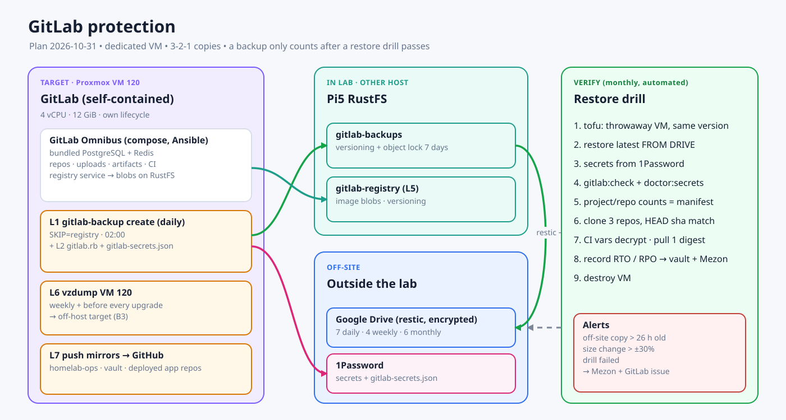

# GitLab: bảo vệ, tách VM riêng và gom registry

GitLab sắp trở thành trung tâm của cả lab: source code, CI/CD, registry duy nhất, nơi chạy apply hạ tầng. Hiện nó **chưa có backup nào kiểm chứng được**. Plan này đưa GitLab về trạng thái khôi phục được trước, rồi mới xoá `registry.dungxbuif.com`.

Plan con của [IaC automation rebuild](./2026-10-31-lab-iac-automation-rebuild.md). Quyết định registry nằm trong [registry.md](../../standards/registry.md).

## 1. Hiện trạng (audit 2026-10-31, read-only)

| Hạng mục | Thực tế |
|---|---|
| Runtime | Swarm service `gitlab_gitlab` 18.11.11 trên VM100, giới hạn 10 GiB/4 CPU. Dùng chung PostgreSQL (`gitlabhq_production`) và Redis (DB 2) với các app khác trên Pi5 |
| Dữ liệu | `/opt/apps/gitlab/{config,data,logs}` trên VM100. Registry 14 GiB nằm trên đĩa VM100. `gitlab-secrets.json` cập nhật lần cuối 2026-10-28 |
| Backup | **Không có lịch.** Class restic `gitlab` không có timer. Lần native backup (~14 GB) gần nhất bị dừng giữa chừng. Databasus có backup DB nhưng **chưa từng restore thử**. Không có bản nào rời khỏi lab mà đã được kiểm chứng |
| Sự cố gần đây | GitLab trả HTTP 500 hai lần (16/10 và 31/10), cả hai đều do Redis dùng chung qua overlay. Bản upgrade lên 19.x đang hoãn vì chưa có backup |
| Registry Pi5 | `registry:2`, 1.5 GiB. Repo: `mypocket-api`, `mypocket-web` (đang dùng), `homepage`, `macocr-proxy`, `omniscan` (cũ). Chỉ MyPocket còn kéo image từ đây |

## 2. Quyết định đề xuất

### 2.1 Tách GitLab sang VM riêng: **có**

| Lý do | Giải thích |
|---|---|
| Cô lập tài nguyên | GitLab đang chiếm 10 GiB trên tổng 16 GiB của VM100 và tranh tài nguyên với app prod. CI runner cũng tranh |
| Vòng đời riêng | Upgrade, snapshot `vzdump` và restore chỉ ảnh hưởng GitLab, không kéo theo toàn bộ app |
| Tự chứa (self-contained) | Dùng **PostgreSQL và Redis bundled** trong Omnibus thay cho Pi5. Lợi ích: một bản backup chứa đủ cả DB; phiên bản PostgreSQL đi theo GitLab nên upgrade 19.x không bị ràng vào PostgreSQL dùng chung; hết loại sự cố overlay Redis đã làm GitLab 500 hai lần |
| Đơn vị DR rõ ràng | Mất VM thì tạo VM từ template rồi restore một bản backup. Không phải dựng lại cả VM100 |

Giới hạn cần nói rõ: VM mới vẫn nằm **cùng host Proxmox và cùng `local-lvm`** với VM100. Tách VM giúp cô lập lỗi phần mềm và tài nguyên, không bảo vệ khi host chết. Phần đó do backup off-site lo (§3).

Đề xuất kích thước: VM `120 gitlab`, 4 vCPU, 12 GiB RAM. Dung lượng đĩa sẽ chốt sau khi đo ở bước G0. Registry chuyển sang RustFS nên đĩa VM không phải chứa 14 GiB đó. Không join Swarm: chạy Omnibus bằng Docker Compose do Ansible quản (stateful, một instance).

### 2.2 Xoá `registry.dungxbuif.com`: **có, nhưng là bước cuối**

**Chỉ một registry cho cả lab.** Không giữ mirror trên Pi5. Image bên thứ ba (traefik, postgres, n8n…) cũng được copy vào chính GitLab Registry dưới `dungxbuif/mirror/` bằng job CI (`skopeo copy`, giữ nguyên digest). Ngoại lệ duy nhất: khi rebuild GitLab (break-glass) thì kéo image GitLab thẳng từ upstream.

## 3. Mô hình bảo vệ GitLab (3-2-1 + kiểm chứng)

| Lớp | Nội dung | Ở đâu | Tần suất |
|---|---|---|---|
| L1 Native backup | `gitlab-backup create` (repos, DB bundled, uploads, artifacts, LFS, CI). Bỏ registry bằng `SKIP=registry` vì registry đã nằm trên RustFS | Thư mục backup trong VM → đẩy đi ngay | Hằng ngày 02:00 |
| L2 Config + secrets | `gitlab.rb`, `gitlab-secrets.json`, cấu hình tunnel. Mã hoá | 1Password (attachment) + kèm mỗi bản backup | Mỗi lần thay đổi + hằng ngày |
| L3 Bản trong lab, khác host | Bucket RustFS `gitlab-backups` trên Pi5, bật versioning và object lock 7 ngày | Pi5 | Hằng ngày |
| L4 Bản off-site | restic (mã hoá, dedup) → Google Drive | Ngoài lab | Hằng ngày. Giữ 7 bản ngày, 4 bản tuần, 6 bản tháng |
| L5 Registry | Bucket `gitlab-registry` (versioning) nằm trong lịch backup RustFS → Drive | Pi5 → Drive | Hằng ngày |
| L6 Ảnh VM | `vzdump` VM 120 lên target ngoài host (quyết định B3: PBS/NAS) | Ngoài host | Hằng tuần + trước mỗi lần upgrade |
| L7 Bản sao source | Push mirror các repo quan trọng (`homelab-ops`, vault, repo app đang deploy) sang GitHub private | GitHub | Mỗi lần push |

**Kiểm chứng** là phần trước đây thiếu, nên bản backup chỉ được tính khi đã restore thử thành công.

Restore drill hằng tháng chạy tự động (job manual lần đầu, sau đó theo lịch):

1. Tạo VM tạm từ template bằng tofu, cài **đúng phiên bản** GitLab.
2. Restore bản mới nhất **lấy từ Google Drive** (không dùng bản local) cùng secrets lấy từ 1Password.
3. Kiểm tra tự động:
   - `gitlab-rake gitlab:check` và `gitlab:doctor:secrets` đều sạch;
   - số project và repo khớp manifest lúc backup;
   - clone 3 repo mẫu, HEAD sha phải khớp;
   - CI variable giải mã được;
   - pull được một digest từ registry;
   - đăng nhập UI thành công.
4. Ghi kết quả (thời gian restore = RTO thực tế, tuổi bản backup = RPO) vào doc vault và báo Mezon. Xoá VM tạm.

Cảnh báo tự động: nếu bản backup off-site cũ hơn 26 giờ, kích thước thay đổi bất thường (±30%), hoặc drill fail, thì báo Mezon và mở GitLab issue.

## 4. Lộ trình

| Bước | Việc | Đụng runtime? | Điều kiện xong |
|---|---|---|---|
| **G0 Đo** | Đo dung lượng `/opt/apps/gitlab/data`, số project/repo, RAM và thin pool của Proxmox. **Cần quyền SSH/API vào Proxmox (hiện chưa có)** | Không | Có số liệu để chốt kích thước VM 120 và target backup |
| **G1 Backup ngay trên VM100** | Chạy một native backup đầy đủ trong maintenance window (gồm cả registry). Copy secrets vào 1Password. Đẩy lên RustFS `gitlab-backups` và Drive bằng restic. Bật lịch hằng ngày (role `backup`, timer systemd trên host, không phụ thuộc CI) | Có (tải I/O, không restart) | Bản backup đầu tiên nằm trên Drive |
| **G2 Restore drill lần 1** | Restore bản trên Drive vào một instance tạm (VM tạm hoặc VM110), chạy checklist §3 | Không đụng prod | **Drill pass**: lần đầu tiên GitLab có backup được kiểm chứng |
| **G3 VM riêng** | Tofu tạo VM 120 → Ansible cài base, docker, GitLab compose cùng phiên bản và bundled PostgreSQL/Redis → restore bản mới nhất (đây cũng là drill lần 2) → chuyển 3 tunnel client sang VM 120 → smoke test web, SSH :2222, registry, runner | Có (cutover khoảng 30 phút, read-only trước đó) | GitLab chạy trên VM 120. Bản cũ trên VM100 scale về 0 và giữ 14 ngày để rollback |
| **G4 Registry → RustFS** | Bucket `gitlab-registry` + metadata DB + `s3_v2` + `mc mirror` + kiểm tra mọi digest (chi tiết trong [registry.md](../../standards/registry.md)) | Có (registry read-only trong lúc chuyển) | Mọi digest pull được từ registry chạy trên RustFS |
| **G5 Gom image** | Push 9 image chỉ có trên máy lên GitLab Registry. Copy image bên thứ ba đang dùng vào `dungxbuif/mirror/`. Copy image MyPocket từ Pi5 registry sang (`skopeo copy`, giữ nguyên digest). Repin `mypocket-api`, `mypocket-worker` (cần duyệt vì service restart) | Có (restart MyPocket) | Không service nào còn dùng `registry.dungxbuif.com` |
| **G6 Xoá Pi5 registry** | Sau 7 ngày ổn định: tar `/ssd-data/infra/registry/data` (1.5 GiB) lên Drive (giữ 90 ngày) → dừng và xoá container `docker-registry` → bỏ route, catalog entry và file auth → cập nhật docs | Có | `registry.dungxbuif.com` hết tồn tại. Rollback: chạy lại container từ bản tar |
| **G7 Vận hành** | Lịch backup + drill hằng tháng + `vzdump` hằng tuần + push mirror. Chỉ upgrade GitLab (U0) khi drill gần nhất pass | — | 3 tháng liền drill pass |

**Thứ tự bắt buộc:** G1 → G2 phải pass trước mọi bước đụng tới GitLab (G3, G4, upgrade U0). G6 chỉ được làm khi G2, G4 và G5 đều xong.

## 5. Rollback

| Bước | Cách rollback |
|---|---|
| G3 | Scale `gitlab_gitlab` trên VM100 trở lại 1 và trả tunnel client về như cũ. Dữ liệu cũ còn nguyên trong 14 ngày |
| G4 | Đổi `registry['storage']` về filesystem. Thư mục cũ còn nguyên trong 14 ngày |
| G5 | Repin MyPocket về digest cũ trên Pi5 registry (Pi5 registry vẫn còn tới G6) |
| G6 | Giải nén bản tar, chạy lại container `registry:2` |

## 6. Cần bạn quyết định

1. Đồng ý tách GitLab sang VM 120 dùng **PostgreSQL và Redis bundled** (rời khỏi Pi5)?
2. Cấp quyền truy cập Proxmox cho bước G0 (API token chỉ đọc + SSH key).
3. Target cho ảnh VM (L6): PBS trên máy khác, NAS, hay `vzdump` lên Drive?
4. Repo nào cần push mirror sang GitHub (L7)? Đề xuất: `homelab-ops`, vault homelab, cùng repo của mọi app đang deploy.
