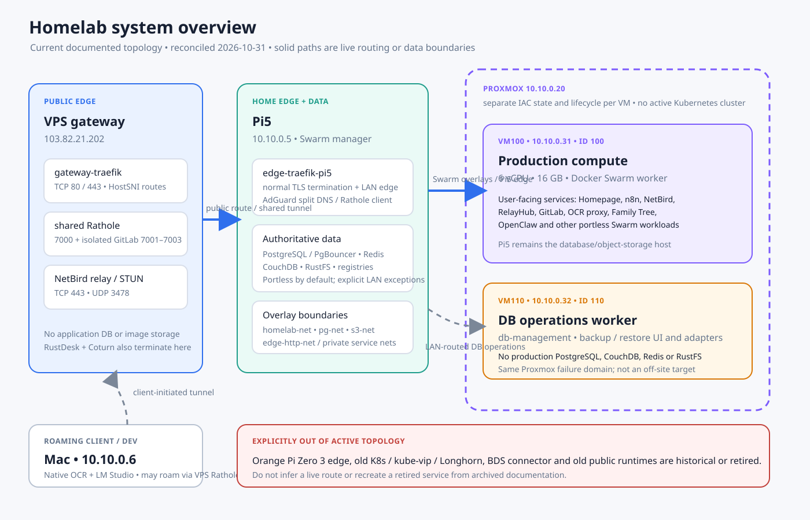
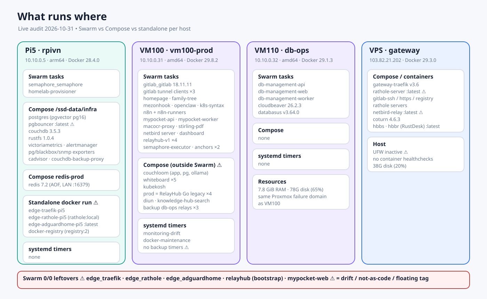
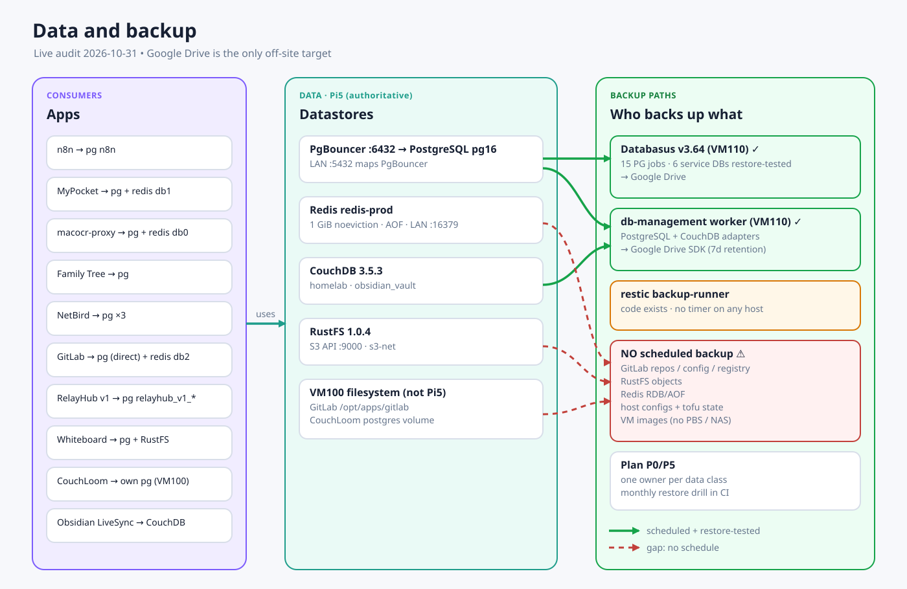
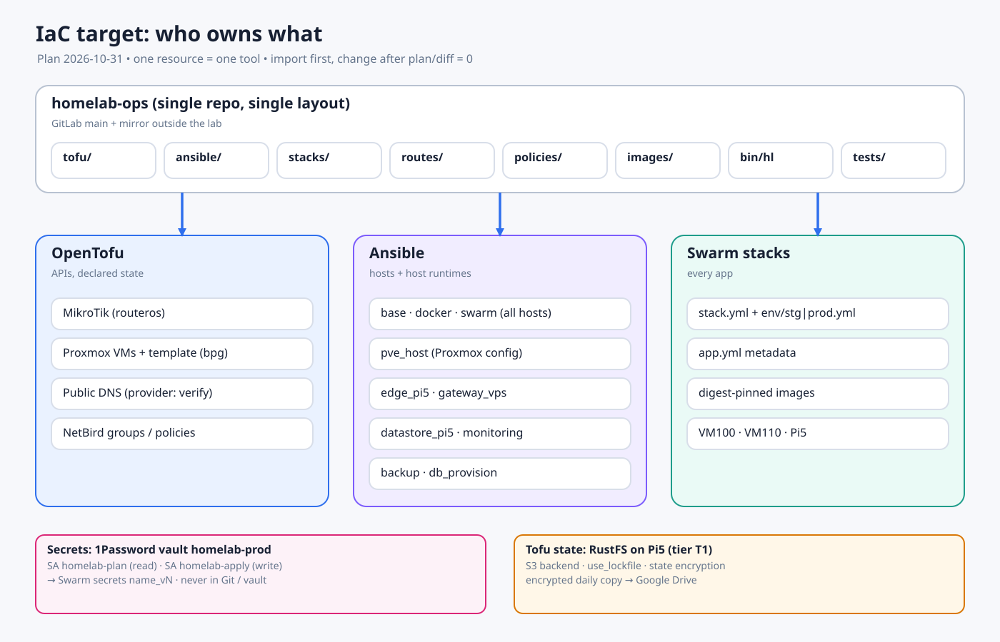
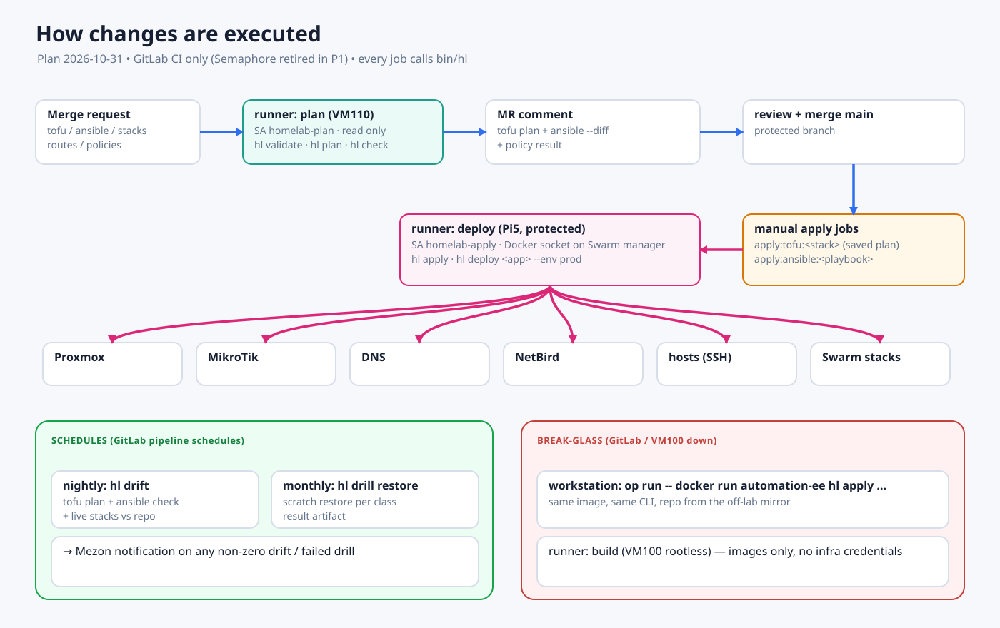
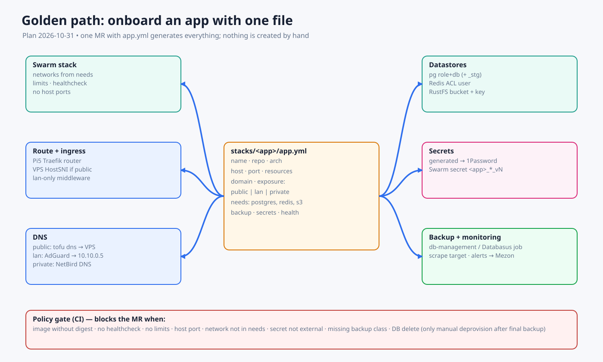
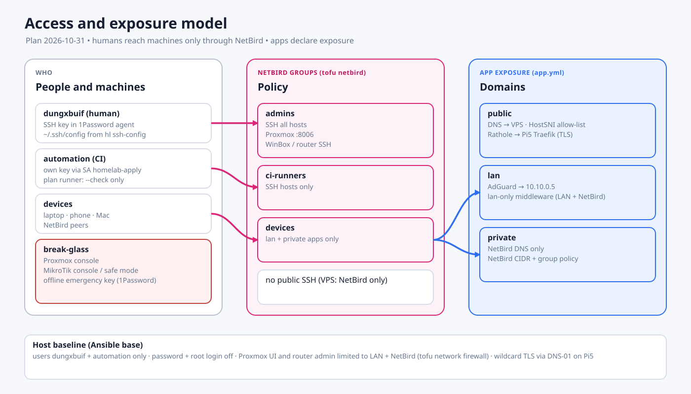
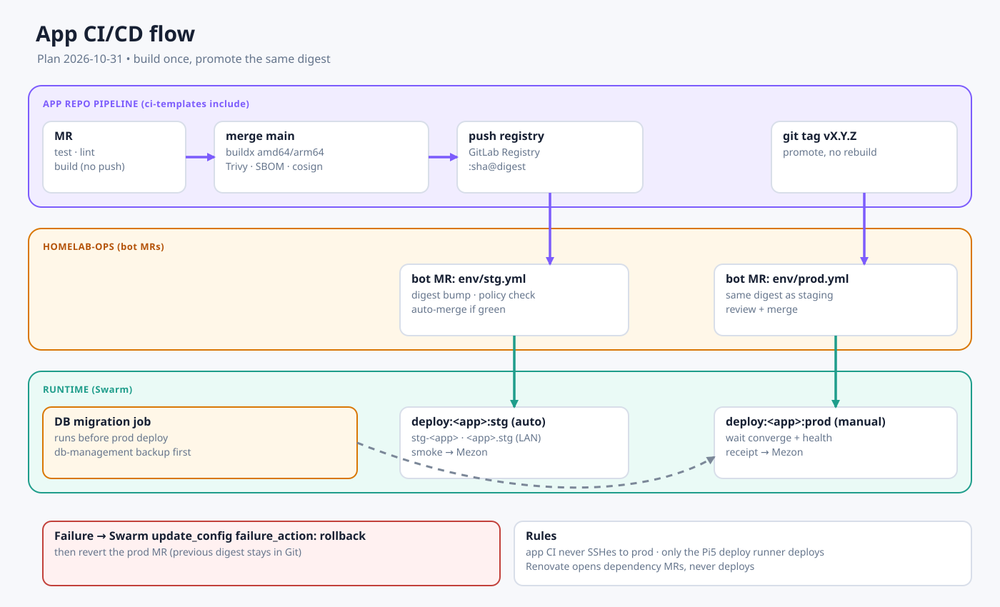
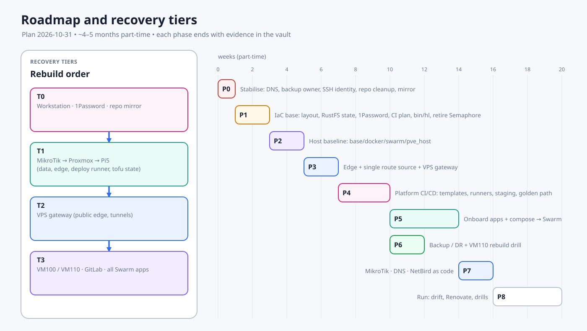

# Kế hoạch tự động hoá toàn lab bằng IaC — 2026-10-31

> Plan này được viết **mới hoàn toàn**. Khi viết, tôi cố ý không đọc các plan/spec cũ
> (`superpowers/plans|specs/*automation*`, `backup-control-plane`, ...). Nó chỉ dựa trên
> audit live ngày 2026-10-31, các trang current-state (`STACK.md`, `STATUS.md`,
> host refs) và code thực tế trong `homelab-ops` (HEAD `80e56ed`).
> Code vẫn nằm trong `homelab-ops`. Vault này chỉ giữ plan, evidence và rollback notes.

---

## 1. Audit hiện trạng (2026-10-31)

### 1.1 Cách kiểm tra

| Host | Cách kiểm tra | Kết quả |
|---|---|---|
| Pi5 `10.10.0.5` | SSH `pi`, read-only | OK |
| VM100 `10.10.0.31` | SSH `vm100`, read-only | OK |
| VM110 `10.10.0.32` | SSH `ubuntu` + `id_homelab_k8s` | OK. Docker 29.1.3, 5 task db-management. Không có compose hay timer homelab. Disk 78G dùng 65%, RAM 7.8G |
| VPS `103.82.21.202` | SSH `gateway` | Không vào được. Trong `~/.ssh/config`, `IdentityAgent` trỏ tới **đường dẫn socket của macOS** (sai trên máy Linux này). Khi trỏ sang `~/.1password/agent.sock` thì server chấp nhận key nhưng agent 1Password `refused operation` (app đang khoá hoặc chưa approve). Dùng audit ngày 2026-10-31 có sẵn |
| Proxmox `10.10.0.20` | SSH | Không có alias hay credential SSH được ghi lại. Agent đưa quá nhiều key nên bị `Too many authentication failures` |
| MikroTik, Mac | Chưa kiểm tra | Chỉ dùng tài liệu |

### 1.2 Runtime thực tế






**Swarm** (manager Pi5 `rpivn`):

- Có 4 node: `rpivn` (leader), `vm100-prod`, `db-ops`, và `orangepizero3` đang **Down nhưng vẫn là thành viên**.
- Có 36 service. Trong đó có các service `0/0` còn sót: `edge_traefik`, `edge_rathole`, `edge_adguardhome`, `relayhub` (bootstrap legacy) và `mypocket-web`.

**Pi5 ngoài Swarm:**

- `infra` compose gồm postgres/pgvector, pgbouncer, couchdb, rustfs, victoriametrics, alertmanager, các exporter, cadvisor và couchdb-backup-proxy.
- `redis-prod` compose riêng.
- Có container standalone không thuộc compose project nào: `edge-traefik-pi5`, `edge-rathole-pi5`, `edge-adguardhome-pi5`, `docker-registry`.
- Không có systemd timer nào của homelab.

**VM100 ngoài Swarm:** có 7 compose project chạy tay.

- `couchloom`: config trỏ tới **4 file compose ở nhiều release dir khác nhau**.
- `whiteboard` (5 container) và `kubekosh`.
- `prod` = RelayHub Go legacy (api, worker, nats, redis). Vẫn đang chạy làm rollback và tốn tài nguyên.
- `diun`, `knowledge-hub-search`, `homelab-backup-db-ops-relay` (3 relay).

**Timer trên VM100:** chỉ còn `homelab-monitoring-drift` và `homelab-docker-maintenance`. **Không còn timer backup nào.**

**Phiên bản Docker lệch nhau:** Pi5 28.4.0, VM110 29.1.3, VPS 29.3.0, VM100 29.8.2.

**Image còn dùng tag trôi:**

- `adguard/adguardhome:latest`
- `edoburu/pgbouncer:latest`
- `prom/blackbox-exporter`, `prom/snmp-exporter` (không có tag)
- `registry:2`
- `zeborg/kubekosh:latest`
- `rathole:local` (build tay)

**Network rác trên Pi5:** `bds-app_bds_network`, `datcom_default`, `dungxbuif_default`, `traefik_proxy`, `proxy_net`, `relayhub_relayhub`, ...

**Disk:** Pi5 dùng 42% (264G trống). VM100 dùng 66% (67G trống). Proxmox `local-lvm` thin pool khoảng 77%, và **không có backup target ngoài host** (không có PBS/NAS).

### 1.3 Hiện trạng `homelab-ops`

| Lớp | Đang có | Thiếu hoặc sai |
|---|---|---|
| OpenTofu | `bpg/proxmox` import VM100 và VM110, state local đã mã hoá | Chưa có bằng chứng đã apply. Không có remote state/lock, không có template VM, không có MikroTik/DNS/NetBird. CI không có job plan |
| Ansible | Inventory 4 host, 29 playbook hẹp (enroll/deploy) | Role gần như chỉ quan sát (`automation_manage_*` = false), chưa phải config management thật |
| Stacks | `catalog.yml` 11 service. Có stack file cho db-management, semaphore, provisioner, diun, rustdesk | **Phần lớn service đang chạy không có file trong repo** (Traefik, datastore Pi5, n8n, whiteboard, couchloom, ...). Chỉ homepage có `deployable: true` |
| Routes | `routes/catalog.yml` → render ra `generated/pi5-traefik.yml`, có contract test | File generated **chưa phải nguồn live**. Live vẫn là `migration/traefik/dynamic.yml`. Các route VPS HostSNI được sửa bằng script ad-hoc |
| CI | Chỉ có validate/build. Deploy tay duy nhất là homepage | Job `validate:semaphore-bootstrap` test file `.mjs` không tồn tại. Không có plan/apply/drift |
| Semaphore | Spec và template ở dạng tài liệu (`design_only`) | Không có gì đẩy template lên Semaphore. Cấu hình UI là tay |
| Backup | `automation/backup-*`, `backup/` legacy, db-management (VM110), Databasus | Có 4 hệ chồng chéo. Timer VM100 đã tắt. GitLab, RustFS và Redis chưa rõ ai đang chạy định kỳ |
| Rác | `k8s/`, `argocd-apps/` (vẫn bật `prune/selfHeal`), `archive/`, `migration/`, `edge-registrar/` (sửa Caddyfile qua ssh), `__pycache__` bị commit | Worktree `feat/dev-vm-iac` tách từ main thời K8s, chậm 67 commit, tạo thêm cây `infra/` song song |

### 1.4 Rủi ro ưu tiên phát hiện qua audit




1. **Không lớp nào rebuild lại được từ code.** Edge Pi5, datastore, gateway VPS và MikroTik đều là "snowflake".
2. **Backup định kỳ có khoảng trống.** Timer VM100 đã tắt. db-management chỉ phụ trách PG/Couch. GitLab, RustFS và Redis chưa có scheduler được xác nhận. Không có backup image VM ngoài Proxmox.
3. **Truy cập automation không đồng nhất.** Mỗi host một kiểu key: 1Password agent, key file, hoặc thử nhiều key đến mức bị khoá.
4. **Swarm có node chết và service ma**, dễ gây nhầm khi deploy hoặc lập lịch.
5. Theo `MIKROTIK.md` (07/2026), DHCP đang quảng bá DNS `10.10.0.2` (Orange Pi, hiện đã chết). **Cần xác minh ngay.** Nếu đúng, client LAN đang rơi về `1.1.1.1` và split-DNS hỏng, khớp với lỗi "workstation resolve ra VPS" đã ghi trong runtime verification 2026-10-26.
6. Nguồn secret rải rác: `credentials/` trong vault, `local_vars.json`, Swarm secrets, biến Semaphore, `.env` trên Mac và 1Password.

---

## 2. Mục tiêu và nguyên tắc

**Mục tiêu:** mọi thứ đang chạy đều có định nghĩa trong `homelab-ops`. Mọi thay đổi đi qua MR → plan/diff → approval → apply. Drift được phát hiện hằng ngày. Một host hỏng có thể rebuild bằng runbook ngắn cộng code.

Nguyên tắc:

1. **Một repo, một layout.** Không có cây `infra/` song song. Không có `migration/`/`archive/` lẫn trong code đang dùng.
2. **Chia việc rõ ràng theo công cụ:**
   - OpenTofu lo thứ có API khai báo: Proxmox, MikroTik, DNS, NetBird.
   - Ansible lo OS và cấu hình host, cùng runtime compose/stack trên host.
   - Swarm stack lo app.
   - Không công cụ nào quản cùng một resource với công cụ khác.
3. **Import trước, thay đổi sau.** Mỗi resource đang sống phải đạt plan/diff = 0 trước khi được phép sửa. Đây là quy tắc an toàn cho production.
4. **Phân tầng phục hồi.** Thứ dùng để rebuild không được phụ thuộc vào thứ đang được rebuild (xem §4).
5. **Secret có một nguồn sự thật**, được inject lúc chạy. Không bao giờ nằm trong Git hoặc vault.
6. Tôn trọng các ràng buộc trong `index.md`: không restart production hay mutate DB khi chưa có approval, không mở port router, Pi5 giữ vai trò data, VM100 là production.

---

## 3. Kiến trúc đích

### 3.1 Layout `homelab-ops`

```text
homelab-ops/
├── tofu/
│   ├── modules/            # proxmox-vm, routeros-*, dns-record, ...
│   ├── stacks/
│   │   ├── proxmox/        # VM100, VM110, cloud-init template, pool, storage refs
│   │   ├── network/        # MikroTik: DHCP, static leases, DNS, firewall, services
│   │   ├── dns/            # public records dungxbuif.com (provider: verify)
│   │   └── netbird/        # groups, policies, routes, setup keys (verify provider)
│   └── backend.hcl         # S3 → RustFS Pi5, use_lockfile, state encryption
├── ansible/
│   ├── inventories/prod/   # hosts + group_vars; no IPs hardcoded elsewhere
│   ├── roles/
│   │   ├── base/           # users, ssh, sudo, unattended upgrades, journald, time
│   │   ├── docker/         # pinned engine version, daemon.json, log rotation
│   │   ├── swarm/          # join/labels/drain, node cleanup
│   │   ├── pve_host/       # repos, no-subscription, storage, backup jobs, API users
│   │   ├── edge_pi5/       # traefik + rathole + adguard compose, routes file
│   │   ├── gateway_vps/    # traefik, rathole server, netbird-relay, rustdesk, firewall
│   │   ├── datastore_pi5/  # postgres/pgbouncer/redis/couchdb/rustfs/registry compose
│   │   ├── monitoring/     # victoriametrics, alertmanager, exporters, rules
│   │   ├── compose_app/    # generic: render compose + .env from secrets, up
│   │   └── backup/         # one backup runner, schedules, notifications
│   └── playbooks/          # site.yml, per-host, per-layer; all support --check --diff
├── stacks/                 # one dir per Swarm app: stack.yml + app.yml (metadata)
├── routes/                 # catalog → generated Traefik (Pi5 file + VPS HostSNI)
├── bin/hl                  # CLI duy nhất: CI và workstation gọi cùng lệnh
├── policies/               # runtime/retired/approval contracts (keep, extend)
├── images/                 # automation-ee, provisioner, rathole, ...
├── tests/                  # contract + unit tests
└── .gitlab-ci.yml
```

Cách chuyển từ cấu trúc hiện tại:

- Chuyển `automation/{tofu,ansible,stacks,routes,policies}` lên cấp gốc. Xoá `automation/semaphore/`, các playbook chỉ phục vụ Semaphore, `automation/provisioner/` (sau khi P1 thay thế xong) và job CI `validate:semaphore-bootstrap`.
- `automation/backup-*` thành role `backup`.
- Xoá `k8s/`, `argocd-apps/`, `edge-registrar/`, `monitoring/`, `tools/goclaw`, `backup/` (sau cutover) và `migration/` (sau khi nguồn live chuyển sang generated).
- `archive/` chuyển sang tag Git `legacy-archive`.

### 3.2 Bảng ai quản cái gì




| Thành phần | Công cụ | Ghi chú |
|---|---|---|
| MikroTik hEX S | OpenTofu `terraform-routeros/routeros` | Import theo từng resource. PPPoE secret lấy từ secret store |
| VM trên Proxmox, template cloud-init | OpenTofu `bpg/proxmox` | Giữ `prevent_destroy` cho VM100 |
| Cấu hình host Proxmox (repo, storage, user/token, vzdump job) | Ansible `pve_host` | Gọi API token từ secret store |
| DNS public `dungxbuif.com` | OpenTofu (provider tuỳ registrar/Cloudflare, **cần xác minh**) | Wildcard và các record đặc biệt như `netbird-relay` |
| Split DNS LAN (AdGuard rewrite) | Ansible `edge_pi5`, render từ `routes/catalog.yml` | Một nguồn route sinh ra cả Traefik lẫn rewrite |
| NetBird (group, policy, route, DNS) | OpenTofu, nếu provider đủ ổn; nếu không, script API idempotent | Server NetBird vẫn là Swarm stack |
| OS Pi5/VM100/VM110/VPS | Ansible `base` + `docker` | Pin Docker engine theo từng host |
| Edge Pi5, gateway VPS | Ansible compose roles | Bỏ container standalone `docker run` |
| Datastore Pi5 | Ansible `datastore_pi5` (compose) | Chỉ quản file/compose. Không đổi engine/data nếu không có approval |
| App | Swarm stacks trong `stacks/` | Gom tất cả compose VM100 về Swarm, trừ ngoại lệ có lý do |
| Mac | Ansible tối thiểu (tunnel compose, brew bundle) **hoặc** để ngoài phạm vi | Mac roaming nên chỉ chạy khi đang trong LAN/NetBird |
| Cấp DB/user cho app | Ansible role `db_provision` (`community.postgresql`), đọc `needs` trong `app.yml` | Thay cho provisioner service đang mount Docker socket |

### 3.3 Secrets

- **Nguồn sự thật: 1Password.** Đã dùng cho SSH agent của VPS, và worktree dev-vm đã có sẵn `op-inject`. Dùng một vault riêng `homelab-prod` và một **Service Account** cho automation.
- Ansible lấy secret qua lookup `community.general.onepassword` (hoặc `op inject` trước khi chạy) và tạo Swarm secret có version (`name_vN`) để rotate không downtime.
- OpenTofu nhận provider token qua `op run` hoặc env của runner. Passphrase mã hoá state cũng nằm trong 1Password.
- GitLab CI chỉ giữ token Service Account dạng masked + protected. Tách hai Service Account: `homelab-plan` (chỉ đọc, dùng cho MR) và `homelab-apply` (chỉ job trên `main` qua runner protected mới thấy được).
- Dọn: `vault/credentials/` và `local_vars.json` chuyển dần vào 1Password, sau đó xoá khỏi đĩa (theo runbook `secret-rotation-and-history-purge.md`).
- Phương án dự phòng nếu không muốn phụ thuộc cloud: SOPS + age, file mã hoá trong repo. Chọn một trong hai, không dùng cả hai.

### 3.4 Thực thi: GitLab CI là control plane duy nhất (không Semaphore)




**Một CLI cho mọi đường chạy.** Mọi job CI chỉ gọi `bin/hl …`, chạy trong image `automation-ee` (có digest). Workstation break-glass chạy đúng lệnh đó, cùng image, với `op run`. Vì vậy CI và tay người không bao giờ lệch nhau.

```text
hl validate                      # lint, test, policy, render routes
hl plan  tofu <stack>            # proxmox | network | dns | netbird  → plan file mã hoá
hl apply tofu <stack> --plan F   # chỉ apply đúng plan đã review
hl check ansible <playbook>      # --check --diff
hl apply ansible <playbook> [--limit host]
hl deploy <app> --env stg|prod   # render stack, docker stack deploy, chờ hội tụ + health
hl drift                         # tofu plan + ansible check + so stack live với repo
hl drill restore <class>         # restore vào scratch, đo kết quả
```

**Runner theo vai trò** (đều có trong GitLab CE: protected branch, protected runner, protected variable):

| Runner | Đặt ở | Nhận job | Quyền |
|---|---|---|---|
| `build` | VM100, rootless dind (đang có) | Mọi project | Không có credential hạ tầng |
| `plan` | VM110 | Pipeline MR của `homelab-ops` | SA `homelab-plan`: Proxmox token chỉ đọc, SSH user `automation` chỉ chạy `--check` |
| `deploy` | Pi5 (Swarm manager, tầng T1) | Chỉ job trên `main`/tag, runner protected | SA `homelab-apply`: Proxmox/RouterOS/DNS token ghi, SSH apply, Docker socket để `stack deploy` |

**Pipeline `homelab-ops`:**

| Khi nào | Job | Ghi chú |
|---|---|---|
| MR | `validate` → `plan` (chỉ stack/role bị đổi, dùng `rules:changes`) → comment plan/diff vào MR | Không có quyền ghi |
| Merge `main` | `apply:tofu:<stack>`, `apply:ansible:<playbook>` dạng `when: manual` | Dùng đúng plan artifact của pipeline đó. Bấm tay = approval |
| Đổi `stacks/<app>/env/stg.yml` | `deploy:<app>:stg` tự động | Từ MR của bot bump digest |
| Đổi `stacks/<app>/env/prod.yml` | `deploy:<app>:prod` manual | Rollback = revert MR |
| Schedule đêm | `drift` | Báo Mezon nếu khác 0 |
| Schedule tháng | `drill` | Lưu kết quả làm artifact và báo Mezon |

**Khi GitLab/VM100 chết:** schedule tạm dừng (chấp nhận được, vì backup không phụ thuộc CI). Sửa bằng break-glass từ workstation: `op run -- docker run automation-ee hl apply …` với bản mirror repo.

**Quy ước code:**
- Ansible: nhóm inventory theo vai trò (`swarm_managers`, `swarm_workers`, `edge`, `gateway`, `datastore`, `pve`). Mỗi role có `assert` preflight, chạy an toàn ở check mode, có tag, có toggle `<role>_manage: true|false` để bật dần. `site.yml` import các playbook theo lớp.
- OpenTofu: mỗi `stacks/<x>` là một root module với state key riêng. Module dùng chung trong `modules/`. Không có biến IP rải rác: lấy từ một file `inventory.auto.tfvars.json` sinh từ inventory Ansible.
- Stack app: `stack.yml` dùng chung, `env/<env>.yml` chỉ chứa digest, replicas và resource. `app.yml` là metadata để generator sinh route, DNS, DB, monitoring và backup.

### 3.5 Domain, truy cập máy, DB, network: luồng tự sinh từ `app.yml`






Một khai báo trong `stacks/<app>/app.yml` sinh ra toàn bộ các mục dưới đây qua MR. Không ai tạo tay.

**Domain: 3 mức `exposure`**

| `exposure` | DNS | Đường đi | Bảo vệ |
|---|---|---|---|
| `public` | Record public → VPS (tofu `dns`) | VPS Traefik HostSNI passthrough → Rathole → Pi5 Traefik (TLS) | Allow-list HostSNI sinh từ catalog |
| `lan` | AdGuard rewrite → `10.10.0.5`, không có record public | Pi5 Traefik | Middleware `lan-only` (LAN + dải NetBird) |
| `private` | NetBird DNS | Qua NetBird tới Pi5 Traefik | Chỉ dải NetBird + group policy |

- TLS: wildcard `*.dungxbuif.com` cấp trên Pi5 bằng ACME DNS-01 (cần API của DNS provider). VPS chỉ passthrough, trừ ngoại lệ GitLab hiện tại.
- Split-DNS: DHCP trên MikroTik phát DNS là `10.10.0.5` (sửa lỗi Orange Pi), quản bằng tofu `network`.

**Truy cập máy**

- Người dùng: **chỉ qua NetBird**. SSH bằng key trong 1Password agent. File `~/.ssh/config` sinh từ inventory bằng `hl ssh-config` (có `IdentitiesOnly`).
- User trên mọi host: `dungxbuif` (người), `automation` (CI, key riêng trong SA). Tắt mật khẩu và root login. Riêng VPS: SSH chỉ mở cho dải NetBird, kèm firewall.
- NetBird groups (tofu `netbird`):
  - `admins` → SSH mọi host, Proxmox `:8006`, WinBox/SSH router
  - `ci-runners` → SSH host
  - `devices` → chỉ app `lan`/`private`
- Proxmox UI và quản trị MikroTik chỉ mở cho LAN + NetBird (firewall quản bằng tofu `network`).
- Break-glass: console Proxmox, console/safe-mode MikroTik, key khẩn cấp offline trong 1Password.

**Tạo DB và datastore** (role `db_provision`, job CI `provision:<app>`; chi tiết: [quy trình DB](../../standards/database-provisioning.md))

```yaml
needs: { postgres: true, redis: true, s3: [uploads], couchdb: false }
```

- Postgres trên Pi5: tạo role và DB `<app>` (thêm `<app>_stg` nếu có staging), cập nhật PgBouncer. Mật khẩu sinh ngẫu nhiên, lưu vào 1Password `apps/<app>/db`, tạo Swarm secret `<app>_db_url_vN`.
- Redis: mỗi app một ACL user + prefix key. Bỏ cách chia "DB index" vì nó không phải ranh giới bảo mật.
- RustFS: tạo bucket, policy và access key cho từng app.
- Tự đăng ký backup (db-management/Databasus) và monitoring.
- **Không bao giờ tự xoá DB.** Gỡ app thì chạy job manual `deprovision` sau khi backup cuối cùng đã pass.

**Network Docker**

| Network | Ai gắn vào |
|---|---|
| `edge-http-net` | Traefik + app có domain |
| `<app>-net` | Nội bộ app (api, worker, redis riêng) |
| `pg-net`, `redis-net`, `s3-net` | Chỉ app có `needs` tương ứng |
| `homelab-net` | Retire dần theo canary |

- Generator gắn network theo `needs`. Policy test chặn app gắn network không khai báo, và chặn publish host port (ngoại lệ ghi trong `policies/`).

### 3.6 CI/CD cho app




```text
MR app        → test, lint, build thử
merge main    → build multi-arch → Trivy → SBOM → cosign → push GitLab Registry (:sha@digest)
              → bot MR homelab-ops: stacks/<app>/env/stg.yml = digest → auto-merge nếu policy pass
              → deploy:<app>:stg tự động → smoke → báo Mezon
tag vX.Y.Z    → bot MR env/prod.yml = cùng digest đã chạy ở staging
              → merge + deploy:<app>:prod manual → chờ hội tụ + health
              → lỗi thì Swarm tự rollback (failure_action: rollback) + revert MR
```

- Project `platform/ci-templates`: app chỉ cần `include:` và khai báo vài biến.
- CI của app không bao giờ SSH vào prod. Chỉ runner `deploy` của `homelab-ops` mới được `stack deploy`.
- DB migration là job riêng, chạy trước prod, có backup ngay trước đó.
- Renovate mở MR bump dependency, không tự deploy.

---

## 4. Phân tầng bootstrap / DR

```text
T0  Workstation + 1Password + bản mirror homelab-ops (GitHub private hoặc bundle trên Drive)
T1  MikroTik  →  Proxmox host  →  Pi5 (Swarm manager, data, edge, runner deploy, RustFS = tofu state)
T2  VPS gateway (public edge, tunnels)
T3  VM100 / VM110 (apps, GitLab), mọi Swarm stack
```

- Tofu state nằm trên RustFS Pi5 (tầng T1). Pi5 không do tofu quản, nên không bị vòng lặp phụ thuộc. State được backup mã hoá lên Drive mỗi ngày.
- GitLab nằm ở T3. Vì vậy repo phải có **mirror ngoài lab**, nếu không thì mất VM100 là mất luôn code để rebuild VM100.
- Mỗi tầng có `make rebuild-<host>` hoặc một playbook, kèm runbook ≤ 1 trang trong vault.

---

## 5. Lộ trình theo phase




Mỗi phase kết thúc bằng **evidence trong vault** (`docs/deployments/…`), có revision `homelab-ops` và đường rollback.

### P0: Ổn định và dọn nền (1 tuần, rủi ro thấp)

- [ ] Xác minh DNS mà DHCP trên MikroTik đang quảng bá. Nếu vẫn là `10.10.0.2` thì đổi sang `10.10.0.5` (có approval).
- [ ] Xác minh lịch backup cho GitLab, RustFS và Redis đang thực sự chạy ở đâu. Nếu không có, bật lại tạm runner cũ cho tới P6.
- [ ] Thống nhất identity automation: user `automation` cùng **một** SSH key (lưu trong 1Password) trên Pi5, VM100, VM110, VPS và Proxmox. Thêm `IdentitiesOnly yes` vào `~/.ssh/config` để hết lỗi `Too many authentication failures`.
- [ ] Repo: xoá `k8s/`, `argocd-apps/` (tắt `selfHeal` trước), `__pycache__`, sửa job `validate:semaphore-bootstrap`. Quyết định bỏ worktree `feat/dev-vm-iac` (giữ lại ý tưởng `op-inject`, không merge cây `infra/`).
- [ ] Bật mirror repo ra ngoài lab.
- **Exit:** CI xanh, mirror chạy, SSH automation đồng nhất trên 5 host, backup được xác nhận có scheduler.

### P0.5: Lấy lại kiểm soát service đang chạy (2–3 ngày, không đụng runtime)

Audit 2026-10-31: 15 Swarm service tạo tay bằng `docker service create` (không stack, không file), 9 image chỉ có local, 7 compose project rải rác `/opt/apps`.

- [ ] Đóng băng: cấm `docker service update`/`docker run` tay trên prod; mọi thay đổi phải có file trong repo trước.
- [ ] Chụp spec live → `homelab-ops/stacks/<app>/` (script từ `docker service inspect`) + copy compose `/opt/apps/*`; secret chỉ ghi tên.
- [ ] Push image local-only lên GitLab Registry, ghi digest (theo [quyết định registry](../../standards/registry.md)).
- [ ] Inventory read-only toàn bộ DB/user/bucket hiện có ([quy trình DB](../../standards/database-provisioning.md) §6).
- [ ] Drift check đêm: spec live vs repo.
- [ ] Mỗi project có doc nội bộ trong vault theo [chuẩn tài liệu](../../standards/project-documentation.md); gate snapshot theo [App Delivery Gates](../../standards/app-delivery-gates.md).
- **Exit:** 100% service đang chạy có file trong repo, 0 image chỉ có local, drift report chạy hằng đêm.

### P1: Nền tảng IaC (2 tuần)

- [ ] Tạo layout §3.1 bằng `git mv`, giữ lịch sử, cập nhật test path.
- [ ] Remote state: bucket `tofu-state` trên RustFS (bật versioning) + S3 backend `use_lockfile=true` + giữ state encryption. Migrate state của 2 module Proxmox.
- [ ] 1Password Service Account (`homelab-plan`, `homelab-apply`), tích hợp vào image EE và CI.
- [ ] Thêm vào CI: `tofu plan` cho từng stack, `ansible-playbook --check --diff` cho site, comment kết quả vào MR.
- [ ] CLI `bin/hl` + runner theo vai trò (§3.4). Thay các chức năng của Semaphore: homepage release → CI, cấp DB → role `db_provision`, host audit → CI schedule.
- [ ] **Gỡ Semaphore**: tar `/ssd-data/infra/semaphore/data` (SQLite) lên Drive → `docker stack rm semaphore semaphore-executor` → bỏ route/rewrite `semaphore.dungxbuif.com` → xoá secrets `semaphore_*` và thư mục data sau 30 ngày → gỡ provisioner khi `db_provision` đã pass.
- **Exit:** `tofu plan` cho VM100 và VM110 bằng **0 thay đổi** trên CI. Semaphore và provisioner đã gỡ, mọi chức năng cũ đã có job CI thay thế.

### P2: Host baseline bằng Ansible (2 tuần)

- [ ] Role `base` + `docker` chạy ở chế độ quản lý thật, bật dần: check → diff → apply từng host theo thứ tự VM110 → VM100 → VPS → Pi5.
- [ ] Pin Docker engine thống nhất, nâng cấp có kế hoạch theo từng node vì đang lệch 28.4 → 29.8.
- [ ] Role `swarm`: gỡ node `orangepizero3`, xoá service `0/0` đã chốt retired, gắn node labels cho placement.
- [ ] Role `pve_host`: repo, user/token API tối thiểu, cảnh báo dung lượng thin pool.
- **Exit:** nightly `ansible --check` cho 4 host Linux và Proxmox báo `changed=0`.

### P3: Edge, gateway và route một nguồn (2 tuần)

- [ ] Pi5 edge: chuyển 3 container standalone thành compose do role `edge_pi5` quản. Cutover trong maintenance window, có lệnh rollback `docker start` container cũ.
- [ ] `routes/catalog.yml` thành nguồn duy nhất, render ra: Traefik file Pi5, danh sách HostSNI cho VPS và rewrite AdGuard. Bỏ `migration/traefik/dynamic.yml`, `vps-hostsni-edit.py` và `edge-publish.sh`.
- [ ] VPS: role `gateway_vps` quản Traefik, Rathole server, netbird-relay, RustDesk, healthcheck. **Bật firewall** (UFW hoặc firewall của nhà cung cấp) theo danh sách port đã duyệt trong `STACK.md`.
- [ ] Build `rathole` thành image có digest thay cho `rathole:local`.
- **Exit:** xoá rồi tái tạo edge Pi5 bằng playbook trong window. Smoke test public và LAN pass. Route mới chỉ cần sửa catalog.

### P4: Platform CI/CD (2–3 tuần)

- [ ] Project `platform/ci-templates` (build multi-arch, Trivy, SBOM, cosign, push GitLab Registry theo digest).
- [ ] Runner `plan` (VM110) và `deploy` (Pi5, protected). Runner `build` giữ nguyên.
- [ ] Bot bump digest mở MR vào `homelab-ops` (`env/stg.yml`, `env/prod.yml`).
- [ ] Staging namespace `stg-<app>`, domain `<app>.stg.dungxbuif.com` (lan).
- [ ] Generator golden path từ `app.yml` (§3.5) và policy gate cho stack.
- [ ] Registry: GitLab Registry là registry duy nhất cho app, Pi5 thành pull-through mirror T1 ([quyết định](../../standards/registry.md)).
- **Exit:** homepage chạy trọn stg → prod → rollback thử.

### P5: Onboard app và data (3–4 tuần)

- [ ] Mỗi workload trong §1.2 có một thư mục `stacks/<app>/` gồm stack, metadata (owner, host, network, secret names, backup class, health URL) và digest pin.
- [ ] Chuyển các compose trên VM100 sang Swarm: whiteboard, couchloom (dọn 4 file release), knowledge-hub-search, diun, backup relays. KubeKosh cần privileged nên giữ compose qua `compose_app`, hoặc retire nó.
- [ ] Retire RelayHub Go legacy (`prod` compose + service `relayhub` 0/0) sau khi owner xác nhận không cần rollback nữa.
- [ ] Pi5 datastore: đưa `/ssd-data/infra` và `redis-prod` vào role `datastore_pi5`, chạy check/diff trước. **Không recreate container DB nếu không có approval và backup mới.** Pin `pgbouncer`, `adguard`, các exporter và `registry` theo digest.
- [ ] Một playbook `app-deploy` chung cho mọi stack thay cho script riêng của từng app. CI deploy bằng digest.
- [ ] Monitoring as code: rule, target sinh từ `stacks/*/app.yml`, alert route về Mezon.
- **Exit:** script drift báo **0 workload chạy mà không có trong repo**, và 0 image dùng tag trôi.

### P6: Backup và DR (2 tuần, chạy song song với P5)

- [ ] Chọn **một** chủ backup cho từng lớp: db-management (PG/Couch), role `backup` (GitLab, RustFS, Redis, host config, tofu state). Databasus giữ hoặc bỏ theo kết quả D1. Xoá `backup/` legacy sau khi cutover.
- [ ] Backup image VM: thêm target ngoài host (PBS trên máy khác/NAS, hoặc vzdump → RustFS/Drive) do Ansible `pve_host` quản lý job.
- [ ] Lịch restore drill hằng tháng chạy như scheduled pipeline GitLab, có kết quả đo được.
- [ ] Diễn tập rebuild: **dựng lại VM110 từ số 0** bằng tofu + ansible + stack (VM110 không phải datastore). Ghi lại thời gian và các bước tay còn sót.
- **Exit:** restore drill tự động pass. Rebuild VM110 không cần bước tay ngoài runbook.

### P7: Mạng và truy cập (2 tuần)

- [ ] MikroTik: import vào tofu theo từng resource (DHCP, lease tĩnh, DNS, firewall filter/NAT, `/ip service`). Cho tới khi plan = 0, export `.rsc` làm backup hằng đêm.
- [ ] Tạo user RouterOS `automation` có quyền tối thiểu, thay cho đường SSH admin.
- [ ] DNS public as code (sau khi xác minh provider).
- [ ] NetBird: group/policy/route as code, thay đường WireGuard + iptables MASQUERADE trên Pi5.
- [ ] (Tuỳ chọn) VLAN segmentation chỉ làm khi đã có rollback qua console.
- **Exit:** `tofu plan` network/dns/netbird = 0. Đổi một firewall rule end-to-end qua MR.

### P8: Vận hành liên tục

- Drift hằng đêm cho tofu, ansible và stacks, báo Mezon. Mọi drift phải được sửa bằng MR hoặc ghi lại lý do.
- Renovate/Diun đề xuất bump digest bằng MR, không tự deploy.
- Hằng quý: diễn tập rebuild một host. Hằng tháng: restore drill.

---

## 6. Gate an toàn (áp dụng mọi phase)

| Hành động | Điều kiện |
|---|---|
| tofu apply, ansible apply trên prod | MR đã merge, apply đúng saved plan của pipeline đó, job manual trên runner protected |
| Recreate container datastore, migrate data | Backup mới cùng ngày, restore test, maintenance window, approval rõ ràng |
| Đổi MikroTik | Có lối vào console, auto-rollback (`/system scheduler` hoặc safe mode), approval |
| Xoá runtime "retired" | Đối chiếu `policies/retired-runtime.yaml` và xác nhận của owner |
| Rotate secret | Theo runbook rotation; Swarm secret có version |

## 7. Việc cần chủ lab quyết định

1. Secret store: **1Password** (khuyến nghị) hay SOPS + age?
2. DNS public đang ở đâu (Cloudflare hay registrar)? Từ đó chọn provider tofu.
3. Target backup ngoài host cho VM image: mua NAS, dựng PBS trên máy khác, hay vzdump lên Drive?
4. Có giữ KubeKosh, Databasus, RelayHub legacy, GitLab Registry trial không?
5. Mac có nằm trong phạm vi IaC không, hay chỉ cần runbook?
6. ~~Archive plan cũ~~: đã xoá toàn bộ plan/spec trước 2026-10-31 khỏi vault ngày 2026-10-31 (còn trong lịch sử git).
