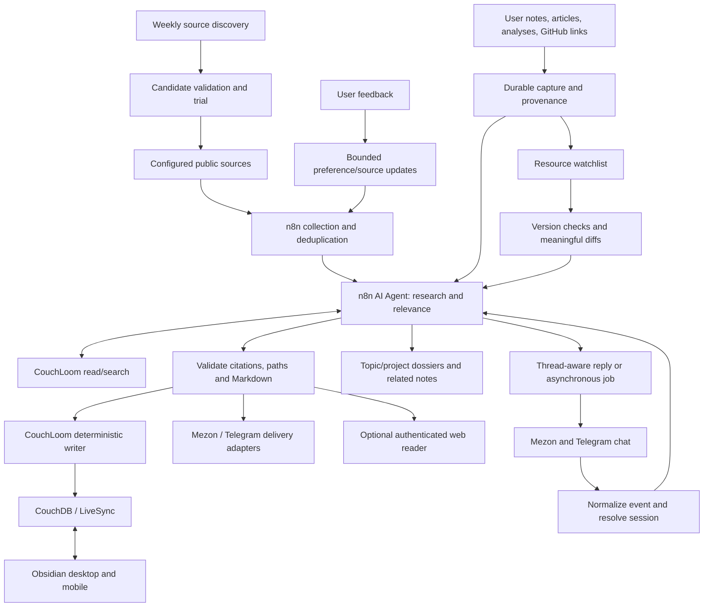

# Personal Research & Knowledge Hub — Design

Status: proposed; planning only, no deployment or schedules enabled.
Date: 2026-10-14. Owner: personal Homelab / Second Brain.
Revision 2: extends daily news with personal capture, submitted resources,
knowledge organization, and recurring update monitoring. Existing document
filenames remain stable so earlier review links continue to work.
Revision 3: brainstorming decisions — Obsidian is the primary interface,
Inbox processing is automatic, and interactive chat supports both Mezon and
Telegram from the first chat slice using existing SDKs/n8n integrations.
User clarification: treat channel integration as n8n nodes. Defer transport,
SDK/library and adapter implementation details until execution; do not make
them a separate architecture decision or approval gate.
Revision 4: analyze submitted resources against their source and the vault;
research externally when needed to verify or fill a specific gap. Store the
results as durable, fully described/tagged/classified knowledge that the user
can query later for ideas and applications.

## Intended outcome

An AI system follows technology, AI, open-source repositories, and configurable
additional topics; finds useful new sources; researches significant developments;
and delivers Vietnamese briefings that become durable Markdown knowledge.
The user reads on a phone or computer, receives notifications, and provides
feedback that improves subsequent selection.

The same system also accepts the user's own notes, Markdown/text, articles,
analyses and GitHub links. It stores originals first, analyzes and connects
them to existing knowledge, maintains topic/project dossiers, and monitors
submitted resources for meaningful changes. A resource may originate from
the user or automated discovery; both share provenance, search and delivery.

Reuse n8n, CouchLoom, CouchDB/LiveSync, and Obsidian. OpenClaw/OpenWorker are
optional agent clients, not required dependencies. Implementation is a future
step; this document and its plan do not authorize production changes.

## Evidence and assumptions

Verified from local documents/source, not from a fresh production audit:

- n8n runs on VM100 at `n8n.dungxbuif.com`; the existing gold/fuel report is a
  separate deterministic workflow and must remain unchanged.
- CouchLoom exposes authenticated Streamable HTTP MCP privately at
  `http://couchloom:8787/mcp`. Its production runbook was validated 2026-10-13.
- CouchLoom supports list/read/search/create/edit, requires `vault_id`, and
  does not expose delete/move/rename. Its current write scope is unrestricted.
- The vault treats Markdown/frontmatter as canonical and indexes as derived.
  AI drafts belong in `raw/` and `staging/`; final `wiki/` remains human-owned.
- LM Studio runs on the Mac; its availability is not a 24/7 guarantee.
- Upstream Horizon's MCP server uses stdio. Its existence does not establish
  direct compatibility with n8n's HTTP MCP clients.

Proposed defaults, adjustable before activation: Mezon and Telegram chat/delivery,
07:00 daily briefing, hourly collection, Sunday 10:00 source discovery,
Vietnamese prose, and `Asia/Ho_Chi_Minh` timezone. Channel credentials/destinations, the model,
search provider, and the actual deployed n8n node versions are preflight inputs.

## Architecture and alternatives

| Approach | Tradeoff | Decision |
|---|---|---|
| n8n native collection + AI Agent + CouchLoom | Some source/formatting logic, few new services | MVP default |
| n8n + Horizon + CouchLoom | Reuses editorial pipeline; stdio/HTTP bridge and duplicate state need verification | Optional adapter after MVP |
| OpenClaw-led research + CouchLoom | Flexible conversational assistant; overlaps scheduling/state with n8n | Optional later |

n8n owns schedules, deterministic validation, operational state, delivery, and
the AI Agent. The model receives research tools and limited vault reads; a
separate deterministic writer validates the final structured output before
calling CouchLoom. No agent receives general SSH/Docker/database access.
Obsidian is the primary note editor, reader and offline capture surface.
The user chose automatic Inbox processing, with `ai-process` opt-in elsewhere.
Mezon and Telegram both provide interactive chat, quick capture/commands and
delivery. Chat embedded in Obsidian and a separate mobile web editor are later
options; neither is needed for the first interactive version.

## Interactive chat and channel integration

This is a conversational assistant, not just a command or notification bot.
Support sourced vault Q&A, follow-up questions, comparisons, deeper research,
capture on request, watch management, job status and feedback in both channels.
Interpret natural requests such as "đào sâu tin số 3", "so sánh với repo tôi
gửi hôm qua", "lưu ý này", and "tạm dừng theo dõi repo đó" using conversation
references rather than requiring slash commands for every action.

Mezon and Telegram are n8n input/output nodes connected to the same hub logic.
Existing SDKs/integrations are implementation resources, not new subsystems to
design now. At execution, verify receipt/reply/restart behavior and fill only
the integration gaps actually encountered. No separate gateway or application
library is required by this design. Different message/file capabilities may
use text/link fallbacks while preserving the same user action and result.

Conversation keys include platform, tenant/clan when applicable, chat/channel,
thread and sender scope. Shared vault access follows the configured user
mapping; numeric IDs from different platforms are never assumed to identify
the same person. Histories stay separate by conversation by default. Long-term
knowledge is shared through the vault; cross-channel continuation requires an
explicit linked identity or job reference. Group access and mentions are
allowlisted so a group message cannot disclose private vault context.

Normal chat is not automatically a permanent note. Capture is explicit when
the user asks to save, forwards material to the designated Inbox, submits a
standalone resource, or uses a capture command. A URL inside an ordinary
question is context, not an automatic watch request. The originating message
and save/analyze/watch intent are preserved in the intake envelope.

Keep bounded conversation memory as operational state (`hub_conversations` /
`hub_messages`), separate from canonical notes. Proposed retention is 30 days;
the active prompt uses at most the last 20 messages plus selected vault context
within the model's configured token cap. User-visible durable job IDs support
slow research: acknowledge queued work, return status, then send a completion
reply to the originating thread. Do not block message receipt on a long LLM
run or broadcast every interactive reply to both platforms.

The user chooses report destinations independently; a report can be sent to
both through the same delivery router. Receipts/retries are destination-scoped
so Mezon failure does not resend a successful Telegram report, or vice versa.



## Behavior and contracts

1. **Collection:** start with up to 20 seed sources covering AI labs, engineering
   blogs, Hacker News, GitHub releases, and repo discovery. Collect hourly using
   provider APIs/RSS. Track published time separately from observed time; never
   invent publication dates. One failed feed produces partial coverage, not a
   fictitious successful scan. Social sources are added only after a working
   adapter is demonstrated; Facebook/X access is not assumed.
2. **Selection:** canonicalize URLs and suppress exact repeats. Group likely
   same-event reports while retaining their sources; two different releases of
   one repo remain separate events. Begin with AI, OSS, backend and homelab;
   additional topics are registry entries, not code rewrites.
3. **Research:** analyze at most 10 selected stories per daily digest, with
   deeper reading for at most 3. Every material factual claim has a fetched
   supporting URL; distinguish source statements, inference, and uncertainty.
   Use at most 5 relevant vault notes after metadata/search, with `wiki/`
   preferred over drafts. A news site's instructions are never workflow policy.
4. **Personal relevance:** explain what changed, why it matters, relevant
   project/note links, and up to 3 actionable next steps. Do not create new
   commitments or mark the user's studies/tasks complete.
5. **Markdown:** save only selected source records under
   `raw/news/YYYY-MM-DD-<story_id>.md`; digest under
   `staging/news/YYYY-MM-DD-digest.md`; deep dives under
   `staging/news/YYYY-MM-DD-<topic_slug>.md`. Names/tags are English; prose is
   Vietnamese. Preserve `type`, `title`, `description`, `timestamp`, `status`,
   and `tags`; raw records include `source` and `raw_type`. Use relative links
   or Obsidian wikilinks. Never manually edit generated indexes.
6. **Write scope:** writer accepts only explicit feature-owned prefixes in
   the knowledge layout below, rejects traversal, and checks the selected
   `vault_id`. User-authored originals are create-only through quick capture;
   subsequent AI output belongs in separate staging notes.
   The AI Agent's MCP tool allowlist excludes `write_note`/`edit_note`; those
   belong only to the deterministic writer. This is workflow enforcement, not
   a claim that the existing shared CouchLoom token is server-side scoped.
   Do not globally change CouchLoom `WRITE_FOLDERS` and break other clients.
7. **Delivery:** send a concise message through each selected Mezon/Telegram
   adapter, with a `.md` attachment when supported and an Obsidian link.
   Otherwise provide a secure report link/text fallback. Persist the report
   before notifying. Phone users can read it while LiveSync catches up.
   An authenticated web reader is an additional phase, generated from the same
   Markdown and limited to reports. No public exposure of the whole vault.
8. **Feedback:** one ingress owner per bot/channel handles `useful`, `skip`,
   and `follow` feedback through shared contracts and a report/story identifier.
   No message click is treated as proof of reading. Do not register another
   webhook on an already owned bot without an integration decision.
9. **Discovery:** weekly search for feeds/authors/projects beyond the seed list.
   Validate public URL, fetchability, recent items, topic fit and duplicates.
   Admit at most 5 new sources/week to a 7-day trial; promote/reduce based on
   relevant unique stories and explicit feedback. Keep existing coverage when
   discovery fails. Never change agent code, tools, credentials, model budget,
   vault governance, or infrastructure as part of "self-evolution".

## Personal capture, analysis and organization

### Capture and ownership

- **Obsidian:** the user can take notes offline as usual. Automatically process
  notes inside `raw/captures/`, or notes explicitly tagged `ai-process` elsewhere.
  Do not index-trigger analysis of every edit to the entire personal vault.
  Elsewhere-tagged originals are read-only to this workflow.
- **Mezon and Telegram:** support `/capture <text>`, `/analyze <url>`, `/watch <url>`,
  `/pause <watch_id>`, `/resume <watch_id>`, `/status <id>` and `/find <query>`
  through channel adapters into the shared dispatcher. Standalone resource
  submissions are analyzed; ordinary chat is saved only on request. Text
  captured explicitly is preserved verbatim. Accept UTF-8 `.md`/`.txt` up to
  64 KiB where supported; provide a text/link fallback on other adapters.
- **Web:** later add authenticated capture, search, dossier and watchlist views;
  editing must preserve human text and expose save/conflict state.
- Acknowledge capture only after a durable write and readback, or explicitly
  say `queued` when the temporary intake queue has durably accepted it. Never
  equate `queued`, `saved`, `analyzed`, and `watching`.
- Preserve the submitted text, URL, capture time and origin. Author statements,
  user interpretation and AI inference remain distinguishable. The user does
  not need to wait for an LLM to save a note.
- Duplicate channel events are idempotent using platform-scoped IDs. A later edit of an opted-in note
  creates a new analysis revision keyed by content hash, not another copy of
  the human original or an AI writeback loop.

### Resource analysis

Default research depth is source analysis plus relevant vault context.
Fetch additional sources when a claim needs verification, the source is
incomplete/contradictory, or an application question remains unanswered.
Do not perform an exhaustive external survey on every capture. The user can
request a deeper pass through chat; preserve the original analysis and append
a sourced revision rather than forgetting the first result.

An article/analysis dossier records its main argument, evidence, assumptions,
limitations, related notes and useful next questions. Preserve URL, author/date
when available, retrieval timestamp and source snapshot/hash. Store original
user uploads and excerpts/links appropriate to external sources; the AI summary
does not replace the original. Unavailable/paywalled content is marked as such,
not summarized from a headline as though the whole article was read.

A GitHub dossier records repository identity, purpose, selected README/docs,
observed license, architecture/stack, usage, limitations and relevance to the
user's projects. Cite a release tag or commit SHA for version-specific claims.
Read selected files through official APIs within budget; never install/run a
submitted repository automatically. Popularity/activity are signals, not proof
of correctness. Public repos work first; private repos require explicitly
configured read credentials and retain the same model/data boundaries.

### Knowledge layout and classification

```text
raw/news/                        # selected automated news sources
raw/captures/                    # human text / Markdown / text captures
raw/resources/<resource_id>/     # article/repo version records and provenance
staging/news/                    # daily reports and news deep dives
staging/notes/<capture_id>/       # analysis of a human note, separate from original
staging/resources/<resource_id>/ # resource dossiers and analysis revisions
staging/topics/                  # topic/project dossiers linking relevant notes
staging/updates/                 # meaningful resource-change reports
tracking/watchlists/             # canonical Markdown watch settings/status
```

Topic/project dossiers are AI-maintained draft Markdown with provenance and
links, not edits to generated `MANIFEST.md`, `AGENT_INDEX.md` or cache files.
Use metadata, tags and relationships (`about`, `supports`, `contradicts`,
`updates`, `related_project`) to organize across existing folders. Do not
physically move/rename/delete the user's notes or rewrite `wiki/`.

Classify against existing topics/projects before creating a new draft topic;
retain multiple labels when useful. Every resource has one stable ID shared
by intake, dossier, watch state and reports. Topic membership is metadata;
it does not require duplicate content in several folders. AI-maintained notes
edited by the human receive revision drafts rather than silent overwrites.

### Durable knowledge records and future idea retrieval

Every completed analysis produces a durable Markdown record, not just a chat
reply. Completion requires persistence/readback of that record and a returned
note link. Records have no automatic expiration: 30-day operational/chat
retention never deletes saved knowledge or retained source evidence.

Use the vault's existing frontmatter conventions and add structured fields
where appropriate: stable ID, type, title, description, tags, primary/secondary
topics, related projects, source references, captured/analyzed/last-verified
timestamps, source version/hash, analysis status and author/origin. Unknown
facts remain explicitly unknown; the model must not invent an author/date.
`description` is a substantive 2–4-sentence discovery summary: what this is,
the main insight, when it is useful, and important limits, not a generic label.

The body contains the main ideas, how the approach works, evidence and source
links, assumptions/tradeoffs/limitations, applications and examples, related
notes/projects, unresolved questions, and version/change history when relevant.
The amount of detail follows source complexity; a short idea does not require
invented detail or empty sections. Repository records also describe what the
repo does, its components/stack and relevant usage constraints.

Queries such as "what could help with my current project?", "which repos did
I save for research agents?", and "give me ideas based on my existing notes"
use metadata/semantic search first, then selected canonical Markdown. The
assistant combines relevant saved items, explains the connection and practical
next step, and cites the notes/sources. Label new synthesis as a suggestion,
distinguish verified facts from draft analyses, and consider verification dates
and update history. Weak/no matches produce an honest gap report and an offer
to research; never imply the idea existed in the vault when it was generated.

Organization is additive: tags, classifications, dossiers and cross-links make
the retained material discoverable. Duplicate submissions resolve to existing
resource identity; genuinely new versions or perspectives receive linked
revisions. Uncertain classifications are marked provisional and can be
corrected through chat without rewriting the user's original note.

## Recurring resource monitoring

Submitted GitHub repos and fetchable article/analysis URLs enter the watchlist
by default within the configured cap; `/pause` and `watch: false` opt out.
Quick notes are not polled as websites. Cap defaults at 20 active targets;
additional targets are clearly `pending_capacity` while capture/analysis remain
available. One hourly n8n dispatcher evaluates `next_due_at`; do not create a
separate cron workflow per resource.

| Target | Initial schedule | Meaningful changes |
|---|---|---|
| GitHub repo | Releases every 6h; README/docs/default-branch changes every 24h | New releases, documented breaking changes, relevant changed files; record SHA/tag |
| Article or analysis URL | Every 24h | Changed main text/claims; ignore ads, counters, navigation and timestamps alone |
| Opted-in personal note | Every 15 minutes after sync; explicit capture immediate | New user content hash, excluding AI-generated writes |
| Watched-resource synthesis | Sunday 08:00 | What changed, what matters, effect on related notes/projects |

Use provider IDs, conditional HTTP requests (`ETag`/`Last-Modified`) and
normalized content hashes. Polls without meaningful changes use no LLM.
Releases and tags are distinct GitHub resources; missing releases do not imply
an inactive repo. Follow verified redirects/renames without duplicating identity.
Webhook support is optional for repos the user controls, not a prerequisite.

Keep detected, analyzed, saved and delivered cursors separate. Advance the
processed baseline only after the version/change record is saved successfully;
retrying a failed analysis must not lose an update. Keep previous version
evidence, compare old/new, and append a change report with links. Rewritten Git
history, deleted/inaccessible URLs, 304, rate limits and model outages are
explicit states, never invented change events.

The daily briefing includes a watched-resources section. Immediate notices use
the existing hot-alert cap/quiet hours; routine commit noise goes into a digest.
Monitoring reports suggestions and impact; it does not upgrade/deploy software,
change project dependencies or silently replace established knowledge.

## Operational state and delivery semantics

Use n8n Data Tables through supported nodes/API for bounded operational state:
`news_sources`, `news_items`, `news_reports`, `news_feedback`, `news_preferences`.
Store IDs, URLs, timestamps, status, scores, hashes and delivery receipts;
Markdown/source bodies remain in the vault or temporary execution data.
Add `hub_intake`, `hub_resources`, `hub_watches` and `hub_changes` via supported
Data Table nodes/API. Canonical watch configuration is Markdown under
`tracking/watchlists/`; `hub_watches` is an execution cache/checkpoint and must
reconcile from that Markdown before scheduling. Resource/topic dossiers are
canonical draft Markdown, not a second hidden knowledge database.

Exception for capture reliability: `hub_intake` can temporarily retain the
original submitted text (max 64 KiB, max 100 pending captures) until vault
write/readback succeeds. Then clear that temporary payload and keep metadata.
Pending unsaved captures never expire silently; reject overflow explicitly.
Apply existing private storage/backup/access controls and keep payloads out of
routine logs. Native Obsidian originals already have durable local storage.
Conversation memory is an explicitly bounded operational exception, not an
automatically curated knowledge collection. Keep it out of ordinary logs and
respect the same configured model/provider boundaries as vault context.
Retain item/delivery markers 30 days; preserve source and feedback summaries.
Retain watch identity, processed version references and baseline checkpoints
for the watch's lifetime; the 30-day marker cleanup does not reset watches or
remove canonical capture/resource/change notes. Back up pending intake and
watch checkpoints with the supported n8n state and Markdown backups.
Never delete vault archives/history as retention maintenance.

`story_id` derives from canonical URL plus an event discriminator when needed.
`report_id` is `daily:<local-date>:v1`. Delivery is tracked separately per
report and destination. Existing unchanged reports are reused on retry. A
changed/user-edited report is not silently overwritten: write a revision draft.

Enforce single-writer execution before automatic activation. Data Table
check-then-insert or workflow static data is not an atomic distributed lock.
If deployed n8n cannot serialize the dedicated workflow, keep it manual until
a supported durable lock/queue integration is selected and verified.
Channel delivery is at-least-once: if a provider accepted a message but its
receipt was lost, mark delivery `unknown` and avoid automatic resends until
reconciled. Do not claim exactly-once external delivery.

## Limits and outage behavior

- Initial caps: 100 fetched items/collection, 10 digest stories/day, 3 deep
  dives/day, 30 model calls/day, 5 trial sources/week. Count attempts/retries.
- The 30-call daily cap is shared by news, intake analysis, discovery and watch
  updates; automatic work may spend at most 20, reserving 10 for user-requested
  analysis. Saving human text does not require model budget. Excess analysis
  waits with visible status; it is not discarded or silently processed by a
  different provider. Start with 20 active watched resources.
- Reserve the day's call budget in serialized state before starting model
  work; stop enrichment at the cap and report partial coverage.
- Provider input/output token and monetary limits are set in preflight after
  the actual model/provider is chosen. Scheduled operation is disabled until
  those caps and maximum execution time are recorded and enforced.
- Fetch timeout 20 seconds; at most 3 attempts with 5/30-second backoff for
  recoverable errors; respect provider `Retry-After` within run limits.
- Mac/model unavailable: retry boundedly; produce a clearly labeled
  deterministic link roundup or queue analysis. Never silently change LLM
  provider or send vault content to a new external provider.
- CouchLoom unavailable: retain draft/report state and retry persistence;
  do not announce a successfully saved vault note until write/readback passes.
- Pilot sends only the daily digest. Later hot alerts require a score >=90/100
  and a primary source or corroboration, max 3/day, quiet hours 22:00–07:00.

## Rollout and acceptance

Phase 0: capability/credential/transport preflight, no production changes.
Phase 1: manual MVP, then three consecutive daily runs with Markdown + mobile
delivery and correct retries. Phase 2: personal capture, submitted-resource
analysis, watchlists and topic/project organization. Phase 3: feedback,
discovery and bounded alerts across both news and watched resources.
Phase 4: optional Horizon adapter and authenticated mobile knowledge UI.

Acceptance includes duplicate/retry/concurrency drills; model/feed/MCP/delivery
outages; malformed dates and multi-source stories; no unauthorized paths;
verified citations; Android/iOS user's actual device + one desktop sync test;
and ability to disable the new workflows without impacting gold/fuel reporting.
Additional acceptance: offline human capture syncing later; duplicate/edited
captures; no AI-on-AI processing loop; save before analysis; repo with no
releases; unchanged/noisy page; branch rewrite/rename; 304/429/404; baseline
replay after save failure; paused watches; cross-topic search; and original
human text preserved after every analysis/organization operation.
Both channels additionally pass the same multi-turn Q&A/follow-up/save/watch/
status scenario, bot self-message filtering, group/identity isolation, reconnect
recovery, destination-specific retries and attachment/text-link fallbacks.
Knowledge acceptance includes a substantive description and classification on
each saved analysis, persistence/readback before completion, and future idea
queries after chat-memory expiration that still find/cite the saved notes.
Do not promise exhaustive coverage of all technology news or always-on mobile
background sync. Report coverage, lag, and unavailable sources explicitly.

## Documentation and references

Implementation updates `docs/deployments/knowledge-hub.md`,
`docs/services/knowledge-hub.md`, `docs/INDEX.md`, `docs/STACK.md`,
`docs/LOG.md`, `index.md`, and `llms.txt` only with actual deployed facts.
Human guide + adjacent machine-readable operations/schema documentation belong
in the canonical homelab repository. RelayHub public docs are unrelated.
No deployment or public documentation change is made in this planning turn.

Local evidence: `docs/STACK.md`, `docs/services/couchloom.md`,
`docs/deployments/n8n-daily-gold-fuel-report-2026-09-24.md`,
`docs/superpowers/plans/2026-10-13-homelab-automation-control-plane.md`, and
the vault's `AGENTS.md` / `skills/second-brain/references/`.

Upstream references checked 2026-10-14:

- [n8n AI Agent](https://docs.n8n.io/integrations/builtin/cluster-nodes/root-nodes/n8n-nodes-langchain.agent/)
- [n8n MCP Client](https://docs.n8n.io/integrations/builtin/core-nodes/n8n-nodes-langchain.mcpclient/)
- [n8n MCP Client Tool](https://docs.n8n.io/integrations/builtin/cluster-nodes/sub-nodes/n8n-nodes-langchain.toolmcp/)
- [n8n Data Tables](https://docs.n8n.io/build/work-with-data/data-tables)
- [Horizon MCP, stdio and artifacts](https://github.com/Thysrael/Horizon/blob/main/src/mcp/README.md)
- [Horizon source configuration](https://github.com/Thysrael/Horizon/blob/main/docs/configuration.md)
- [MCP transport bridge candidate](https://github.com/sparfenyuk/mcp-proxy)
- [Obsidian LiveSync](https://github.com/vrtmrz/obsidian-livesync)
- [GitHub releases API](https://docs.github.com/en/rest/releases/releases)
- [GitHub commits and comparisons](https://docs.github.com/en/rest/commits/commits)
- [GitHub conditional requests and rate-limit practice](https://docs.github.com/en/rest/using-the-rest-api/best-practices-for-using-the-rest-api)

